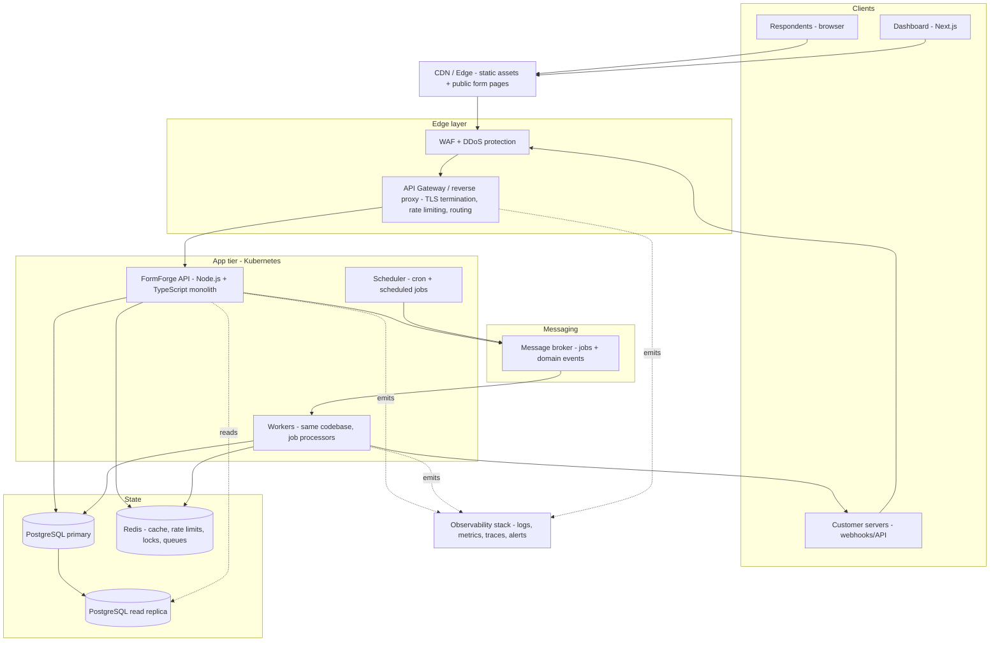

# Running Application Architecture Overview

This book uses one fictional product — **FormForge** — as a thread through all 111 chapters. Keeping a single application means every rate limiter, index, queue, and alert has a *reason to exist*: a concrete FormForge feature that breaks without it.

> FormForge is fictional. It is modeled on real form-builder SaaS products (Typeform, Jotform, Tally), but no company, traffic pattern, or incident in this book is a real one. Numbers are illustrative and always labeled as such.

## 1. The Product

FormForge lets teams:

- **Build forms** — a visual editor backed by a JSON schema per form (fields, validation rules, logic jumps).
- **Publish forms publicly** — respondents fill `https://forms.example.com/f/{slug}` without an account.
- **Collect submissions** — stored in PostgreSQL, searchable and exportable.
- **See analytics** — completion rates, per-field drop-off, time-to-complete.
- **Get notified** — email notifications on submissions; webhooks pushed to customer systems (CRM, Zapier-style integrations).
- **Automate** — scheduled digest emails, nightly aggregation jobs.

### Illustrative scale targets (fictional)

| Metric | Target | Why it matters in the book |
|---|---|---|
| Registered workspaces | 10,000 | multi-tenancy: per-workspace isolation and quotas |
| Published forms | 100,000 | read-heavy public form-serving path → caching (Ch 02, 48–50) |
| Form fills / day | 5,000,000 | write bursts → queues (Ch 15), rate limiting (Ch 01) |
| Peak submissions / min | 20,000 | autoscaling (Ch 45), backpressure (Ch 44) |
| API availability target | 99.9% monthly | SLOs and error budgets (Ch 63–65) |
| Public form page load | < 300 ms server time at P95 | CDN and edge caching (Ch 48, 49, 93) |

These numbers are chosen to justify engineering decisions, not to describe any real deployment. When a chapter says "at this scale you need X," the scale refers to this table.

## 2. Evolution Stages

The architecture is presented in five stages. Which stage you are in determines which chapters are *necessary* versus *aspirational* for you.

| Stage | What runs | Chapters that become relevant | What usually triggers the move |
|---|---|---|---|
| **S1 — Monolith** | One Node.js/TS app + PostgreSQL + Nginx on a VM | 01–05, 11–14, 25–28 | First real users |
| **S2 — Decoupled workers** | + Redis, background job queue, scheduled jobs | 15, 20, 21, 44 | Slow requests blocking HTTP; nightly jobs timing out |
| **S3 — Containers** | + Docker Compose everywhere, then Kubernetes | 06–09, 56, 57, 104–107 | "Works on my machine" debt; deployment friction |
| **S4 — Distributed** | + read replicas, caching layer, CDN, event bus | 02, 29, 32, 45–50, 58–66 | Database CPU at 80%; global users complaining about latency |
| **S5 — Hardened multi-region** | + multi-region DB, chaos drills, progressive delivery | 71–88, 89–96, 109–111 | Enterprise contracts; compliance; regional outages |

**Rule of thumb repeated throughout the book:** do not adopt a stage's technology before the stage's pain is real. A message broker at 50 requests/day is not engineering; it is inventory management.

## 3. Target Architecture (Stage S4)



### Component responsibilities

| Component | Responsibility | First introduced |
|---|---|---|
| Next.js frontend | Dashboard, form editor, analytics views; talks to API with JWT | — |
| CDN | Static assets (JS/CSS/fonts); cacheable public form pages | Ch 48, 49 |
| WAF + DDoS layer | Block known-bad traffic before it reaches the app | Ch 74, 75 |
| API gateway / reverse proxy | TLS termination, routing, global rate limiting, request ID injection | Ch 04, 05, 01 |
| FormForge API | AuthN/AuthZ, business logic, synchronous REST endpoints | — |
| Workers | Async jobs: email sending, webhook delivery, analytics rollups | Ch 15, 21 |
| Scheduler | Cron-style triggers producing jobs (digestes, retention sweeps) | Ch 21 |
| PostgreSQL primary | Source of truth: workspaces, forms, submissions, users | — |
| Read replica | Offload analytical/reporting reads | Ch 29 |
| Redis | Cache, rate-limit counters, distributed locks, job queue (S2) | Ch 02, 38 |
| Message broker | Durable async work + domain events | Ch 15, 16 |
| Observability stack | Structured logs, metrics, traces, dashboards, alerts | Ch 58–66 |

### Key request paths

1. **Respondent submits a form** (hot path): CDN → WAF/gateway (rate limit) → API (auth via signed form token, validate) → PostgreSQL insert → 201. Side effects (email, webhook, analytics) go to the broker → workers. The HTTP response never waits for side effects.
2. **Dashboard reads analytics** (heavy read path): Next.js → API → read replica or Redis-cached aggregate. Never hits the primary for report-style queries.
3. **Customer webhook delivery** (unreliable external dependency): API → broker → worker with retries, exponential backoff, circuit breaker, DLQ → customer endpoint (Ch 10–13, 20, 101).

## 4. Data Model Sketch

Entities the book's SQL examples use (simplified; full DDL appears in Part III chapters):

```sql
-- Illustrative DDL (PostgreSQL 16). Simplified for readability.
CREATE TABLE workspaces (          -- tenant boundary for isolation & quotas
  id            uuid PRIMARY KEY DEFAULT gen_random_uuid(),
  name          text NOT NULL,
  plan          text NOT NULL DEFAULT 'free',  -- free | pro | enterprise
  created_at    timestamptz NOT NULL DEFAULT now()
);

CREATE TABLE forms (
  id            uuid PRIMARY KEY DEFAULT gen_random_uuid(),
  workspace_id  uuid NOT NULL REFERENCES workspaces(id),
  slug          text NOT NULL UNIQUE,
  title         text NOT NULL,
  schema_json   jsonb NOT NULL,    -- field definitions, validation, logic
  published     boolean NOT NULL DEFAULT false,
  created_at    timestamptz NOT NULL DEFAULT now()
);

CREATE TABLE submissions (
  id            uuid PRIMARY KEY DEFAULT gen_random_uuid(),
  form_id       uuid NOT NULL REFERENCES forms(id),
  answers_json  jsonb NOT NULL,
  respondent_ip inet,              -- used by abuse handling; retention-limited
  created_at    timestamptz NOT NULL DEFAULT now()
);
```

Chapter 25 (Indexing) and Chapter 26 (Query Optimization) turn this sketch into a properly indexed schema; Chapter 31 (Partitioning) shows why `submissions` is the first partitioning candidate.

## 5. Technology Stack and Assumptions

| Layer | Choice | Alternatives discussed in the book |
|---|---|---|
| Frontend | Next.js (App Router) | Plain React SPA |
| API | Node.js 22 + TypeScript + Express | Fastify, NestJS, Hono |
| Primary DB | PostgreSQL 16 | MySQL, and MongoDB where document shape truly varies |
| Cache / coordination | Redis 7 | KeyDB, Memcached (limited), Hazelcast |
| Queue (S2) | BullMQ on Redis | RabbitMQ, SQS, Kafka, NATS |
| Reverse proxy | Nginx | Caddy, HAProxy, cloud load balancer |
| Containers | Docker + Compose | Podman |
| Orchestration (S3+) | Kubernetes | ECS, Nomad, VM + PM2 |
| CI/CD | GitHub Actions | GitLab CI, CircleCI |
| Observability (S4) | OpenTelemetry + Prometheus + Grafana + Loki/Tempo | Datadog, Grafana Cloud |

Every chapter names which alternatives exist and when they win. Versions are assumptions; verify against official docs before running (see the preface's version honesty note).

## 6. Repository Layout of the Example Code

Runnable examples live in `book/code/` under the chapter number that introduces them:

```
book/code/
└── 01-rate-limiting/     # Chapter 01: Express API with Redis-backed rate limiting
    ├── docker-compose.yml
    ├── package.json
    ├── tsconfig.json
    ├── src/
    └── test/
```

Later chapters add sibling directories (e.g., `15-message-queues/`), each independently runnable with `docker compose up` + `npm install` + `npm test`.

## 7. What This Architecture Is NOT

To keep the running example honest:

- It is **not** microservices by default. The API is a modular monolith until a chapter demonstrates a reason to split (Ch 17, 19 cover the real reasons and their costs).
- It does **not** require Kubernetes to be correct. S1 and S2 run happily on one VM with PM2 — the book's own Docker chapters start there.
- The message broker is **optional at small scale**: Chapter 15 shows the in-process queue fallback and states exactly when it stops being enough.
- Multi-region (S5) is presented as an *expensive, deliberate choice*, not a default. Most products at FormForge's illustrative scale never need it.

## 8. FormForge's Journey Through the Book

Each part of the book adds something to FormForge. Use this table to see where a topic lands in the running example:

| Part | What FormForge gains |
|---|---|
| I — Traffic & Deployment | Rate limiting on public submission API, Nginx reverse proxy, Docker Compose dev env, CI/CD pipeline, retry/breaker policy for webhook delivery |
| II — Async workflows | Submission side effects move to a job queue; webhook delivery with backoff + DLQ; live analytics stream via SSE |
| III — Database | Real indexes on `submissions`/`forms`, N+1 fix in analytics, PgBouncer pooling, read replica for reports |
| IV — Concurrency | Row-level locking for form editing, Redis locks for scheduler singleton, deadlock avoidance in billing |
| V — Scaling & caching | Redis cache for public form schemas, CDN for form pages, cache invalidation on publish |
| VI — Deployment | Feature flags for the new editor, canary rollout, health probes |
| VII — Observability | Structured logs with request IDs, OTel traces across API+workers, latency SLO with error budget |
| VIII — Security | Secrets in a vault, OAuth for integrations, CORS/CSRF hardening, WAF rules |
| IX — Data mgmt | Zero-downtime migrations, PITR backups, failover drill |
| X — Performance | P95/P99 latency work on the submission path, cold-start mitigation for workers |
| XI — Networking | HTTP/2 tuning, gRPC for internal worker↔API calls, versioned public API |
| XII — Infra | Terraform for the staging stack, Helm chart for the API |
| XIII — Operations | A real FormForge incident worked end-to-end: detection → response → postmortem |

---

*Next: read [Chapter 01 — Rate Limiting](01-traffic-management/01-rate-limiting.md), or check the [Prerequisite Map](00-prerequisite-map.md) for the best reading order.*


