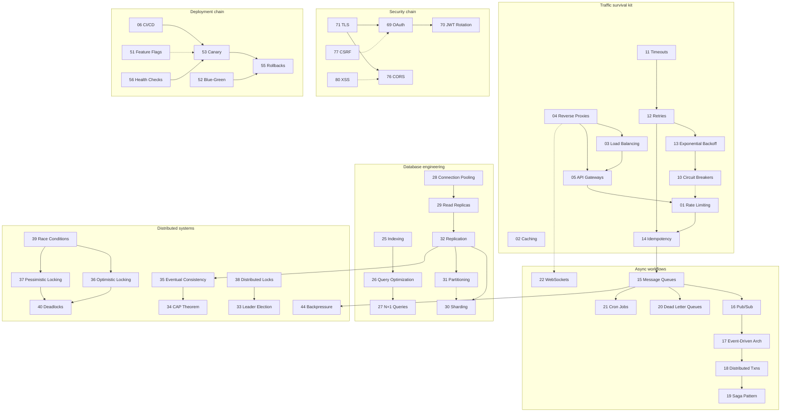

# Prerequisite Map and Study Roadmap

Chapters are self-contained, but they build on each other. This file tells you what to read *before* a chapter, and offers three guided tracks if you prefer linear study over random access.

## How to Use This Map

- **Solid arrow (→)** means "read this first; the later chapter assumes it."
- **Dashed arrow (⇢)** means "recommended context; the later chapter explains gaps itself."
- If you hit a chapter that feels like it assumes a foreign language, you are probably missing one of its prerequisites.

## Dependency Graph

## Hard Prerequisites (read in this order or expect friction)

| Later chapter | Must first understand | Why |
|---|---|---|
| 05 API Gateways | 01, 03, 04 | A gateway is a productized bundle of rate limiting, routing, and proxying |
| 10 Circuit Breakers | 11, 12, 13 | Breakers terminate the retry cascade; you must see the cascade first |
| 14 Idempotency | 11, 12 | Retries without idempotency duplicate side effects — this pairing is the core lesson |
| 19 Saga Pattern | 18, 15 | Sagas are the practical answer to the distributed-transaction problem |
| 20 Dead Letter Queues | 15, 16 | DLQs only exist because brokers deliver to consumers that fail |
| 29–32 Replica/Shard chapters | 32 Replication first | Every scaling option builds on replication semantics |
| 35 Eventual Consistency | 32, 34 | You cannot reason about staleness without replication and CAP |
| 38 Distributed Locks | 39, 40 | Locks are the cure *and* a cause of the diseases in those chapters |
| 44 Backpressure | 44's siblings: 15, 41 | Backpressure prevents the overload that becomes leaks and OOM |
| 53 Canary Releases | 54, 55, 56 | Progressive delivery needs fast health signals and safe rollback |
| 63–65 SLO/SLI/Error Budgets | 58–62 observability stack | Budgets are computed from SLIs, which come from metrics |
| 70 JWT Rotation | 69 OAuth | Rotation is a hardening layer on top of the OAuth/token model |
| 87 Chaos Engineering | 56, 58–62, 109–111 | You only run chaos experiments safely with health checks, observability, and incident process in place |

## Three Study Tracks

### Track A — "Backend engineer, months 0–3" (order for maximum early payoff)

01 → 02 → 11 → 12 → 13 → 14 → 10 → 25 → 26 → 27 → 28 → 15 → 20 → 21 → 03 → 04 → 05

*Outcome:* you can harden an API, fix slow queries, and add background processing — the four most common real-world interventions.

### Track B — "System design interview prep" (order for design-round fluency)

34 → 35 → 32 → 29 → 30 → 31 → 46 → 47 → 45 → 48 → 49 → 50 → 03 → 09 → 33 → 38 → 91 → 92 → 93 → 94 → 95

*Outcome:* you can size a system, pick a consistency model, and defend scaling choices with trade-off language.

### Track C — "Production ownership / DevOps" (order for on-call readiness)

56 → 57 → 58 → 59 → 60 → 61 → 62 → 63 → 64 → 65 → 66 → 109 → 110 → 111 → 83 → 84 → 85 → 87 → 51 → 53 → 55

*Outcome:* you can run the service you built: measure it, alert on it, recover it, and improve it after incidents.

Parts VII–XIII complete the picture; after the tracks, read remaining chapters in part order and revisit this map whenever a chapter references something you do not remember.

## Just-in-Time Prerequisites

Reading a chapter out of order? Search the chapter text for `→ Chapter NN`. Each mention is a pointer to a concept the chapter assumes. If the surrounding explanation feels insufficient, open the referenced chapter's sections 1 and 3 first — you rarely need the whole chapter before continuing.
