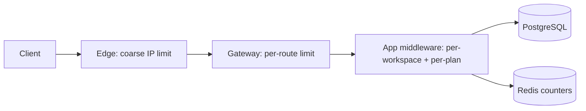
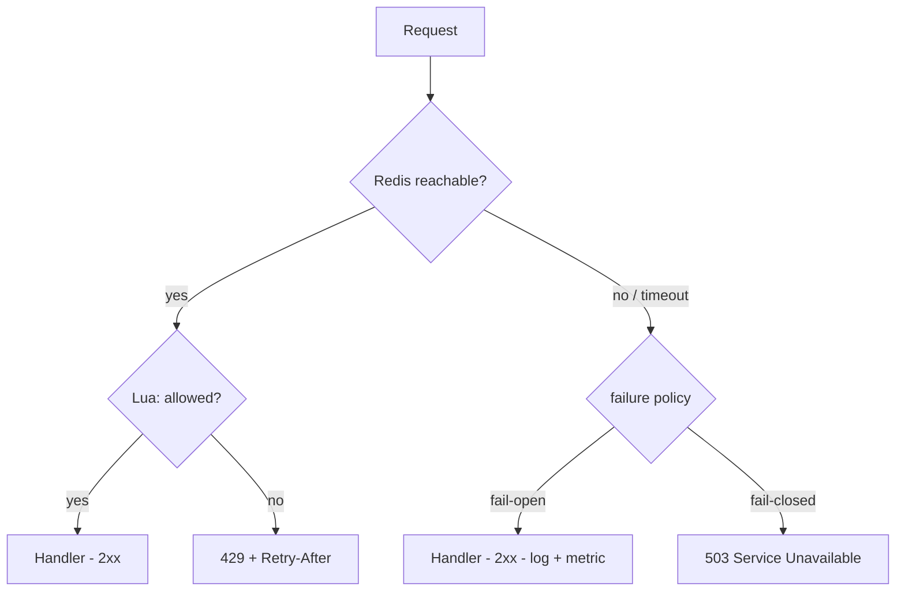

# Chapter 01 — Rate Limiting

> **Part I — Traffic Management and Deployment**
> **Prerequisites:** none required. Helpful: basic HTTP knowledge and a Node.js dev environment.
> **FormForge context:** the public submission endpoint `POST /v1/forms/:formId/submissions` is open to the internet and abused by scripted bots. This chapter protects it.

---

## 1. Definition and Fundamentals

### What it is

**Rate limiting** is the practice of controlling how many requests a client is allowed to send to a system during a period of time, rejecting (or slowing) the excess. A rate limiter sits on the request path, counts requests per client according to some rule, and answers one of two questions: *allow* or *deny — you have exceeded your limit.*

A rate limit rule usually has three parts:

| Part | Example | Meaning |
|---|---|---|
| **Key** | user ID, API key, IP address, workspace ID | *who* is being limited |
| **Quota** | 100 requests | *how much* is allowed |
| **Window** | per minute | *per when* the quota applies |

Denials are communicated with HTTP status **429 Too Many Requests**, standardized in RFC 6585 §4 ([datatracker.ietf.org/doc/html/rfc6585#section-4](https://datatracker.ietf.org/doc/html/rfc6585#section-4)), typically accompanied by a `Retry-After` header telling the client when to come back.

### Why it exists / what problem it solves

Without rate limiting, any single client controls your resource usage. Rate limiting solves five distinct problems at once:

1. **Fairness** — one customer's runaway script cannot consume the capacity other customers pay for.
2. **Abuse and cost control** — bots scraping forms, credential-stuffing logins, or spamming submissions cost compute, storage, and money per request.
3. **Protection against overload** — a sudden flood (malicious or accidental) gets shaped *before* it collapses your database connections or event loop. Rate limiting is the first line of defense before → Chapter 44 (Backpressure) and autoscaling kick in.
4. **Business model enforcement** — free tier 10 requests/s, Pro 100/s: quotas are how SaaS products meter usage (→ Chapter 88, Cost Optimization).
5. **SLA protection** — protecting the latency you promised your *compliant* customers (→ Chapter 63, SLOs). Overload kills P99 latency for everyone; see → Chapter 93 (P99 Latency).

### How it works internally (first pass)

At its simplest: a counter per key. Request arrives → increment counter → if counter exceeds the quota, reject. The interesting engineering starts with two facts that make this naive approach wrong in production:

- **Counters must live somewhere shared** when you run more than one server instance. In-memory counters on each instance multiply your effective limit by the number of instances — we dissect this failure in Section 6. The usual shared store is Redis, or the gateway layer (→ Chapter 05, API Gateways).
- **Incrementing and checking must be atomic.** If two requests interleave between "read counter" and "write counter," both may pass under a limit of one. Redis Lua scripting (a small program executed atomically inside Redis) is the standard fix — we implement it in Section 4.

### Where it fits in the architecture

Rate limiting can be enforced at multiple layers, from outermost to innermost:

1. **CDN / edge / DDoS provider** — coarse limits against volumetric attacks (→ Chapter 75).
2. **Reverse proxy / API gateway** — per-IP or per-route limits in front of all instances (→ Chapter 04, 05).
3. **Application middleware** — per-user, per-workspace, per-plan, business-aware limits (our Section 4 implementation).
4. **Downstream services** — the database has its own connection limits; your limiter protects it *from* your app.

FormForge's layered defense:



A real-world analogy: **the door policy of a busy club plus a drink-ticket system.** The bouncer counts people per group (key) and turns groups away once they hit their allowance (deny). VIP groups get bigger allowances (API plans). Tickets refill over time so the club is not permanently full (windows/buckets). Crucially, the policy protects *the experience of everyone inside*, not just the club's furniture.

### A production example (FormForge)

FormForge's `POST /v1/forms/:formId/submissions` is a public endpoint — no login, by design: respondents are anonymous. Without a limiter, one bot can write a million rows to `submissions` (storage cost), enqueue a million notification jobs (queue cost), and push database CPU to 100% (availability incident for every other tenant). The rules implemented in this chapter:

- Anonymous submitter (keyed by IP): **10 submissions per minute per form**.
- Authenticated API clients (keyed by API token): plan-based quota — free 100 requests/minute, pro 1,000/minute.

### When it is necessary / when it is unnecessary

**Necessary (essentially always) when:**

- Any endpoint is reachable by anonymous or untrusted clients.
- Requests have real per-request cost (DB writes, outbound calls, LLM API calls — especially AI-powered features).
- Multiple tenants share infrastructure and fairness matters.
- You sell access via quotas.

**Often unnecessary (or overkill) when:**

- The service is internal-only, single-tenant, behind a VPN, with trusted callers and no cost asymmetry.
- Traffic is tiny and human-driven (an internal admin tool) — you have bigger risks than runaway load.
- A load balancer or managed gateway already enforces equivalent limits and you have no per-user quota needs. (Verify this rather than assume: "the gateway handles it" is often an assumption nobody checked.)

**Important distinction:** rate limiting is *not* a substitute for authentication (→ Chapter 69, OAuth), authorization, or DDoS protection (→ Chapter 75). It is one control in a defense-in-depth stack (→ Chapter 74, WAF).

## 2. Types, Variants, and Classifications

Rate limiting has two classification axes: **the algorithm** (how counting works) and **the enforcement architecture** (where counting happens). Algorithms decide *what kind of traffic bursts you tolerate*; enforcement points decide *how accurate the count is*.

### Axis 1: Counting algorithms

These five algorithms are the established set; most libraries (Nginx `limit_req`, `express-rate-limit`, Envoy, Kong, Cloudflare) implement one or more of them. Other names you encounter (GCRA, "leaky bucket as a meter") are mathematically related variants of these families.

#### 2.1 Fixed Window Counter

The simplest scheme. Time is divided into non-overlapping windows (e.g., `10:03:00–10:03:59`). A counter per key per window; when the counter reaches the quota, all further requests in that window are denied. The window identity is typically `floor(now / windowSize)`.

- **How it works:** `INCR key:windowId`; if result > quota → 429. Expire the key after the window.
- **Advantages:** trivial to implement and reason about; O(1) memory per key (one counter); cheap in Redis (two commands).
- **Disadvantages:** the **window-boundary burst problem** — a client can send `quota` requests at `10:03:59` and another `quota` at `10:04:00`, sustaining *twice* the intended rate across the boundary. Limits are enforced per-window, not per-time.
- **Use cases:** coarse protection where boundary bursts are harmless; Nginx's `limit_req` is a close relative (with its own smoothing options).
- **Limitation to remember:** never use a fixed window as a *hard* capacity guarantee.

#### 2.2 Sliding Window Log

Keeps the timestamp of every recent request per key (e.g., in a Redis sorted set scored by time). On each request: remove entries older than the window; if remaining count < quota → allow and append, else deny.

- **How it works:** `ZREMRANGEBYSCORE key -inf (now−window)`, then `ZCARD`; compare, then `ZADD` + `PEXPIRE`.
- **Advantages:** exact — no boundary burst; the limit holds over *any* window of the configured size.
- **Disadvantages:** memory and CPU grow with request rate: O(quota) memory per active key and O(log n + m) per call where m is the number of expired entries removed. At high QPS per key this is the most expensive algorithm.
- **Use cases:** strict per-user quotas on low-to-moderate rate keys (e.g., password-reset emails: 5/hour — exactness matters, volume is small).
- **Limitation:** do not use for high-throughput keys without a different data design.

#### 2.3 Sliding Window Counter (hybrid)

The practical compromise, popularized by Cloudflare's engineering write-up on their distributed limiter. Keep counters for the current *and* previous fixed window; on a request, compute a weighted sum:

`estimated_count = previous_count × (1 − elapsed_ratio) + current_count`

where `elapsed_ratio` is how far into the current window we are (0..1). If `estimated_count ≥ quota` → deny, else increment the current window.

- **Advantages:** O(1) memory per key, and it *smooths* the fixed-window boundary burst (the boundary spike is partially carried over). Much cheaper than a log, much fairer than a fixed window.
- **Disadvantages:** still an *estimate* — it can slightly under- or over-count depending on the traffic distribution inside windows.
- **Use cases:** the default choice for API-wide per-user limits at scale; this is what our production implementation uses.
- **Note:** the weighting formula is a modeling choice; libraries vary in details (rounding, clamping). Behavior is implementation-specific — read your library's docs.

#### 2.4 Token Bucket

A bucket holds up to `capacity` tokens; tokens refill at rate `r` per second (continuously, not in steps). Each request costs one (or more) tokens. Requests are allowed while tokens remain; when empty, they are denied (or queued — that overlap is the leaky-bucket story).

- **How it works:** on each request, `tokens = min(capacity, tokens + (now − last_ts) × r)`, then spend; allow if tokens remain.
- **Advantages:** naturally models **sustained rate + burst allowance** — capacity is your burst, `r` is your steady rate. Continuous refill means no window artifacts at all. Very cheap: two numbers per key.
- **Disadvantages:** a burst of `capacity` is always allowed, so size capacity deliberately; the math needs a clock you trust (see clock skew, Section 6).
- **Use cases:** bandwidth shaping, API plans ("100 req/s sustained, burst to 200"); AWS-style limits are in this family (GCRA is a close mathematical cousin).

#### 2.5 Leaky Bucket (and why it blurs into token bucket)

Requests drain from the bucket at a constant rate; excess either **queues** (bursts become smooth output — *shaping*) or is **dropped** (*policing*). Queue-based shaping is usually wrong for interactive HTTP APIs (clients would wait unboundedly), so HTTP APIs implement policing, which behaves like a token bucket with a drain. This is why API docs often use the two names interchangeably — read the actual math before assuming which one you have.

#### 2.6 Composite / multi-layer limits

Production systems rarely use one algorithm or one key. A typical FormForge-style stack:

| Layer | Algorithm | Key | Purpose |
|---|---|---|---|
| Edge | fixed/sliding window | source IP | cheap flood control |
| Gateway | sliding window counter | route + API key | fair global quota |
| App | token bucket | workspace ID + route class | burst-tolerant business limits |

### Algorithm comparison

| Algorithm | Memory/key | Boundary burst? | Accuracy | Cost per request | Best fit |
|---|---|---|---|---|---|
| Fixed window | O(1) — 1 counter | **Yes, up to 2× quota** | Coarse | Lowest | Coarse protection |
| Sliding window log | O(quota) — 1 entry/request | No | **Exact** | Highest | Low-rate strict quotas |
| Sliding window counter | O(1) — 2 counters | Smoothed (small residual) | High estimate | Low | **Default for APIs** |
| Token bucket | O(1) — 2 numbers | Intentional burst = capacity | Rate-accurate | Lowest | Sustained rate + burst |
| Leaky bucket (shaping) | O(queue depth) | No — smooths | Rate-accurate | Medium | Traffic shaping, not HTTP APIs |

### Axis 2: Enforcement architecture

| Variant | How it works | Pros | Cons | Use when |
|---|---|---|---|---|
| **In-process (per instance)** | Counter in app memory | Zero extra infra; sub-ms | Effective limit × N instances; resets on restart; inconsistent across nodes | Single instance, dev, or as a *pre-limiter* (Section 5) |
| **Centralized store (Redis)** | Atomic script in shared Redis | Consistent global limit; survives restarts | +1 network hop; Redis on the critical path (design for failure) | **Default for multi-instance production** |
| **Gateway-managed** | Nginx / Kong / Envoy / cloud gateway enforces | No app code; language-agnostic | Coarse keys (usually IP); config deploy to change | Global/per-IP limits; defense in depth |
| **Hybrid two-tier** | Local pre-limit + global Redis sync | Local absorbs bursts cheaply; global keeps fairness | More complex; two configurations to tune | High QPS with per-user quotas |

### Decision guide

1. **Anonymous, IP-keyed, burst-tolerant?** → sliding window counter (or token bucket with small capacity).
2. **Strict quota where overage is costly (emails, LLM spend)?** → sliding window log, *or* token bucket with `capacity = 1` (pure policing).
3. **Need "N/sec sustained with occasional bursts"?** → token bucket — this is its native use case.
4. **Multiple instances and a shared, fair limit matters?** → centralized Redis (or gateway) — never per-instance counters alone.
5. **Very high QPS with per-user fairness?** → hybrid two-tier (Section 5).
6. **Selling usage tiers?** → sliding window counter at the API/gateway for the quota, token bucket for burst control.

## 3. Internal Working and Architecture

This section walks the request path of our production choice — the **Redis-backed sliding window counter** — then shows the token-bucket flow and the failure path when Redis dies.

### Execution flow: sliding window counter, request by step

Assume rule: `POST /v1/forms/:formId/submissions`, key = client IP + form ID, quota = 10 per 60 s window.

1. Request arrives at Express; middleware `rateLimit(...)` runs before any handler work.
2. Middleware computes the **key**: `rl:submit:{formId}:{clientIp}`. Behind a proxy, the IP must come from a trusted header (`X-Forwarded-For` set by *your* Nginx/gateway — blindly trusting the client-supplied header is spoofable; see Section 7).
3. It computes `windowMs`, `windowStart = floor(now / windowMs) × windowMs`, and the two Redis keys: `…:{windowStart}` (current) and `…:{windowStart − windowMs}` (previous).
4. It calls Redis with an **atomic Lua script** (`EVALSHA`) passing limit, window, now, cost, and both keys. Inside the script, in order:
   a. `GET` both counters (missing = 0).
   b. Compute `elapsedRatio = (now − windowStart) / windowMs`.
   c. `estimated = prev × (1 − elapsedRatio) + curr`.
   d. If `estimated + cost > limit` → return `allowed = 0` (do **not** increment).
   e. Else `INCRBY current cost`, `PEXPIRE current windowMs × 2`, return `allowed = 1`.

   Redis executes Lua scripts atomically — no two clients can interleave between c and e. This is the atomicity guarantee Section 1 promised.
5. Middleware sets rate-limit headers and either calls `next()` (allowed → handler runs, e.g. INSERT) or responds **429** with JSON `{ "error": "rate_limit_exceeded", "retryAfterSeconds": N }` plus `Retry-After`.
6. Redis errors (timeout, down): the middleware consults its **failure policy** — fail-open (allow, log, count an error metric) or fail-closed (503). Our example defaults to fail-open for the public form endpoint; Section 5 explains when that default is wrong.

```mermaid
sequenceDiagram
    participant C as Client
    participant A as Express API
    participant R as Redis
    C->>A: POST /v1/forms/f1/submissions
    A->>A: key = rl:submit:f1:203.0.113.9
    A->>R: EVALSHA sliding_window (limit=10, window=60s, cost=1)
    R->>R: GET curr, GET prev; estimated = prev*(1-t)+curr
    alt estimated + 1 <= 10
        R->>R: INCRBY curr 1; PEXPIRE 120s
        R-->>A: allowed=1, remaining
        A->>A: handler: INSERT submission
        A-->>C: 201 Created (RateLimit-Remaining: 8)
    else quota exhausted
        R-->>A: allowed=0, retry_after_ms
        A-->>C: 429 Too Many Requests (Retry-After)
    end
```

### Token bucket flow (same middleware, different script)

1. `HGETALL key` → `{tokens, lastRefillMs}` (empty on first request → full bucket).
2. `refill = (now − lastRefillMs) / 1000 × refillPerSec`; `tokens = min(capacity, tokens + refill)`.
3. `allowed = tokens >= cost`; if allowed, `tokens −= cost`.
4. `HSET tokens, lastRefillMs = now`; `PEXPIRE` for twice the full-refill time (idle keys then disappear).

Both scripts share the pattern: **read → decide → write, all inside Redis** — the entire algorithm must live on one side of the network to be atomic.

### Failure path: Redis unavailable



Design rules from this diagram:

- Redis calls need their **own short timeout** (50–100 ms). A hung Redis must not hold your request pipeline hostage (→ Chapter 11, Timeouts).
- Whatever policy you choose, **alert on the error metric** (`rate_limit_redis_errors_total`). A limiter silently failing open for a week is an unenforced limiter.
- Connection loss vs command timeout are different states; ioredis exposes both — handle both in the policy, log them distinctly.

### Complexity and resource use

| Algorithm | Time per request | Space per active key | Notes |
|---|---|---|---|
| Fixed window | O(1) | 1 counter + TTL | 1 Redis call |
| Sliding window counter | O(1) | 2 counters + TTL | 1 Lua call |
| Sliding window log | O(log n + m) | 1 zset entry per request | m = expired entries purged |
| Token bucket | O(1) | 2 numbers | 1 Lua call |

Network RTT dominates everything above: a Redis call in the microsecond–millisecond range dwarfs the microseconds of Lua computation. This is why the hybrid two-tier design (Section 5) exists — avoid the RTT for most requests.

### Important configuration parameters

| Parameter | Example | Guidance |
|---|---|---|
| `limit` | 10/60s (anonymous), 1000/60s (pro) | Set from cost-per-request and capacity math (Section 8), not vibes |
| `windowMs` | 60_000 | Shorter reacts faster; longer is smoother but slower to forgive |
| `cost` | 1; 5 for expensive routes | Weight heavy endpoints instead of inventing parallel limits |
| Redis timeout | 100 ms | Shorter than the API latency budget; policy decides the rest |
| Failure policy | fail-open (public), fail-closed (billing) | An explicit decision per route class, never an accident |
| Key TTL | `windowMs × 2` | Too short loses previous-window data for the sliding estimate |
| Headers | `RateLimit-Limit`, `-Remaining`, `-Reset`, `Retry-After` | Draft IETF shape — see note below |
| Trust proxy | `app.set('trust proxy', …)` | Wrong hop count → wrong IP keys (Section 7) |

> **Header standard note:** the `RateLimit-*` names come from IETF draft `draft-ietf-httpapi-ratelimit-headers`, still a draft at time of writing — verify its current status before shipping. Some large APIs ship custom `X-RateLimit-*` headers instead. `Retry-After` on 429 is the stable, standardized part (RFC 6585 §4).

## 4. Practical Implementation

We build a runnable Express + TypeScript API that protects FormForge's public form-submission endpoint with a **Redis-backed sliding window counter** (rate class "anonymous") and show the token-bucket variant for plan quotas. Full project: [`book/code/01-rate-limiting/`](../code/01-rate-limiting/).

### Scenario

Bots hammer `POST /v1/forms/:formId/submissions`, writing junk rows and drowning real respondents. Protect the endpoint per (form, IP) with 10 requests / 60 s, respond `429` with `Retry-After`, and keep the limiter consistent across multiple API instances.

### Requirements

**Functional**
- Sliding window counter, atomic, shared across instances (Redis + Lua).
- Limit 10 requests per 60 s per `(formId, clientIP)`; configurable via env.
- 429 + JSON body + `Retry-After` + `RateLimit-Limit/Remaining/Reset` headers on denial.
- Fail-open policy when Redis is down (public endpoint), with error logging.
- `/healthz` endpoint for orchestrators (→ Chapter 56).

**Non-functional**
- Limiter adds one Redis round-trip (< ~2 ms locally) per request.
- No unbounded memory: every Redis key has a TTL.
- Graceful shutdown (close server, quit Redis).
- Deterministic tests: the Lua script receives `now` as an argument, so window behavior is testable without sleeping.

### Technology stack

| Piece | Choice | Note |
|---|---|---|
| Runtime | Node.js 20+ (written on 22) | ES modules |
| Language | TypeScript 5.x, `strict` | |
| Web | Express 4.x | Middleware model you know |
| Store | Redis 7 via `ioredis` 5.x | `defineCommand` for Lua |
| Tests | Vitest 2.x + supertest | |
| Local infra | Docker Compose (Redis only) | |

### Project structure

```
01-rate-limiting/
├── docker-compose.yml      # Redis 7 for local dev/tests
├── package.json
├── tsconfig.json
├── .env.example
├── src/
│   ├── config.ts           # typed env loading, fail-fast validation
│   ├── app.ts              # express app factory (routes + middleware)
│   ├── server.ts           # bootstrap + graceful shutdown
│   ├── limiter/
│   │   ├── types.ts        # Limiter interface + decision type
│   │   ├── sliding-window.ts  # Lua-backed sliding window counter
│   │   └── token-bucket.ts    # Lua-backed token bucket (plan quotas)
│   └── middleware/
│       └── rate-limit.ts   # Express middleware over any Limiter
└── test/
    ├── sliding-window.test.ts  # integration vs real Redis (skips if absent)
    ├── token-bucket.test.ts    # integration vs real Redis (skips if absent)
    └── api.test.ts             # end-to-end 201 → 429 via supertest
```

### Configuration

`.env.example`:

```bash
PORT=3000
REDIS_URL=redis://127.0.0.1:6379
# Express 'trust proxy' value: number of hops, or 'loopback', 'uniquelocal'…
# Only set this when the app really sits behind your own proxy — see Section 7.
TRUST_PROXY=loopback
SUBMIT_LIMIT=10
SUBMIT_WINDOW_MS=60000
PLAN_LIMIT=100
PLAN_WINDOW_MS=60000
```

`docker-compose.yml` (deliberately minimal — a limiter needs nothing else):

```yaml
services:
  redis:
    image: redis:7-alpine
    ports:
      - "6379:6379"
    command: ["redis-server", "--save", "", "--appendonly", "no"]  # data is disposable
    healthcheck:
      test: ["CMD", "redis-cli", "ping"]
      interval: 5s
      timeout: 3s
      retries: 5
```

### Implementation

**`src/limiter/types.ts`** — the middleware depends on an interface, not on Redis directly. This is what makes the middleware unit-testable and lets you swap algorithms per route class.

```typescript
export interface RateLimitDecision {
  allowed: boolean;
  /** Best-effort estimate of requests left in the current effective window. */
  remaining: number;
  /** Milliseconds until the client should retry (0 when allowed). */
  retryAfterMs: number;
}

export interface Limiter {
  /** @param key fully-built limit key, e.g. "rl:form-submit:f1:203.0.113.9" */
  check(key: string, limit: number, windowMs: number, cost?: number): Promise<RateLimitDecision>;
}
```

**`src/limiter/sliding-window.ts`** — the algorithm lives entirely inside Redis. Notice `now` is an *argument*: the script is a pure function of its inputs, which makes window-boundary behavior deterministic in tests.

```typescript
import type { Redis } from 'ioredis';
import type { Limiter, RateLimitDecision } from './types.js';

const SLIDING_WINDOW_LUA = `
local currKey  = KEYS[1]
local prevKey  = KEYS[2]
local limit      = tonumber(ARGV[1])
local windowMs   = tonumber(ARGV[2])
local now        = tonumber(ARGV[3])
local cost       = tonumber(ARGV[4])

local curr = tonumber(redis.call('GET', currKey) or '0')
local prev = tonumber(redis.call('GET', prevKey) or '0')

local windowStart = now - (now % windowMs)
local elapsedRatio = (now - windowStart) / windowMs
local estimated = prev * (1 - elapsedRatio) + curr

if estimated + cost > limit then
  local retryAfterMs = windowMs - (now - windowStart)
  return {0, math.max(0, math.floor(limit - estimated)), retryAfterMs}
end

redis.call('INCRBY', currKey, cost)
redis.call('PEXPIRE', currKey, windowMs * 2)
return {1, math.max(0, math.floor(limit - estimated - cost)), 0}
`;

type RedisWithScript = Redis & {
  slidingWindow: (
    currKey: string, prevKey: string,
    limit: number, windowMs: number, now: number, cost: number,
  ) => Promise<[number, number, number]>;
};

export function install(redis: Redis): void {
  (redis as RedisWithScript).defineCommand('slidingWindow', {
    numberOfKeys: 2,
    lua: SLIDING_WINDOW_LUA,
  });
}

export function slidingWindowLimiter(redis: Redis): Limiter {
  install(redis);
  return {
    async check(key, limit, windowMs, cost = 1): Promise<RateLimitDecision> {
      const now = Date.now();
      const windowStart = Math.floor(now / windowMs) * windowMs;
      const [allowed, remaining, retryAfterMs] = await (redis as RedisWithScript).slidingWindow(
        `${key}:${windowStart}`, `${key}:${windowStart - windowMs}`,
        limit, windowMs, now, cost,
      );
      return { allowed: allowed === 1, remaining, retryAfterMs };
    },
  };
}
```

**Why two keys?** The sliding estimate needs the previous window's count. `key:windowStart` and `key:windowStart−windowMs` — TTL `windowMs × 2` keeps the previous window alive long enough to be read exactly once by the next window's requests, then Redis reaps both.

**`src/middleware/rate-limit.ts`** — one middleware, any limiter, explicit failure policy:

```typescript
import type { Request, Response, NextFunction } from 'express';
import type { Limiter } from '../limiter/types.js';

export interface RateLimitRule {
  name: string;                       // appears in logs/metrics
  limit: number;
  windowMs: number;
  keyBuilder: (req: Request) => string;
  failureMode?: 'fail-open' | 'fail-closed';  // default: fail-closed (safer default)
}

export function rateLimit(limiter: Limiter, rule: RateLimitRule) {
  const failureMode = rule.failureMode ?? 'fail-closed';
  return async (req: Request, res: Response, next: NextFunction): Promise<void> => {
    const key = `rl:${rule.name}:${rule.keyBuilder(req)}`;
    let decision;
    try {
      decision = await limiter.check(key, rule.limit, rule.windowMs);
    } catch (err) {
      // Production: structured logger (pino) + metrics counter, see Section 5.
      console.error(JSON.stringify({
        level: 'error', event: 'rate_limit_store_error',
        rule: rule.name, error: (err as Error).message,
      }));
      if (failureMode === 'fail-closed') {
        res.status(503).json({ error: 'rate_limit_unavailable' });
        return;
      }
      return next(); // fail-open: allow, limiter is advisory during outage
    }

    res.setHeader('RateLimit-Limit', String(rule.limit));
    res.setHeader('RateLimit-Remaining', String(decision.remaining));
    if (!decision.allowed) {
      const retryAfterSeconds = Math.max(1, Math.ceil(decision.retryAfterMs / 1000));
      res.setHeader('Retry-After', String(retryAfterSeconds));
      res.status(429).json({
        error: 'rate_limit_exceeded',
        message: `Too many requests. Retry in ${retryAfterSeconds} seconds.`,
      });
      return;
    }
    next();
  };
}
```

**`src/app.ts`** — wires the limiter into the FormForge route. The full token-bucket implementation (same pattern, `HGETALL`/`HSET` in Lua) lives in [`src/limiter/token-bucket.ts`](../code/01-rate-limiting/src/limiter/token-bucket.ts); its flow is Section 3's step list.

```typescript
import express from 'express';
import { randomUUID } from 'node:crypto';
import type { Limiter } from './limiter/types.js';
import { rateLimit } from './middleware/rate-limit.js';

export interface AppOptions {
  redisLimiter: Limiter;
  submitLimit: number;
  submitWindowMs: number;
}

export function createApp(opts: AppOptions): express.Express {
  const app = express();
  app.disable('x-powered-by');                 // no framework fingerprinting
  app.use(express.json({ limit: '16kb' }));    // bounded body size (Section 6)

  app.get('/healthz', (_req, res) => { res.json({ status: 'ok' }); });

  const submitLimit = rateLimit(opts.redisLimiter, {
    name: 'form-submit',
    limit: opts.submitLimit,
    windowMs: opts.submitWindowMs,
    // req.ip respects Express 'trust proxy' — configure it consciously (Section 7)
    keyBuilder: (req) => `${String(req.params.formId)}:${req.ip}`,
    failureMode: 'fail-open',   // public endpoint: outage should not stop respondents
  });

  app.post('/v1/forms/:formId/submissions', submitLimit, (req, res) => {
    const answers = req.body as Record<string, unknown> | undefined;
    if (!answers || typeof answers !== 'object' || Object.keys(answers).length === 0) {
      res.status(400).json({ error: 'answers_required' });
      return;
    }
    // Omitted on purpose (Section 5): persistence, auth tokens, event emission.
    res.status(201).json({
      id: randomUUID(),
      formId: req.params.formId,
      receivedAt: new Date().toISOString(),
    });
  });

  return app;
}
```

**`src/server.ts`** — bootstrap with fail-fast config and graceful shutdown (SIGTERM closes the listener, then quits Redis; a hard-exit timer covers a stuck quit):

```typescript
import { createServer } from 'node:http';
import { Redis } from 'ioredis';
import { loadConfig } from './config.js';
import { createApp } from './app.js';
import { slidingWindowLimiter } from './limiter/sliding-window.js';

const config = loadConfig();  // throws on bad PORT / missing REDIS_URL
const redis = new Redis(config.redisUrl, { maxRetriesPerRequest: 1, commandTimeout: 100 });
redis.on('error', (e) => console.error(JSON.stringify({ level: 'error', event: 'redis_error', error: e.message })));

const app = createApp({
  redisLimiter: slidingWindowLimiter(redis),
  submitLimit: config.submitLimit,
  submitWindowMs: config.submitWindowMs,
});
app.set('trust proxy', config.trustProxy);

const server = createServer(app).listen(config.port, () =>
  console.log(JSON.stringify({ level: 'info', event: 'listening', port: config.port })));

function shutdown(signal: string): void {
  console.log(JSON.stringify({ level: 'info', event: 'shutdown', signal }));
  server.close(() => { void redis.quit().finally(() => process.exit(0)); });
  setTimeout(() => process.exit(1), 10_000).unref();
}
process.on('SIGTERM', () => shutdown('SIGTERM'));
process.on('SIGINT', () => shutdown('SIGINT'));
```

### Execution

```bash
cd book/code/01-rate-limiting
cp .env.example .env
docker compose up -d          # starts Redis 7
npm install
npm run dev                   # API on http://localhost:3000

# 11 requests; the 11th must be rejected
for i in $(seq 1 11); do
  curl -s -o /dev/null -w "%{http_code}\n" \
    -X POST http://localhost:3000/v1/forms/f1/submissions \
    -H 'Content-Type: application/json' -d '{"q1":"hello"}'
done
curl -si -X POST http://localhost:3000/v1/forms/f1/submissions \
  -H 'Content-Type: application/json' -d '{"q1":"x"}' | head -n 12
```

### Testing

Three layers, matching the template's requirements:

1. **Unit (no Redis):** middleware tests inject a fake `Limiter` that always denies / always allows / throws, asserting the 429 body, `Retry-After`, and both failure branches. Fast, run everywhere.
2. **Integration (real Redis; the suite skips itself if Redis is unreachable):** call `slidingWindowLimiter(redis).check(...)` with synthetic timestamps to verify window math *without sleeping* — burst to the limit, cross a window boundary, confirm previous-window decay and key TTLs:

```typescript
// vitest, real Redis; unique key per run to avoid cross-test pollution
const limiter = slidingWindowLimiter(redis);
const key = `rl:test:${randomUUID()}`;
for (let i = 0; i < 5; i++) {
  expect((await limiter.check(key, 5, 60_000)).allowed).toBe(true);
}
const denied = await limiter.check(key, 5, 60_000);
expect(denied.allowed).toBe(false);
expect(denied.retryAfterMs).toBeGreaterThan(0);
```

3. **End-to-end (supertest + Redis):** `createApp` with limit 3/60 s; fire 4 requests; expect `201, 201, 201, 429`; assert `RateLimit-Remaining` decrements. A **failure test** points the app at a dead Redis port: the fail-open route still returns 201, the fail-closed route returns 503.

```bash
npm run typecheck
npm test          # set REDIS_URL to enable the integration suites
```

### Expected result (representative)

```
201  201  ... 201 (10 allowed, RateLimit-Remaining: 0)
429 {"error":"rate_limit_exceeded","message":"Too many requests. Retry in 43 seconds."}
     Retry-After: 43      RateLimit-Limit: 10
```

*Representative output of the described tests; exact `Retry-After` varies with time of observation.*

### Explanation of key decisions

- **Interface-shaped `Limiter`** — unit tests need no Redis; a route can switch to the token bucket without touching middleware.
- **`now` as a script argument** — deterministic window-boundary tests with zero `sleep()`; production callers pass `Date.now()`.
- **TTL everywhere** — a counter key without TTL is a memory leak on a timer (Section 6, case 4).
- **`maxRetriesPerRequest: 1` + `commandTimeout`** — ioredis's default retry queueing would silently inflate limiter latency past your budget; the request path must fail fast instead.
- **Fail-open vs fail-closed is per route**, chosen from blast radius, never inherited from a library default.

## 5. Production-Ready Implementation

The Section 4 demo is correct and atomic; production adds everything that keeps the limiter *alive, trustworthy, and cheap* under real load.

### Correctness at scale: distributed counting

- **One Redis, or Redis with HA — and a story for each.** A single Redis is a single point of failure for every limited route. Production options: Redis Sentinel (automatic failover; brief write unavailability during election — → Chapter 33, Leader Election), Redis Cluster (scale-out; keys of one script must hash to one slot, so pass all window keys via `KEYS[]` with a **hash tag**, e.g. `rl:{submit:f1:ip}:…` — without the braces, `CROSSSLOT` errors), or a managed Redis service with failover. Whatever you pick, the fail policy covers the failover window.
- **Multi-region:** Redis in one region + clients in another means every request pays cross-region RTT *and* the count lags. The usual answer is per-region limits (N×limit global ceiling) or an eventually-synchronized local+global design; there is no cheap exactly-global counter. State this trade-off to stakeholders; do not pretend it away (→ Chapter 86).

### Security and access control

- **Key construction must be unspoofable.** Anonymous keys use IPs only from headers your proxy sets (`X-Forwarded-For` with `trust proxy` configured to your hop count — trusting the raw header lets attackers rotate fake IPs and bypass the limit entirely; see Section 7, case 5). Authenticated keys use the API token/workspace ID — never the client-supplied body.
- **Separate limits per cost class.** Cheap `GET /forms/:id` and expensive `POST /submissions` (DB write + jobs) must not share one quota; use per-route limits or `cost` weighting.
- **Do not leak information in 429 bodies** beyond retry timing; no internal keys, no other tenants' state.
- **The limiter is not auth.** A 429-increasing scraper is still an attacker probing your routes — feed 429 rates into your WAF/abuse signals (→ Chapter 74, 75).

### Configuration and secrets

- Limits are **business configuration**: load them per workspace/plan from the database (cached in Redis with short TTL) rather than hardcoding; changing a plan limit should not require a deploy. Flag-driven limits (→ Chapter 51) let you rescue a misconfigured limit in minutes.
- Redis URLs are **secrets** (→ Chapter 67): env-injected, TLS-enabled (`rediss://`) for managed services, never in the image.

### Resource management and latency

- One shared ioredis connection pool (a single connection suffices for non-blocking commands); **command timeout ~100 ms**; `maxRetriesPerRequest: 1`.
- Pipeline or batch when a request consults several limiters (submit + plan + global): `EVAL` both scripts in one pipeline round-trip instead of two.
- Memory: every key TTLs; capacity-plan Redis (`keys × ~100 bytes` for counter pairs). Cardinality explosion comes from bad keys (Section 6, case 7).

### Observability (the part that makes it operable)

Minimum metrics (→ Chapter 61):

| Metric | Type | Why |
|---|---|---|
| `rate_limit_decisions_total{rule, action=allow\|deny}` | counter | deny ratio is your abuse + misconfiguration signal |
| `rate_limit_store_errors_total{rule}` | counter | **alert** — silent fail-open detection |
| `rate_limit_check_duration_seconds` | histogram | limiter latency on your P99 (→ Chapter 93) |
| `rate_limit_remaining{rule}` (optional) | gauge | early warning before customers hit 429 |

Structured logs (→ Chapter 59) on deny only (sample if noisy): `{rule, keyHash, retryAfter, requestId}` — hash keys, never log raw IPs next to user data without a retention policy. A deny-rate spike is an **alert** (→ Chapter 62) worth a dashboard panel next to traffic; a sudden jump from 0.1% to 5% deny rate usually means a client bug or an attack — both need humans, not more capacity.

### Timeouts, failure handling, graceful behavior

- Per-route failure policy (Section 4) + a **global kill switch**: an env/flag that disables limiting during a limiter-caused incident, so rollback is a config change, not a code deploy (→ Chapter 55).
- During Redis failover, expect a burst of store errors: fail-open routes keep serving; fail-closed routes return 503 — which is *correct*, but the error budget for those routes is being spent, so the alert must fire (→ Chapter 65, Error Budgets).

### Deployment and rollback

- Limits are tuned by observing, not guessing: ship conservative limits behind a flag, watch deny rates for a week, adjust (→ Chapter 53, Canary). Rollback = revert config/flag.
- If the limiter moves from app middleware to gateway (→ Chapter 05), run **both at 2× for a while** and compare deny decisions before decommissioning either — cutover mismatches produce surprising 429 storms.

### Testing and maintainability

- Contract test per limiter implementation: "never allows more than limit within a simulated window; always sets Retry-After on deny."
- Load test in CI (k6, Section 9) with a deny-rate assertion — regressions in limiter math show up as throughput cliffs.
- Chaos drill (→ Chapter 87): kill Redis in staging and verify each route's declared policy actually happens.

### Cost and operational complexity

- Redis cost is real but small (counters are tiny); the *operational* cost is owning another failure mode. Managed Redis with failover is usually worth it below serious scale; self-operating Redis Cluster is a specialist task.
- Moving limits to an existing gateway often *reduces* cost/complexity — but you lose business-aware keys (per-workspace plan limits). Split by capability, not by fashion.

## 6. Edge Cases and Failure Scenarios

Eight cases; each follows scenario → cause → impact → detect → prevent → test.

### Case 1 — Window-boundary burst (fixed window)

- **Scenario:** limit 60/min; client sends 60 requests at 10:03:59.9 and 60 more at 10:04:00.1.
- **Cause:** fixed windows count per calendar window, not per elapsed time.
- **Impact:** 2× the intended instantaneous rate hits your DB right at the boundary — exactly when a burst hurts most.
- **Detect:** graph request timestamps at second resolution during deny tests.
- **Prevent:** sliding window counter or token bucket (Section 2); if stuck with Nginx fixed windows, add `burst` smoothing or lower window size.
- **Test:** integration test with synthetic `now` values at `windowStart−1ms` and `windowStart`, asserting the weighted estimate blocks the double burst.

### Case 2 — Per-instance counters multiply the limit (multi-node)

- **Scenario:** limit 10/min deployed on 4 replicas with in-memory counters; a client sustains 36/min.
- **Cause:** each replica enforces its own 10; the load balancer spreads traffic, so nobody sees the full count.
- **Impact:** effective limit = limit × replicas, silently wrong the day you scale out — the bug arrives with your first successful autoscaling event (→ Chapter 45).
- **Detect:** load test through the LB; compare per-node deny counts vs aggregate.
- **Prevent:** shared store (Redis) or gateway-level limiting; if using a local pre-limiter, size it as a *fraction* of the global limit (Section 5 hybrid).
- **Test:** k6 through an LB with 2+ instances; assert aggregate ≤ limit (allowing the declared tolerance).

### Case 3 — Non-atomic check-then-increment race

- **Scenario:** custom limiter does `GET counter`, checks, then `INCR` — two concurrent requests both read 9/10, both allow; 11 requests slip through.
- **Cause:** TOCTOU across the network; Redis commands are individually atomic, sequences are not (→ Chapter 39, Race Conditions).
- **Impact:** limit violations exactly under concurrency — invisible in single-threaded manual testing, visible in production bursts.
- **Detect:** concurrency test (`Promise.all` of N+1 requests at limit N) fails nondeterministically.
- **Prevent:** Lua script / `MULTI`-style atomicity, or a single `INCR` followed by conditional delete-on-overage (the classic "increment then rollback" trick).
- **Test:** 100 parallel requests at limit 10, loop 50×, assert never 11 allowed.

### Case 4 — Missing TTL → Redis memory exhaustion

- **Scenario:** after a deploys-weeks, Redis hits maxmemory; every write fails, taking caches and queues down with it.
- **Cause:** a limiter path incremented counters but forgot `EXPIRE` (typo in a refactor), so every distinct key ever created still exists.
- **Impact:** limiter outage *plus* collateral damage to everything else sharing Redis (in FormForge: cache, BullMQ queues).
- **Detect:** `redis-cli INFO memory | grep used_memory_human` trending up with flat traffic; `redis-cli --bigkeys`.
- **Prevent:** TTL in the same Lua script (can't forget it mid-crash); `maxmemory-policy noeviction` awareness — note eviction policies can evict *limiter keys too*, weakening limits (choose `volatile-lru` consciously, and never share an eviction-prone instance with critical queues).
- **Test:** integration test asserting `TTL(key) > 0` after a check; memory-growth test under random-key load.

### Case 5 — Spoofed `X-Forwarded-For` defeats IP limits

- **Scenario:** attacker sends `X-Forwarded-For: 1.2.3.{random}` per request; every request gets a fresh key; limit never trips.
- **Cause:** app trusts a client-controlled header (or `trust proxy` is misconfigured and Express takes the leftmost/rightmost entry incorrectly for your proxy chain).
- **Impact:** complete bypass of anonymous limits → the Case "bot flood" the limiter existed to stop happens anyway.
- **Detect:** 429 rate near zero while traffic analysis (WAF logs, connection counts) shows one source; `req.ip` values look synthetic.
- **Prevent:** configure `trust proxy` for your exact hop count; have the proxy *overwrite* (not append blindly) the header; key on authenticated identity where possible.
- **Test:** send forged header through the real proxy in staging; assert same limiter key as without the header.

### Case 6 — Redis outage: fail-open floods, fail-closed 503s

- **Scenario:** Redis dies during a deploy. Fail-open routes now unlimited: traffic that was quietly limited all week (a misconfigured scraper sending 500 req/s) reaches the DB unthrottled. Fail-closed routes return 503 to *everyone*, including healthy customers.
- **Cause:** the limiter's store is on the critical path; either policy has costs.
- **Impact:** availability incident caused *by the protection layer* — the worst kind, because it converts a small outage into a big one.
- **Detect:** `rate_limit_store_errors_total` spike; correlate with 5xx/deny-rate dashboards (→ Chapter 58).
- **Prevent:** declare policy per route class by blast radius (public reads: fail-open; expensive/monetized writes: often fail-closed with a *circuit breaker* on the route); Redis HA (Sentinel/Cluster/managed); a coarse gateway/IP limit still standing during app-level limiter failure.
- **Test:** chaos test in staging: stop Redis, assert each route returns its declared behavior, assert the alert fires (→ Chapter 87).

### Case 7 — Key cardinality explosion

- **Scenario:** key = `rl:{workspaceId}:{path}` with unbounded path values (arbitrary user-supplied IDs, or worse, full URLs); Redis fills with millions of single-use keys, and hit rate of the sliding estimate collapses.
- **Cause:** untrusted or unbounded input flows into the key template.
- **Impact:** memory blow-up (Case 4), plus per-request cost of creating keys Redis would never have needed.
- **Detect:** `redis-cli --bigkeys` / `SCAN` sampling shows huge key counts with tiny values; memory per request chart.
- **Prevent:** key only on stable, bounded dimensions (plan tier, route *name* not path, workspace ID); hash or truncate unbounded parts; TTL (always).
- **Test:** fuzz the endpoint with random IDs; assert Redis key count stays bounded.

### Case 8 — Clock skew across instances (token bucket / synthetic time)

- **Scenario:** two API instances have clocks 800 ms apart; token buckets refill based on each instance's `Date.now()`. Combined with a shared bucket, tokens are counted at different rates from each writer's perspective.
- **Cause:** wall clocks drift (NTP not running, VM suspend, leap events) — → Chapter 96, Clock Skew.
- **Impact:** limits wobble by `skew × refillRate`; in worst designs (windows computed per instance), keys disagree and counting breaks entirely.
- **Detect:** log/compare `Date.now()` deltas across instances in a CI job; alert on skew > 100 ms (Node has no built-in skew detection — measure it).
- **Prevent:** run NTP everywhere; for shared-store limiters prefer designs keyed on *Redis time* (`TIME` command inside the script) so all writers share one clock; keep windows long relative to plausible skew.
- **Test:** unit-test the script with `now` values offset by ±500 ms; assert limits degrade gracefully (they wobble, they never invert allow/deny logic into an error).

> **A note on "exactly once per window" claims:** no distributed limiter gives a mathematically exact global count under partitions and failovers. Sliding window counters are estimates; Redis failover may lose very recent counter writes; fail-open admits everything. Know which guarantee you actually have — "at most N per window ± estimation error, and unlimited during declared outages" — and document that, not marketing language.

## 7. Common Mistakes and Anti-Patterns

### Mistake 1 — In-memory counters in a multi-instance deployment

- **Wrong:** `const counts = new Map()` in Express middleware; works beautifully on your laptop and in a single-PM2 process.
- **Why devs choose it:** zero dependencies, five lines, obvious.
- **Why it fails:** Case 2 — the effective limit multiplies with every replica and resets on every deploy/restart (which is when traffic spikes often happen, because deploys attract health-check and reconnect bursts).
- **Correct:** shared store (Redis) or gateway; keep in-memory only as the cheap local tier of a hybrid design.
- **Consequence seen in the wild:** "we had rate limiting" — but the protection silently evaporated at the first scale-out event, and the incident review found the Map.

### Mistake 2 — Fixed window everywhere because it's easy

- **Wrong:** `INCR key:{minute}` and ship.
- **Why devs choose it:** it is the first tutorial pattern; it is what a bare Redis `INCR` seems to want.
- **Why it fails:** boundary bursts (Case 1); customers complain "your API is flaky at minute boundaries," or your DB finds out first.
- **Correct:** sliding window counter (O(1) like the fixed window, but smooth) or token bucket; keep fixed windows only for coarse limits that tolerate bursts.
- **Local vs production:** a fixed window passes every dev test because dev traffic is sparse; production traffic is adversarial precisely at boundaries.

### Mistake 3 — Keying on spoofable identity

- **Wrong:** `req.headers['x-forwarded-for']` used raw as the key.
- **Why devs choose it:** works in local curl tests; nobody remembers the header is client-controlled.
- **Why it fails:** Case 5 — one-line bypass; the limiter becomes decoration.
- **Correct:** `req.ip` with correct `trust proxy`, or authenticated IDs; never body/query values.
- **Consequence:** an "unlimited" AI-proxy scraper writes a $4k LLM bill in a weekend (this class of story is common for AI features).

### Mistake 4 — No `Retry-After`, or 429 with no headers at all

- **Wrong:** bare `res.status(429).end()`.
- **Why devs choose it:** it satisfies the test that only checks the status code.
- **Why it fails:** well-behaved clients cannot back off correctly; they guess, retry immediately, and convert your rate limit into a retry storm that keeps your servers busy (→ Chapter 12, Retries; Chapter 13, Exponential Backoff). SDKs like Stripe's/GitHub's *document* what they send precisely because clients rely on it.
- **Correct:** `Retry-After` (seconds, RFC 6585) + `RateLimit-*` headers on *all* responses, not just denials — clients adapt before hitting the wall.
- **Note:** some clients ignore these headers; your server-side protections (Section 5) still matter.

### Mistake 5 — One global limit for everything

- **Wrong:** `app.use(rateLimit({ max: 100 }))` as the only control.
- **Why devs choose it:** framework quickstart defaults; one line to "have rate limiting."
- **Why it fails:** a single heavy route (submission POST with DB writes) starves cheap health checks and reads; or the limit is sized for the cheap routes and does nothing for the expensive one. Tenants on different plans get identical service — sales finds out during the enterprise pilot.
- **Correct:** per-route-class limits with per-cost weighting (Section 3 config table) and per-plan quotas.
- **Consequence:** the endpoint with the limiter is fine; the *next* endpoint an attacker finds is not.

### Mistake 6 — Fail-open without alerts (or fail-closed without an exit)

- **Wrong:** default library behavior chosen without discussion; no metric on store errors.
- **Why devs choose it:** the failure policy is invisible until it isn't.
- **Why it fails:** fail-open + no alert = weeks of unenforced limits discovered during an attack; fail-closed + no kill switch = a Redis blip becomes a full API outage with no fast recovery path.
- **Correct:** explicit per-route policy, `rate_limit_store_errors_total` alert, config kill switch (Section 5).
- **Local vs production:** locally, Redis never dies under your docker-compose; production Redis dies the way all stateful things die — rarely, then suddenly.

### Mistake 7 — Treating the limiter as a substitute for fixing slow endpoints

- **Wrong:** an LLM proxy endpoint taking 8 s gets a rate limit slapped on instead of timeouts, a queue, and a breaker (→ Chapters 10, 11, 15).
- **Why devs choose it:** rate limiting is faster to ship than making the endpoint fast.
- **Why it fails:** you now *guarantee* slow rejections instead of removing slowness; concurrency (slow requests × in-flight) still exhausts workers; limits tuned this way become permanent crutches.
- **Correct:** rate limit *plus* the async/offload path; use the limiter for fairness and cost, not as an apology for a bad architecture.

## 8. Performance and Scalability

### Cost model per request

The limiter adds: (a) one network RTT to Redis, (b) a Lua script of ~10 O(1) operations, (c) header serialization. (b) is negligible; (a) dominates. *Hypothetical illustration — not measured:* LAN RTT 0.5 ms + Redis execution 0.1 ms ⇒ ~0.6 ms added; the same call over an inter-AZ link at 2 ms ⇒ ~2.1 ms. Algorithm choice (fixed vs sliding vs token) moves microseconds; *topology* moves milliseconds. Measure your own path with Section 9's histogram.

### Complexity recap

| Algorithm | Time | Space/key | Scaling lever |
|---|---|---|---|
| Fixed window | O(1) | O(1) | shard by key across Redis nodes |
| Sliding window counter | O(1) | O(1) | shard by key (hash-tag for Lua) |
| Sliding window log | O(log n) | **O(rate)** | first to run out of headroom |
| Token bucket | O(1) | O(1) | shard by key |

### Throughput and bottlenecks

- **One Redis core per hot script.** Redis is single-threaded per node; a *global* limiter key (one bucket for the whole API) becomes a hot key. Per-user keys distribute naturally across slots/nodes; a single global key does not (→ Chapter 30, Sharding).
- **Connection storms:** thousands of app instances each holding idle pools to one Redis is a classic way to melt it. Cap connections per instance; add a local pre-limiter tier.
- **Node GC pauses** (→ Chapter 42) appear as limiter latency spikes; keep limiter payloads tiny (ints, not JSON) to avoid allocation churn.

### Scaling strategies (order you will actually use them)

1. **Right-size keys and windows** — most "Redis can't keep up" stories are key-design stories (Case 7).
2. **Hybrid two-tier limiting** — local in-process token bucket at `globalLimit × 0.8 / instances`; Redis authoritative global count only for requests that pass locally. Cuts Redis QPS by roughly the local pass rate (typically 90%+ in normal traffic). This is the standard design behind "rate limiting at millions-of-domains scale"; trade-offs: brief overshoot during rebalancing, two configs to tune (→ Chapter 46 for the general pattern).
3. **Shard Redis by key** — Redis Cluster + hash tags keeps one key's script atomic while spreading keys across nodes.
4. **Move coarse layers outward** — edge/gateway absorbs volumetric junk (→ Chapter 75); app Redis handles only authenticated/business limits.
5. **Accept regional limits** in multi-region setups instead of a global counter (Section 5).

### Benchmarking method (reproduce, don't trust)

- **Limiter microbench:** k6 or a Node script against the API with the limiter's Redis healthy vs middleware removed; compare P50/P95/P99 (→ Chapters 91, 93). Use Redis 7 `INFO commandstats` / `latencystats` to split app time vs store time.
- **Adversarial bench:** drive traffic right at the limit; the deny path must not be costlier than the allow path (it isn't here — same script, no increment on deny).
- **Fail bench:** kill Redis mid-test; confirm the declared policy and that the error path doesn't silently queue requests (ioredis retries!).

*No benchmark numbers are claimed as measured in this chapter; all figures above are labeled hypotheticals that teach the method.*

## 9. Testing and Debugging

### Unit tests (no Redis)

Middleware with fake limiters: allow path (calls `next`, sets headers), deny path (429, `Retry-After ≥ 1`, JSON shape), throw path (fail-open: `next()`; fail-closed: 503). Pure, millisecond-fast, run on every commit. The committed project ships these in `test/rate-limit.middleware.test.ts`.

### Integration tests (real Redis)

Covered in Section 4; the key technique is **synthetic `now`** — pass timestamps to the script to walk through windows without sleeping. Assert: exact allow count, deny behavior, `retryAfterMs ∈ (0, windowMs]`, TTL > 0, and decay (fill window A, jump to the middle of window B, assert the weighted estimate admits some but not all).

### Concurrency test

```typescript
// limit 10, 100 simultaneous requests — must never allow 11+
const results = await Promise.all(
  Array.from({ length: 100 }, () => limiter.check(key, 10, 60_000)),
);
expect(results.filter((r) => r.allowed).length).toBeLessThanOrEqual(10);
```

Loop it (50×) in CI: races are probabilistic; one lucky pass proves nothing.

### Load test (k6 sketch)

```javascript
import http from 'k6/http';
export const options = {
  vus: 50, duration: '30s',
  thresholds: { http_req_failed: ['rate<0.6'] }, // limit admits only a minority
};
export default function () {
  http.post('http://localhost:3000/v1/forms/f1/submissions',
    JSON.stringify({ q1: 'x' }),
    { headers: { 'Content-Type': 'application/json' } });
}
```

Watch for: deny rate ≈ limit × duration × clients; latency of 201s stays flat; **no 5xx ever** — the limiter must not *cause* errors.

### Failure injection

```bash
docker compose stop redis        # fail-open routes keep 201ing; store errors logged
curl -s localhost:3000/healthz   # health must NOT depend on the limiter
docker compose start redis       # recovery: limits resume, counters start fresh (document this!)
```

### Debugging toolkit

| Signal | Command / place | What it tells you |
|---|---|---|
| Key state | `redis-cli GET 'rl:form-submit:f1:203.0.113.4:17…'` | current/previous counts for a stuck client |
| TTL sanity | `redis-cli TTL <key>` | forgot-TTL bugs (Case 4) |
| Script cache | `redis-cli SCRIPT LIST` | did `defineCommand` actually load? |
| Memory | `redis-cli INFO memory`, `--bigkeys` | cardinality explosions (Case 7) |
| App logs | grep `rate_limit_store_error` | fail-open periods — correlate with incidents |
| Metrics | deny-rate dashboards | misconfig vs attack vs client bug |
| Traces | OTel span around the check (→ Chapter 60) | limiter's share of request latency |

**Expected failure signals:** store-error log lines and `rate_limit_store_errors_total` rising; fail-closed routes returning 503; on recovery, a window of weaker-than-expected limits because counters reset — brief support teams about it, or the "your rate limiter is broken" ticket arrives anyway.

## 10. Follow-Up Interview Questions

### Level 1 — Fundamentals

**Q1. What is rate limiting, and why does an API need it?**
**Answer:** Controlling request volume per client/key over time, rejecting excess with 429. It provides fairness between tenants, abuse/cost protection, overload shaping, quota enforcement, and SLA protection.
**Misconception:** "It's just to stop hackers." It mostly protects *you from all clients* — including your own customers' buggy code.
**Follow-up:** Where would you place it relative to a load balancer? (Edge → gateway → app layers.)

**Q2. What status code and header should a denied request return?**
**Answer:** `429 Too Many Requests` (RFC 6585 §4) with `Retry-After` in seconds; ideally also `RateLimit-Limit/-Remaining/-Reset`.
**Misconception:** 403 Forbidden — wrong semantics: the client is allowed, just too fast. 503 suggests *you* are down.
**Follow-up:** What changes if the limit is a daily quota vs a per-second burst? (Reset-time semantics in headers.)

**Q3. Name the three parts of a rate-limit rule.**
**Answer:** Key (who), quota (how much), window (per when).
**Misconception:** "It's just requests per second" — the key design is the hardest part (identity, spoofing, cardinality).

### Level 2 — Implementation

**Q4. Implement a sliding window counter in Redis. Why Lua?**
**Answer:** Two window counters (current + previous), weighted estimate `prev×(1−t)+curr`, increment current when under quota. Lua because read-decide-write must be atomic across concurrent clients; separate `GET`/`INCR` commands interleave (TOCTOU).
**Misconception:** "`MULTI/EXEC` is enough" — it batches but doesn't branch on read values; Lua scripts (or clever INCR-then-rollback) do.
**Follow-up:** How do you test window behavior without sleeping? (Pass `now` as a script argument.)

**Q5. How do you pick client IPs from `X-Forwarded-For` safely?**
**Answer:** Terminate TLS and set/overwrite the header at *your* proxy; configure Express `trust proxy` to the exact hop count so `req.ip` returns the trusted entry; never read the raw header. For authenticated routes, key on identity instead.
**Misconception:** trusting the header as sent — a one-line bypass (Section 6, Case 5).
**Follow-up:** Two proxies in the chain? (Hop count = 2; a wrong count either trusts attackers or keys everyone as the proxy.)

**Q6. Your limiter stores counters in Redis — show the deny path's response.**
**Answer:** 429 + `Retry-After: N` (e.g., time to window end), `RateLimit-Remaining: 0`, JSON error body for API clients.
**Misconception:** `Retry-After: 0` or omitted — clients then hammer you in a tight retry loop.

### Level 3 — Advanced Engineering

**Q7. Fixed window vs sliding window counter vs token bucket — trade-offs?**
**Answer:** Fixed: O(1), cheap, but 2× boundary bursts. Sliding counter: O(1), smooths boundaries, but an estimate. Token bucket: natural sustained-rate + burst model, continuous refill, needs trusted time. Sliding log: exact but O(rate) memory.
**Misconception:** "Sliding window is strictly better than fixed" — it costs an extra key read and is still approximate; for coarse limits fixed is fine.
**Follow-up:** Which for password-reset emails at 5/hour, and why? (Sliding log or small-capacity token bucket — exactness matters at tiny quotas.)

**Q8. We run 20 replicas with in-memory limiters. What's our effective limit?**
**Answer:** Up to 20× the configured value depending on LB distribution, plus resets on every deploy. A silent scaling bug.
**Misconception:** "The load balancer averages it out" — it multiplies it.
**Follow-up:** Fix it for 10k RPS without making Redis the bottleneck. (Hybrid two-tier: local pre-limit + global sync.)

**Q9. Should the limiter fail open or fail closed when Redis is down?**
**Answer:** Depends on blast radius: fail-open for public reads/respondent paths (availability first) with store-error alerts; often fail-closed for expensive monetized writes (LLM calls, emails) where unlimited traffic costs real money. Always: alert + kill switch.
**Misconception:** "Fail-closed is more secure, always" — it converts a Redis blip into a full API outage.
**Follow-up:** How do you roll back a bad fail-closed decision in production? (Config/flag kill switch, not a deploy.)

### Level 4 — Production Scenarios

**Q10. Deny rate jumps from 0.1% to 8% at 3 a.m. Triage.**
**Answer:** Check in order: total traffic (attack? traffic shift?), per-key deny concentration (one client = their bug/abuse; uniform = your config), recent deploys/limit changes (window configured in seconds vs milliseconds is a classic), Redis health (failover resetting counters? evictions?), clock skew after VM-host maintenance. Mitigate: raise the limit via flag, block the offender, scale Redis, fix config.
**Misconception:** "Scale the API" — 429s are not capacity errors; more pods don't change limiter math.
**Follow-up:** Which log field proves one client vs many? (The hashed limiter key.)

**Q11. Customers report intermittent 429s exactly at minute boundaries. Root cause?**
**Answer:** Fixed-window counters; the client's legitimate burst straddles the boundary (Case 1). Fix: sliding window counter or token bucket; meanwhile advise clients to smooth bursts using `RateLimit-Reset`.
**Misconception:** "Client bug — tell them to slow down." The API advertised a per-minute rate; boundary doubling is a server-side modeling flaw.

**Q12. An incident review says "rate limiting was bypassed during the attack." Three likely causes?**
**Answer:** (1) Spoofable key (XFF or rotating IPs — key on identity; add behavior signals); (2) fail-open during a Redis outage with no alert; (3) only one layer limited — the attacker used a different route, or a gateway limiter keyed per-connection was defeated by HTTP/2 multiplexing (→ Chapter 99).
**Misconception:** "The attacker was sophisticated" — most bypasses are the Section 6/7 cases: configuration, not cryptography.

### Level 5 — System Design

**Q13. Design rate limiting for a public API serving 50k RPS across regions.**
**Answer sketch:** Layers — CDN/edge coarse IP limits (volumetric), gateway per-route sliding counters, app-level per-API-key token buckets for plan quotas. Store — regional Redis shards by key hash (hash tags for Lua slots); document the global-ceiling compromise (per-region limits ⇒ N×global) or async global reconciliation for hard quotas. Hybrid local pre-limiter keeps Redis QPS ≪ request QPS. Ship headers + client SDK guidance. Deny-rate and store-error SLOs (→ Chapter 63). Failure policy per route class; kill switches; memory capacity plan.
**Misconception:** one global Redis — RTT, single point of failure, and hot global keys.
**Follow-up:** How does this change for websocket connection counts? (Limit at handshake; connection quotas → Chapter 22.)

**Q14 (bonus). How does rate limiting interact with caching and retries?**
**Answer:** Cache hits are cheaper — some systems limit only cache misses (or weight them lower), but cached routes still need volumetric protection. Retries must honor `Retry-After` with jittered backoff (→ Chapter 12, 13), and clients need idempotency keys (→ Chapter 14) so a retried write that crossed the limit window doesn't double-execute.
**Misconception:** "429 means don't retry" — 429 *with Retry-After* means retry *then*, and never without idempotency on writes.

## 11. Scenario-Based Engineering Problems

### Scenario A — The form-spam incident

**Problem:** FormForge's public submission endpoint receives 2,000 req/s from a botnet; each request writes a row and enqueues an email job. DB CPU 95%, email queue growing, real respondents timing out.
**Constraints:** anonymous endpoint by design; 3 API replicas behind Nginx; Redis available; RTO measured in minutes; no code deploy preferred during the incident.
**Options:** (1) Nginx `limit_req` per IP at the edge; (2) app-level Redis limiter push via config flag; (3) block at WAF; (4) scale DB/API.
**Recommended:** (1) + (2) layered — edge `limit_req` (coarse, per-IP, no app change) buys time; app-level per-IP+per-form sliding counter (flag-raised limit from 10→5/min temporarily) restores fairness; (3) for identified bot signatures. (4) alone is the trap: you pay 10× to serve 9× junk.
**Trade-offs/alternatives:** pure edge limiting hurts users behind NAT (many respondents share an office IP) — app layer keyed per (form, IP) plus CAPTCHA on excess is fairer; queue-side token bucket on the email job protects the downstream regardless of entry path (→ Chapter 15).
**Failure scenarios:** limiter config typo blocks all respondents (mitigate: canary the flag, kill switch); botnet rotates IPs (IP limits degrade — plan quotas/cost limits become the backstop).
**Testing:** replay the flood in staging with k6; assert respondent P95 stays under SLO, deny rate high for attacker profile, zero 5xx.

### Scenario B — Plan-based quotas for an enterprise pilot

**Problem:** Sales sold "Enterprise: 100k API requests/hour per workspace." Implement it; the customer's CI hammers the API with parallel jobs and gets *bursty* 429s they consider violations.
**Constraints:** workspace identity known (JWT); bursty legitimate traffic (CI spikes to 3k RPS for 30 s, then idle); multi-tenant Redis; contract wording says "per hour" but the customer means "smooth me, don't reject my CI."
**Options:** (1) fixed 100k/hour window; (2) token bucket 27.8 req/s with capacity 3,000 (hourly quota translated to sustained rate + burst); (3) sliding window counter 100k/hour; (4) usage-based billing with soft limits.
**Recommended:** (2) — token bucket is the honest translation of a monthly-ish quota into traffic shaping: sustained `100000/3600 ≈ 27.8/s`, burst capacity sized to their CI pattern. Document the burst number *in the contract appendix*; ship `RateLimit-*` headers so their CI can adaptively schedule.
**Trade-offs:** (1)/(3) permit a 100k burst at hour boundary — your DB finds out; (4) avoids the problem but needs billing infra and the contract is already signed. Bucket math: `capacity=3000, refillPerSec=27.8`.
**Failure scenarios:** Redis failover mid-hour loses recent spend — decide whether fail-open (slight overage) or fail-closed (slight underuse) matches the contract; clock skew between writers (use Redis `TIME` in the script).
**Testing:** synthetic CI pattern in staging (burst/idle cycles); assert no 429 during declared bursts and enforced ceiling over a full hour; concurrency test at the boundary.

### Scenario C — The limiter becomes the outage

**Problem:** 04:12 — the API returns 503 on 40% of requests. The limiter's Redis is in failover after an node eviction-triggered restart; fail-closed routes are rejecting; the on-call engineer is unsure whether disabling limiting is safe because "then we're unprotected."
**Constraints:** no runbook entry for limiter failure; traffic includes a known 300 RPS scraper that was being held at bay by the limiter; incident commander needs a decision in 5 minutes.
**Options:** (1) wait for Redis recovery; (2) flip the global kill switch (disable limiting); (3) flip only fail-closed routes to fail-open via config; (4) scale Redis / restore from snapshot.
**Recommended:** (3) — smallest blast radius: keep edge/gateway coarse limits (still standing), temporarily fail-open the app layer, accept scraper traffic for the recovery window, alert on store errors. Then (4) as the durable fix; (1) risks burning the entire error budget while "waiting."
**Trade-offs:** (2) removes all layers including edge — worse than (3); scraper abuse for ~10 min costs money but bounded; write it in the postmortem as an accepted cost (→ Chapter 111).
**Failure scenarios this teaches:** fail-open flooding (Case 6), missing kill switch (Mistake 6), recovery window with fresh counters (Section 9).
**Testing:** quarterly chaos drill: kill Redis in staging, time the kill-switch flip (target: < 2 min from alert), verify alert → runbook link fires (→ Chapter 87, 110).

## 12. Hands-On Exercises

Attempt each before opening the solutions. All exercises extend [`book/code/01-rate-limiting/`](../code/01-rate-limiting/).

### Beginner — In-memory fixed window, then feel its limits

**Task:** Implement `fixedWindowLimiter()` in plain TypeScript (a `Map<string, {count, windowStart}>`), wire it into the middleware via the `Limiter` interface, and demonstrate the boundary burst with requests timed across a window edge.
**Hints:** `Math.floor(now / windowMs) * windowMs` is your window identity; an entry is stale when its `windowStart` no longer matches — that's your "TTL" logic.
**Acceptance criteria:**
1. Unit test: limit 3/1s → exactly 3 allows then a deny; a new window allows again.
2. A test demonstrates ≥ 2×limit admits within ~1.2× window time when requests straddle the boundary (the flaw, proven on purpose).
3. The middleware's 429 shape is unchanged from Section 4.

### Intermediate — Redis sliding window + multi-instance honesty test

**Task:** Using the committed sliding-window implementation: (a) add `RateLimit-Reset` on *all* responses (allowed too); (b) write the concurrency test (Section 9) and a "two instances" test that runs **two limiter objects** (as two replicas would) against the same Redis and proves the *shared* limit holds — then run the same shape against two in-memory limiters and watch it fail.
**Hints:** two `Redis` connections = two instances; for the failing variant, reuse your Beginner limiter.
**Acceptance criteria:**
1. `RateLimit-Reset` present on allow responses; seconds, > 0 while in-window.
2. Shared-Redis test: 2 limiters × 50 parallel checks, limit 50 → ≤ 50 allowed, stable over repeated runs.
3. In-memory variant demonstrates > 50 allowed — commented with which production incident this reproduces.

### Advanced — Two-tier limiter with fail-open and metrics

**Task:** Implement the hybrid design from Section 8: a local in-process token bucket (capacity `0.8 × globalLimit / instances`, refill `0.8 × globalRate / instances`) before the Redis sliding window; locally-rejected requests never touch Redis. Add a pluggable metrics sink (callback counters are fine) for `local_deny`, `global_deny`, `store_error`; wire the failure policy to increment `store_error` and fail open. `INSTANCES` env drives the sizing math.
**Hints:** order matters — local first; a local deny still returns 429 with honest `Retry-After` (derive from the local refill rate); drive the local bucket with `process.hrtime.bigint()` deltas, not wall clock (Case 8).
**Acceptance criteria:**
1. Under steady traffic ≤ global rate, Redis QPS < request QPS (assert via metrics counts).
2. Redis stopped: locally-rejected requests still 429 (local tier unaffected); locally-allowed ones 201 (fail-open), `store_error` incremented.
3. Concurrency test: global admits never exceed the configured global limit while Redis is healthy.
4. Code comments document the overshoot window when `instances` changes — why it exists and its bound.

---

## Solutions

> Try the exercises first. Solutions are complete but keep teaching comments short — your version may differ and still be correct.

### Solution — Beginner

```typescript
import type { Limiter, RateLimitDecision } from '../limiter/types.js';

interface WindowEntry { windowStart: number; count: number; }

export function fixedWindowLimiter(): Limiter {
  const store = new Map<string, WindowEntry>();
  return {
    async check(key, limit, windowMs, cost = 1): Promise<RateLimitDecision> {
      const now = Date.now();
      const windowStart = Math.floor(now / windowMs) * windowMs;
      let entry = store.get(key);
      if (!entry || entry.windowStart !== windowStart) {
        entry = { windowStart, count: 0 };   // stale entry → replaced (our "TTL")
        store.set(key, entry);
      }
      if (entry.count + cost > limit) {
        return { allowed: false, remaining: Math.max(0, limit - entry.count),
                 retryAfterMs: windowStart + windowMs - now };
      }
      entry.count += cost;
      return { allowed: true, remaining: limit - entry.count, retryAfterMs: 0 };
    },
  };
}
```

Boundary-burst demo (the flaw, intentionally): with `limit=10, windowMs=1000`, fire 10 requests at t≈0.95 s and 10 at t≈1.05 s → all 20 admitted within 100 ms of wall time. In production this "works on my machine" demo is Case 1 — why Section 2 pushes you to sliding/token designs.

### Solution — Intermediate (core assertions)

```typescript
test('shared redis holds the global limit across two instances', async () => {
  const a = slidingWindowLimiter(new Redis(url));   // "instance 1"
  const b = slidingWindowLimiter(new Redis(url));   // "instance 2"
  const key = `rl:t2:${randomUUID()}`;
  const results = await Promise.all([
    ...Array.from({ length: 50 }, () => a.check(key, 50, 60_000)),
    ...Array.from({ length: 50 }, () => b.check(key, 50, 60_000)),
  ]);
  expect(results.filter((r) => r.allowed).length).toBeLessThanOrEqual(50);
});

test('two in-memory instances MULTIPLY the limit (production bug demo)', async () => {
  const a = fixedWindowLimiter(); const b = fixedWindowLimiter();
  // ...same shape as above, both limiters over the same key/limit...
  // EXPECTED: allowed > 50 — this is Case 2 / Mistake 1 in executable form.
});
```

`RateLimit-Reset` on allows: add `resetAfterMs` to `RateLimitDecision` (or derive from the window end computed in `check`) and have the middleware emit `Math.ceil(resetAfterMs / 1000)` on every response. Document the field's semantics in `types.ts` — headers are API surface, ambiguity becomes support tickets.

### Solution — Advanced (core structure)

```typescript
export function hybridLimiter(
  local: Limiter, global_: Limiter, metrics: (name: string) => void,
  localLimit: number,
): Limiter {
  return {
    async check(key, limit, windowMs, cost = 1): Promise<RateLimitDecision> {
      const localDecision = await local.check(`${key}:local`, localLimit, windowMs, cost);
      if (!localDecision.allowed) { metrics('local_deny'); return localDecision; }
      try {
        const d = await global_.check(key, limit, windowMs, cost);
        metrics(d.allowed ? 'global_allow' : 'global_deny');
        return d;
      } catch {
        metrics('store_error');   // production: alert on this counter
        return { allowed: true, remaining: limit, retryAfterMs: 0 }; // fail-open
      }
    },
  };
}
// sizing: localLimit = max(1, floor(0.8 * globalLimit / instances))
// changing `instances` re-baselines local buckets: bounded overshoot of up to
// one local capacity per instance during the transition window — document it.
// local bucket clock: process.hrtime.bigint() deltas, immune to wall-clock skew.
```

**Overshoot bound (state it in your design doc):** during an `instances` increase, each instance's fresh local bucket admits up to `localLimit` beyond the global rate until the global tier absorbs the excess; worst-case transient overshoot ≈ `newInstances × localLimit` requests, then the global counter reasserts. This is the price of keeping Redis out of the hot path — price it, don't hide it.

## 13. Chapter Summary and Revision Notes

### Five key takeaways

1. Rate limiting protects **fairness, cost, and availability at once** — pick the key (who) as carefully as the quota (how much); key design is where real-world limiters succeed or fail.
2. **Algorithm choice is a burst-tolerance decision:** fixed window (cheap, 2× boundary bursts), sliding window counter (O(1) default for APIs), token bucket (sustained rate + intentional burst), sliding log (exact, O(rate) memory).
3. **Atomicity and sharing are non-negotiable across instances:** read-decide-write lives inside Redis Lua; per-instance counters multiply your limit by your replica count — silently, at your first scale-out.
4. **The limiter is a distributed system component with its own failure modes:** fail-open vs fail-closed is a per-route blast-radius decision, always paired with store-error alerts and a kill switch.
5. Limits are **observable, tunable business configuration** — headers to clients, metrics to operators, flags to rescue you at 4 a.m.; never a magic number in a deployed binary.

### Quick revision sheet

| Question | One-line answer |
|---|---|
| Status/headers on deny? | 429 + `Retry-After`; `RateLimit-*` on all responses |
| Default algorithm for APIs? | Sliding window counter (estimate, O(1)) |
| Burst-shaped quota? | Token bucket: capacity = burst, refill = sustained rate |
| Atomic shared counting? | Redis Lua (EVALSHA), keys in `KEYS[]`, hash tags for Cluster |
| Test windows without sleeping? | `now` as script argument |
| Redis down? | Per-route fail policy + alert + kill switch |
| Biggest multi-node bug? | In-memory counters × replicas |
| Biggest spoof bug? | Trusting `X-Forwarded-For` raw |
| Scale lever #1? | Hybrid local pre-limit + global Redis |

### Essential terminology

`429 Too Many Requests` · fixed window · sliding window log · sliding window counter · token bucket · leaky bucket (shaping vs policing) · GCRA · window boundary burst · key cardinality · fail-open / fail-closed · kill switch · `Retry-After` · `RateLimit-*` (IETF draft) · hash tag (`{tag}`) · pre-limiter / two-tier limiting · TOCTOU · trust proxy

### Formulas and parameters

- **Sliding window estimate:** `estimated = prev × (1 − elapsed_ratio) + curr`, `elapsed_ratio = (now − windowStart) / windowMs`; allow iff `estimated + cost ≤ limit`.
- **Fixed window identity:** `windowStart = floor(now / windowMs) × windowMs`; worst boundary burst = `2 × limit`.
- **Token bucket:** `tokens = min(capacity, tokens + Δt × refillPerSec)`; sustained rate = `refillPerSec`; burst = `capacity`.
- **Hourly quota → bucket:** `refillPerSec = hourlyLimit / 3600`; capacity = agreed burst.
- **Two-tier local sizing:** `localLimit = max(1, floor(0.8 × globalLimit / instances))`.
- **Key TTL rule:** `≥ 2 × windowMs` for sliding designs; never unset.

### Decision-making checklist

- [ ] What is the key, and can a client spoof it?
- [ ] What burst does the business actually tolerate? (Then choose the algorithm.)
- [ ] Per-route limits by cost class, not one global number?
- [ ] Atomic + shared across instances? Hash-tagged for Cluster?
- [ ] Every key TTLs? Cardinality bounded?
- [ ] Failure policy declared per route class? Alert on store errors? Kill switch exists?
- [ ] `Retry-After` + `RateLimit-*` shipped; client guidance documented?
- [ ] Deny-rate dashboard + load/fail tests in CI?
- [ ] Multi-region/global-ceiling trade-off documented if applicable?
- [ ] Is the underlying slow endpoint actually fixed, or is the limiter an apology? (Mistake 7)

### Flashcards

1. **Q:** Why does a fixed window admit `2 × limit` at the boundary? **A:** Two adjacent windows each admit a full quota; the limit is per-window, not per-time.
2. **Q:** Why Lua instead of `GET` + `INCR`? **A:** Sequences of Redis commands are not atomic; Lua read-decide-write cannot interleave.
3. **Q:** Effective limit with 5 replicas and in-memory counters? **A:** Up to 5 × limit, reset on every deploy.
4. **Q:** Fail-open vs fail-closed decision input? **A:** Blast radius of unlimited traffic (money/DB) vs blast radius of 503s (availability), per route.
5. **Q:** Token bucket "capacity" maps to which real-world concept? **A:** The allowed burst size — refill rate is the sustained rate.

### Three questions to verify genuine understanding

1. A teammate proposes keying the limiter on `req.query.userId` for "per-user limits" on a public endpoint. Walk through exactly how this fails and what to do instead — including what happens when the attacker sends 10,000 distinct userIds.
2. Derive from first principles why the sliding window *counter* needs the previous window's count but the token bucket does not — and what each pays for that property.
3. Your limiter is fail-open and its Redis is down for 6 minutes at night while no alert fires (the alert rule was misconfigured). Describe the full incident chain at 07:00 when morning traffic arrives, and the two mechanisms that would have broken the chain.

### Authoritative references and further reading

- RFC 6585 §4 — 429 Too Many Requests: [datatracker.ietf.org/doc/html/rfc6585](https://datatracker.ietf.org/doc/html/rfc6585)
- IETF draft — RateLimit headers for HTTP (draft status varies; verify before shipping): [datatracker.ietf.org/doc/html/draft-ietf-httpapi-ratelimit-headers](https://datatracker.ietf.org/doc/html/draft-ietf-httpapi-ratelimit-headers)
- Cloudflare — *How we built rate limiting capable of scaling to millions of domains*: [blog.cloudflare.com](https://blog.cloudflare.com/how-we-built-rate-limiting-capable-of-scaling-to-millions-of-domains/)
- Stripe — API rate limits: [stripe.com/docs/api/rate-limits](https://stripe.com/docs/api/rate-limits) (excellent client-facing design: headers, error body, idempotency interplay)
- GitHub — REST API rate limiting: [docs.github.com/en/rest/rate-limits](https://docs.github.com/en/rest/rate-limits/rate-limits-for-the-rest-api)
- Nginx — `limit_req` module: [nginx.org/en/docs/http/ngx_http_limit_req_module.html](https://nginx.org/en/docs/http/ngx_http_limit_req_module.html)
- Redis — Lua scripting: [redis.io/docs/latest/develop/using-lua-scripting](https://redis.io/docs/latest/develop/using-lua-scripting/)
- OWASP — Rate limiting: [owasp.org/www-community-rate-limiting](https://owasp.org/www-community/RateLimiting)

---

**Next:** → Chapter 02 (Caching) — the fastest lever on read paths and the source of the most expensive staleness bugs. Rate limiting shapes *how much* traffic arrives; caching changes *how expensive each request is*. Then → Chapter 05 (API Gateways) to see where limiter enforcement moves when you outgrow app middleware.


