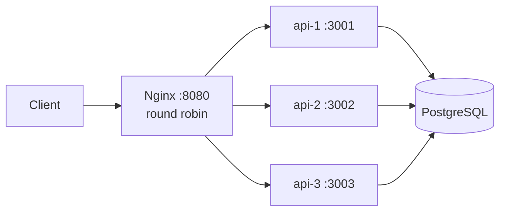
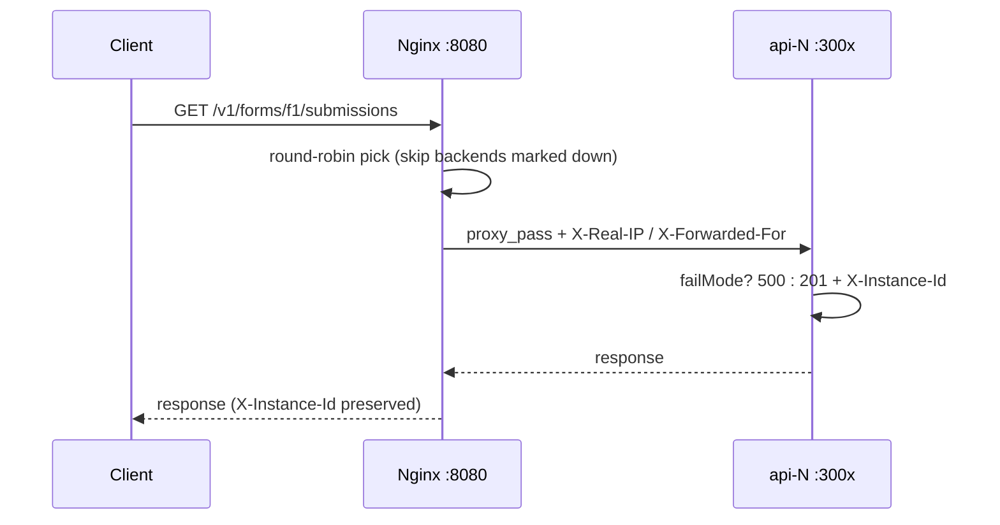

# Chapter 03 — Load Balancing

> **Part I — Traffic Management and Deployment**
> **Prerequisites:** Chapter 01 (Rate Limiting) is helpful but not required. Basic familiarity with HTTP requests and with running `docker compose up` is enough.
> **FormForge context:** the public submission endpoint from Chapters 01–02 (`GET /v1/forms/:formId/submissions`) now runs on three identical API instances behind one Nginx load balancer, so a single dead instance stops being a user-visible outage.

---

## 1. Definition and Fundamentals

### What it is

**Load balancing** is the practice of distributing incoming requests across multiple backend servers, instead of sending everything to one machine. A **load balancer** is the component that makes that choice — it sits in front of a pool of backends and, for each request, picks *which* backend should answer it.

Our implementation uses the most widely deployed open-source combination: **Nginx 1.24 (open source)** as a Layer 7 load balancer in front of **three identical Node.js/Express API instances**. Each instance is an independent process on its own port (`3001`, `3002`, `3003`); Nginx listens on `8080` and forwards each request to one of them. Every response carries an `X-Instance-Id` header (`api-1`, `api-2`, or `api-3`) so you can *see* the distribution happening.

### Why it exists / what problem it solves

One server is a single point of failure and a hard capacity ceiling. Load balancing solves four problems at once:

1. **Availability** — a dead backend is removed from rotation automatically; the user never notices provioded capacity remains (→ Chapter 56, Health Checks; → Chapter 85, Failover).
2. **Throughput** — N healthy instances serve roughly N× the request rate of one, for stateless workloads.
3. **Rolling change** — deploy one instance at a time while the others keep serving (→ Chapter 54, Rolling Deployments).
4. **Fault isolation** — a slow or poisoned instance stops receiving *new* traffic once the balancer notices, instead of dragging every request down with it.

### How it works internally (first pass)

1. Client sends a request to the balancer (`http://localhost:8080/v1/forms/f1/submissions`).
2. The balancer picks a backend from its pool — ours uses **round robin** (take turns: api-1, api-2, api-3, api-1, …).
3. It proxies the request there (`proxy_pass`), forwards the backend's response to the client, and stamps no extra state — any instance can serve any request.
4. Separately, the balancer watches for failures: in our config, **3 failed proxied requests within 10 seconds** marks a backend down (`max_fails=3 fail_timeout=10s`), and it is left alone for 10 seconds before being tried again.

### Where it fits in the architecture



CHUNK-MARKER-1

The balancer lives at the edge of the app tier: *behind* the CDN/gateway/rate-limiter layers (→ Chapter 01, → Chapter 04, → Chapter 05) and *in front of* the application instances. It owns one decision — *which instance answers* — and one discovery loop — *which instances are currently healthy*.

### A real-world analogy

A **taxi dispatcher with three identical cabs**. Riders (requests) call one number (port 8080); the dispatcher sends them out in rotation. If one cab breaks down (backend crash), the dispatcher simply stops assigning rides to it until the driver radios back in. The dispatcher never drives anyone anywhere itself — it only decides *who drives*.

### A production example (FormForge)

FormForge's public submission endpoint is anonymous and bursty — a popular form shared on social media can go from tens to thousands of requests per minute. One Node.js process saturates its event loop; three processes behind Nginx triple the headroom, and when one instance crashes on a bad deploy, respondents keep submitting while the orchestrator restarts it. No shared state is involved: every instance reads the same PostgreSQL, so any instance can answer any request.

### When it is necessary / when it is unnecessary

**Reach for a load balancer when:** a single instance is near its CPU/event-loop/connection ceiling; you need deploys without downtime; you need one instance's failure to be invisible.

**Think twice when:**

- One small instance handles the load with headroom to spare — a balancer adds a moving part (config, health checks, TLS) for no benefit.
- Requests carry local state (in-memory sessions, local uploads) that would break when the next request lands elsewhere — fix the state story first (external session store, → Chapter 02) or accept sticky routing and its costs (Section 2).
- The backend is a single managed service you don't control (e.g., a third-party API) — you cannot balance what you cannot replicate.

---

## 2. Types, Variants, and Classifications

### By OSI layer

| Layer | What it sees | Strengths | Limitations |
|---|---|---|---|
| **Layer 4 (TCP/UDP)** | IP + port only | Very fast; protocol-agnostic; cheap health checks | Cannot route by URL, header, or cookie; no sticky sessions by identity |
| **Layer 7 (HTTP)** | Method, path, headers, cookies | Path/host routing, header-based canary, sticky cookies, request rewriting | Must terminate/parse HTTP; slightly more CPU per request |

Our example is **Layer 7**: Nginx reads the HTTP request and proxies it, which is what lets it route by path (`/healthz` for its own status vs `/` for backends) and forward client identity headers (`X-Real-IP`, `X-Forwarded-For`). Use Layer 4 when you only need raw distribution; use Layer 7 the moment routing depends on anything inside the request.

### By algorithm

| Algorithm | How it picks | Best when | Watch out for |
|---|---|---|---|
| **Round robin** (ours) | Strict rotation | Backends identical and requests uniform | Slow backends get equal share — rotation is fair in *count*, not in *cost* |
| **Least connections** | Fewest active connections | Long-lived or uneven-cost requests | Needs accurate connection counts; useless if every request is instant |
| **IP hash** | Hash of client IP | You need naive stickiness with no shared state | One NAT / office = one backend; reshuffles on pool changes |
| **Weighted** variants | Rotation biased by weight | Heterogeneous hardware | Weights rot; someone must keep them honest |
| **Least time** (Nginx Plus / HAProxy) | Fastest recent responses | Latency-sensitive pools | Commercial or complexity cost |

### Decision guide

- 3 identical stateless app servers, uniform requests → **round robin** (this chapter).
- Long-lived connections (WebSockets, → Chapter 22) → **least connections**.
- Must pin a user to one box with no shared store → **IP hash**, and plan the migration to a shared store.
- Mixed hardware generations → **weighted** round robin, re-measured quarterly.

CHUNK-MARKER-2

---

## 3. Internal Working and Architecture

### Request lifecycle through our Nginx



Step by step:

1. **Accept** on `:8080`. `client_max_body_size 64k` rejects oversized bodies early (cheap defense that belongs at the edge).
2. **Select** the next healthy upstream from `formforge_api`. Round robin is a cursor, not a computation — O(1). Backends inside their `fail_timeout` down-window are skipped.
3. **Proxy** with `proxy_connect_timeout 2s` / `proxy_read_timeout 5s` / `proxy_send_timeout 2s`: the balancer refuses to wait indefinitely for a sick backend.
4. **Count failures.** A proxied request that fails per `proxy_next_upstream` increments that backend's counter; 3 within 10 s marks it down for 10 s.
5. **Return** the backend's response untouched, including `X-Instance-Id` — the per-request observable our tests assert on.

### The `proxy_next_upstream` trap (read this twice)

Open-source Nginx counts a backend as failed **only for connection-level errors and timeouts by default** — a backend that *returns* HTTP 500 does **not** count toward `max_fails`. Our backends signal a crash by returning 500 (`failMode`), so without extra config the failover test can never pass: api-1 would keep receiving traffic forever.

The fix, used in both shipped configs:

```nginx
proxy_next_upstream error timeout http_500;
proxy_next_upstream_tries 1;
```

- `http_500` makes a returned 500 count as an upstream failure, so `max_fails` can actually fire.
- `tries 1` disables the retry-to-another-backend behavior, so the client still sees that 500 as-is. Without it, Nginx would silently re-send the failed request elsewhere — a hidden retry that multiplies load during an incident (→ Chapter 12, Retries). This combination — *count the failure, don't retry it* — is the deliberate policy choice of this chapter.

### Passive vs active health checks

| | Passive (ours, open source) | Active (Nginx Plus / external prober) |
|---|---|---|
| How it learns | Real client traffic fails | Synthetic probes on a timer |
| Cost | Free | Extra traffic + prober to operate |
| Blind spot | An idle backend's death is invisible until traffic arrives | None — but probes can disagree with real-traffic health |
| Failover speed | After `max_fails` real failures | After N missed probes |

Recommendation: passive checks are honest and free, and they are exactly what this example validates. Add active probing when idle-backend blindness matters (low-traffic services, → Chapter 56).

### Algorithms and complexity

Round-robin selection is O(1) per request; failure accounting is O(1) per failed proxy. Memory is O(number of backends). The balancer adds roughly one extra network hop of latency (hypothetical order of magnitude on localhost: sub-millisecond; measure yours) plus header forwarding.

### Configuration parameters (safe defaults used here)

| Parameter | Value | Why |
|---|---|---|
| `max_fails` / `fail_timeout` | `3` / `10s` | 3 strikes in 10 s marks down; down for 10 s. Tolerant of one-off blips, fast enough to matter. |
| `proxy_next_upstream` / `proxy_next_upstream_tries` | `error timeout http_500` / `1` | Count returned 500s as failures; never silently retry (see trap above). |
| `proxy_connect/read/send_timeout` | `2s` / `5s` / `2s` | Bound how long one sick backend can hold a client. |
| `keepalive 32` + `proxy_http_version 1.1` + cleared `Connection` | as shown | Reuse upstream connections; without the 1.1 + header lines, `keepalive` silently does nothing. |
| `client_max_body_size 64k` | as shown | Reject abuse at the cheapest layer. |

CHUNK-MARKER-3

---

## 4. Practical Implementation

> **Runnable** — everything in this section exists in `book/code/03-load-balancing/` and was executed during writing (host-level: real Nginx binary + 3 real Node processes; Docker path provided but the sandbox daemon was unavailable, so Compose validity was checked with `docker compose config` only).

### Scenario

FormForge's submission endpoint must survive one dead instance with no user-visible errors, and traffic must split roughly evenly across healthy instances.

### Requirements

**Functional:**

- Three identical Express instances on `:3001`/`:3002`/`:3003`, each stamping `X-Instance-Id`.
- Nginx on `:8080`, round robin, skipping backends marked down.
- `GET /healthz` on every instance (orchestrator-grade health signal) and on the LB itself.
- Failure injection for tests only: `POST /_test/fail` (every submission returns 500) and `POST /_test/recover`.

**Non-functional:**

- Strict TypeScript; config read once at startup via a typed module; fail fast on invalid env.
- Graceful shutdown (SIGTERM/SIGINT drain, 10 s hard cap).
- Tests pass against the live stack; visible skips (never silent green) when infra is down.

### Technology stack

| Piece | Choice | Why |
|---|---|---|
| Backends | Node.js 22 / Express 4, TypeScript strict | Same stack as Chapters 01–02; minimal deps (express only at runtime) |
| Balancer | Nginx 1.24 open source | The industry default; passive checks are free |
| Tests | Vitest 2 + supertest | Same harness as earlier chapters; probe helper with `REQUIRE_INFRA=1` CI mode |

### Project structure

```
book/code/03-load-balancing/
├── docker-compose.yml      # lb + api-1/2/3; host port map 8080, 3001-3003
├── Dockerfile              # full-deps install → tsc → prune → node dist/server.js
├── .dockerignore / .env.example / .gitignore
├── package.json / tsconfig.json   # NodeNext ESM, strict, emit to dist/
├── nginx/
│   └── docker-nginx.conf   # conf.d snippet for `docker compose` (service-name upstreams)
├── lb-nginx/
│   ├── nginx.conf          # standalone main config for Docker-less local runs
│   └── mime.types          # copied from the Nginx distribution
├── src/config.ts           # typed env config, fail-fast validation
├── src/app.ts              # Express app: healthz, submissions, X-Instance-Id, _test/*
├── src/server.ts           # bootstrap + graceful shutdown
└── test/
    ├── helpers/infra.ts    # LB probe: true / visible-skip / REQUIRE_INFRA=1 throw
    ├── lb-distribution.test.ts  # 60 requests → all 201, all 3 ids, ±8 of 20 each
    └── lb-failover.test.ts      # poison api-1 → ≤6 api-1 attempts, 0 api-1 201s
```

### Configuration

`.env.example` (per-instance identity is injected by Compose, not shared):

```bash
PORT=3001
INSTANCE_ID=api-1
TRUST_PROXY=loopback
ENABLE_TEST_ENDPOINTS=true
```

Upstream + failover policy (identical in both Nginx variants; hostnames differ):

```nginx
upstream formforge_api {
    server api-1:3001 max_fails=3 fail_timeout=10s;
    server api-2:3002 max_fails=3 fail_timeout=10s;
    server api-3:3003 max_fails=3 fail_timeout=10s;
    keepalive 32;
}
```

> Inside the Compose network, backends are reachable **by service name** (`api-1:3001`). `127.0.0.1` inside the `lb` container would point at Nginx itself — the single most common reason a Compose LB returns 502 on first boot. The host-level `lb-nginx/nginx.conf` uses `127.0.0.1:300x` because there everything shares one loopback.

CHUNK-MARKER-4

### Implementation (backend — runnable)

`src/config.ts` — typed config, fail fast:

```typescript
export interface AppConfig {
  port: number;
  instanceId: string;
  trustProxy: string | number;
  enableTestEndpoints: boolean;
}

function requiredString(raw: string | undefined, name: string): string {
  if (!raw || raw.trim().length === 0) {
    throw new Error(`${name} is required`);
  }
  return raw.trim();
}

function positiveInt(raw: string | undefined, fallback: number, name: string): number {
  const value = raw === undefined ? fallback : Number(raw);
  if (!Number.isInteger(value) || value <= 0) {
    throw new Error(`${name} must be a positive integer, got: ${String(raw)}`);
  }
  return value;
}

export function loadConfig(env: NodeJS.ProcessEnv = process.env): AppConfig {
  return {
    port: positiveInt(env.PORT, 3001, 'PORT'),
    instanceId: requiredString(env.INSTANCE_ID, 'INSTANCE_ID'),
    trustProxy: env.TRUST_PROXY ?? 'loopback',
    enableTestEndpoints: env.ENABLE_TEST_ENDPOINTS === 'true',
  };
}
```

`src/app.ts` — the app (abridged; full file in the repo):

```typescript
import express from 'express';
import type { AppConfig } from './config.js';

export function createApp(deps: { config: AppConfig; failMode: boolean }): express.Express {
  const app = express();
  app.disable('x-powered-by');
  app.set('trust proxy', deps.config.trustProxy);
  app.use(express.json({ limit: '16kb' }));

  // Per-request observable: every response says who served it.
  app.use((_req, res, next) => {
    res.setHeader('X-Instance-Id', deps.config.instanceId);
    next();
  });

  app.get('/healthz', (_req, res) => {
    res.status(200).json({ status: 'ok', instance: deps.config.instanceId });
  });

  app.get('/v1/forms/:formId/submissions', (_req, res) => {
    if (deps.failMode) {
      res.status(500).json({ error: 'backend_injected_failure' });
      return;
    }
    res.status(201).json({ id: String(Date.now()), formId: _req.params.formId, instance: deps.config.instanceId });
  });

  if (deps.config.enableTestEndpoints) {
    app.post('/_test/fail', (_req, res) => { deps.failMode = true; res.json({ ok: true, failMode: true }); });
    app.post('/_test/recover', (_req, res) => { deps.failMode = false; res.json({ ok: true, failMode: false }); });
  }
  return app;
}
```

`src/server.ts` — bootstrap with graceful shutdown (full file in the repo): listens on the configured port, logs a JSON `listening` line, and on SIGTERM/SIGINT stops accepting, drains, and hard-exits after 10 s.

`Dockerfile` — compile inside the image (plain `node` at runtime, no tsx needed):

```dockerfile
FROM node:22-alpine
WORKDIR /app
COPY package.json package-lock.json* tsconfig.json ./
RUN npm install --no-fund --no-audit
COPY src ./src
RUN npx tsc && npm prune --omit=dev --no-fund --no-audit
EXPOSE 3001 3002 3003
CMD ["node", "dist/server.js"]
```

> Earlier draft installed with `--omit=dev` *before* compiling, so `tsc` didn't exist in the image and every API container exited. Installing full deps, compiling, then pruning is the fix — and `.dockerignore` keeps `node_modules`, `dist`, logs, and the host-only `lb-nginx/` out of the build context.

### Execution

```bash
cd book/code/03-load-balancing
cp .env.example .env
docker compose up -d --build
curl -s http://localhost:8080/healthz   # lb ok
```

Observe the rotation (representative output — yours will interleave api-1/2/3 in order):

```
$ for i in $(seq 1 6); do curl -s -o /dev/null -w "%{http_code} %{header_x-instance-id}\n" http://localhost:8080/v1/forms/f1/submissions; done
201 api-1
201 api-2
201 api-3
201 api-1
201 api-2
201 api-3
```

Poison one backend and watch it leave rotation after 3 failures:

```
curl -s -X POST http://localhost:3001/_test/fail
for i in $(seq 1 15); do curl -s -o /dev/null -w "%{http_code} %{header_x-instance-id}\n" http://localhost:8080/v1/forms/f1/submissions; done
# ~3x "500 api-1", then only "201 api-2" / "201 api-3"
curl -s -X POST http://localhost:3001/_test/recover
docker compose down
```

CHUNK-MARKER-5

### Testing

`test/helpers/infra.ts` probes `127.0.0.1:8080/healthz` once: reachable → suites run; unreachable → loud warning + visible `SKIPPED:` suites; `REQUIRE_INFRA=1` → throw (CI fails instead of skipping).

- **Distribution** (`lb-distribution.test.ts`): 60 sequential requests; asserts all 201, all three `X-Instance-Id` values present, each within 12–28 (≈20 ± 8).
- **Failover** (`lb-failover.test.ts`): poisons api-1 via its admin port, fires 30 concurrent LB requests, asserts ≤6 api-1 attempts, zero api-1 successes, and both survivors serving; recovers api-1 in `afterAll`.

Execution evidence (host-level run, real Nginx 1.24 binary + 3 real Node processes on :3001–:3003):

```
$ npm run typecheck   # tsc --noEmit — clean
$ REQUIRE_INFRA=1 npm test
 Test Files  2 passed (2)
      Tests  4 passed | 1 skipped (5)
```

The 1 skipped test is the `up === false` skip-marker suite (correctly inert when infra is up). Docker-path validation was limited to `docker compose config --quiet` (success) — the sandbox daemon was unavailable, stated honestly per → 00-standards §2.

### Expected result (representative)

Distribution: ~20/20/20 across api-1/2/3 over 60 requests, every response `201` with a matching `X-Instance-Id`. Failover: exactly the first few api-1 turns return `500 api-1` (≤6 including in-flight), then only `201 api-2` / `201 api-3` — api-1 never returns a 201 while poisoned.

### Design decisions

- **Round robin, not least-connections:** backends are identical and requests uniform; rotation is the simplest correct policy and makes the distribution directly assertable.
- **`X-Instance-Id` as a response header:** turns routing into a per-request observable with zero log plumbing — the tests need no log scraping.
- **Failure injection via admin endpoints, Compose-only:** production code paths stay clean; `ENABLE_TEST_ENDPOINTS` gates them and Compose is the only place that enables them.
- **`GET` submissions returning 201:** mirrors the FormForge submission resource shape from Chapters 01–02 while keeping the LB example dependency-free (no DB/Redis needed to demonstrate balancing).

---

## 5. Production-Ready Implementation

What changes before this demo serves real traffic:

- **TLS termination at the LB** (cert management, HTTP→HTTPS redirect, HSTS) — backends stay plain HTTP inside the VPC (→ Chapter 71, TLS).
- **Active health checks** (Nginx Plus or an external prober hitting `/healthz` plus a deeper readiness signal, e.g. DB reachability) so idle-backend death is visible without client traffic (→ Chapter 56, Health Checks).
- **Rate limiting at the edge** before balancing, so one abusive client can't saturate all three instances at once (→ Chapter 01).
- **Timeouts + retries as a pair:** keep `tries 1` at the LB, and put bounded, backoff'd retries with idempotency in the *client* (→ Chapter 11, → Chapter 12, → Chapter 13, → Chapter 14).
- **Observability:** structured access logs with `$upstream_addr` + `$upstream_status`, per-backend latency histograms, and an alert on backends-down count (→ Chapters 58–62).
- **Graceful deploys:** rolling restarts with connection draining (`worker_shutdown_timeout`, preStop sleeps in Kubernetes) so in-flight requests finish (→ Chapter 54).
- **Secrets/config:** instance identity and feature flags via the orchestrator (Compose env → Kubernetes env/Secrets), never baked into images (→ Chapter 67).
- **Cost:** three always-on instances cost 3× one; autoscale on CPU/latency with a floor of 2 across zones (→ Chapter 45, → Chapter 88).

CHUNK-MARKER-6

---

## 6. Edge Cases and Failure Scenarios

### Case 1 — Returned 500 never marks a backend down (the default-trap)
- **Scenario:** a backend starts returning 500 for every request; traffic keeps hitting it indefinitely.
- **Cause:** open-source Nginx only counts connection errors/timeouts toward `max_fails` unless `proxy_next_upstream` names the HTTP status. This is the trap dissected in Section 3 — our failover test failed (~10 api-1 attempts, expected ≤6) until `http_500` was added.
- **Impact:** a poisoned backend absorbs its full rotation share; users see persistent 500s.
- **Detect:** per-backend 5xx rate in LB access logs (`$upstream_status`); the failover test itself.
- **Prevent/mitigate:** `proxy_next_upstream error timeout http_500; proxy_next_upstream_tries 1;` — count it, don't retry it.
- **Test the fix:** `lb-failover.test.ts` — poisons api-1, asserts ≤6 attempts and zero successes.

### Case 2 — The LB container resolves backends to itself (Compose 502s)
- **Scenario:** `docker compose up` succeeds, but every LB request returns 502.
- **Cause:** upstream `server 127.0.0.1:3001` inside the `lb` container points at the Nginx container itself, not the API containers. Each container has its own loopback.
- **Impact:** total outage through the LB while backends are individually healthy.
- **Detect:** `docker compose logs lb` shows `connect() failed (111: Connection refused) while connecting to upstream`; direct `:3001/healthz` works.
- **Prevent/mitigate:** use Compose service names (`api-1:3001`) in `nginx/docker-nginx.conf`; keep `127.0.0.1` only in the host-level `lb-nginx/nginx.conf`.
- **Test the fix:** distribution suite green through `:8080` on a fresh `compose up`.

### Case 3 — Docker image builds but API containers exit instantly
- **Scenario:** `api-1/2/3` show `Exited (1)`; LB returns 502/503.
- **Cause:** `npm install --omit=dev` before `npx tsc` — the TypeScript compiler isn't installed, so the build layer fails and `dist/server.js` never exists.
- **Impact:** same user-visible shape as Case 2 (LB up, pool empty).
- **Detect:** `docker compose logs api-1` shows `tsc: not found` / `Cannot find module dist/server.js`.
- **Prevent/mitigate:** full install → `npx tsc` → `npm prune --omit=dev` (our Dockerfile); `.dockerignore` keeps the context lean.
- **Test the fix:** `docker compose ps` shows all four containers `Up`; `/healthz` on `:3001–:3003` returns 200.

### Case 4 — `keepalive 32` silently does nothing
- **Scenario:** upstream keepalive configured, but connection churn stays high.
- **Cause:** Nginx requires `proxy_http_version 1.1` plus `proxy_set_header Connection ""` for upstream keepalive; without them the directive is accepted and ignored.
- **Impact:** extra TCP handshakes per request; higher tail latency under load.
- **Detect:** packet capture or connection instrumentation showing new upstream connections per request.
- **Prevent/mitigate:** ship the two lines with every `keepalive` (both our configs do).
- **Test the fix:** load test comparing connection counts with/without the lines (hypothetical here — not measured in this chapter).

### Case 5 — Recovered backend stays out of rotation for `fail_timeout`
- **Scenario:** api-1 is fixed (`/_test/recover` returns `failMode: false`), but requests still avoid it for seconds.
- **Cause:** by design — a marked-down backend is skipped until `fail_timeout` (10 s) elapses.
- **Impact:** reduced capacity window after every incident; confusing during demos ("I fixed it, why is traffic still 50/50?").
- **Detect:** `X-Instance-Id` distribution missing api-1 right after recovery; access-log timestamps.
- **Prevent/mitigate:** tune `fail_timeout` down for fast-recovering pools, or add active checks (→ Chapter 56); document the window (our README and failover test both call it out).
- **Test the fix:** after `recover`, poll the LB and assert api-1 reappears within ~`fail_timeout` + one rotation.

### Case 6 — Thundering recovery: all traffic slams the healed backend
- **Scenario:** api-1's down-window expires mid-spike; the cursor hands it a full share instantly while its caches/pools are cold.
- **Cause:** round robin has no warm-up; slow-start needs explicit support (Nginx Plus `slow_start`, or staged re-entry).
- **Impact:** latency spike on the just-healed instance; possible re-marking (flapping).
- **Detect:** per-backend latency split by time-since-recovery.
- **Prevent/mitigate:** `slow_start` where available; otherwise reintroduce gradually (weight, or drain-first deploys, → Chapter 54).
- **Test the fix:** chaos-style exercise (Advanced exercise below).

### Case 7 — The LB itself is the single point of failure
- **Scenario:** the Nginx process/container dies; all three healthy backends become unreachable.
- **Cause:** one LB, one host, one config — the demo topology, honestly labeled.
- **Impact:** full outage despite healthy capacity.
- **Prevent/mitigate:** ≥2 LB replicas behind DNS round robin / anycast / cloud LB, health-checked independently (→ Chapter 86, Multi-Region Deployment).
- **Test the fix:** kill the LB and assert traffic fails over (hypothetical in this single-host demo — stated, not shown).

CHUNK-MARKER-7

---

## 7. Common Mistakes and Anti-Patterns

### Mistake 1 — Assuming `max_fails` counts HTTP errors by default
- **Wrong approach:** `server api-1:3001 max_fails=3` and expecting 500s to trigger it.
- **Why devs choose it:** the name *sounds* like "3 failures of any kind."
- **Why it fails:** documented Nginx behavior — only `proxy_next_upstream`-listed conditions count (Case 1).
- **Correct alternative:** name the statuses explicitly (`error timeout http_500`) and decide retries separately (`tries 1`).
- **Real-world consequence:** the exact green-distribution/red-failover split we observed: everything looks balanced until the first real crash, which never fails over.

### Mistake 2 — `127.0.0.1` upstreams in a Compose network
- **Wrong approach:** copying a host-tested `nginx.conf` into the `lb` container unchanged.
- **Why devs choose it:** it worked on the laptop without Docker.
- **Why it fails:** each container owns its loopback (Case 2).
- **Correct alternative:** service-name upstreams in the Docker variant; keep a separate, clearly labeled host variant.
- **Real-world consequence:** 502 on every request from a stack whose backends are all healthy.

### Mistake 3 — `proxy_next_upstream off` as "disable retries" (stale idiom)
- **Wrong approach:** `proxy_next_upstream off;` intending "never retry, never count."
- **Why devs choose it:** old tutorials and the intuitive reading of "off."
- **Why it fails:** `off` disables *both* retrying and failure-counting for HTTP statuses — the backend can never be marked down for returning 500.
- **Correct alternative:** `proxy_next_upstream error timeout http_500;` + `proxy_next_upstream_tries 1;` — count once, retry never.
- **Real-world consequence:** silent retry amplification if you list statuses without `tries 1`, or silent non-exclusion if you use `off`.

### Mistake 4 — Equal counts confused with equal load
- **Wrong approach:** "round robin is fair, so all instances are equally loaded."
- **Why devs choose it:** the distribution test *is* even (20/20/20), which feels like proof.
- **Why it fails:** even counts ≠ even cost — one slow request type, one hot form, one GC pause skews CPU/latency while counts stay perfect.
- **Correct alternative:** watch per-backend latency + active connections, not just counts; switch algorithms when cost variance is real (Section 2).
- **Real-world consequence:** a "balanced" pool with one saturated instance and two idle ones; tail latency blamed on the app instead of the policy.

### Mistake 5 — Test-only endpoints reachable in production
- **Wrong approach:** shipping `/_test/fail` enabled everywhere because "it's just a test helper."
- **Why devs choose it:** gating feels like ceremony during development.
- **Why it fails:** anyone who can reach the backend can switch off ⅓ of your capacity (or all of it) with one POST.
- **Correct alternative:** `ENABLE_TEST_ENDPOINTS` env gate (default off), Compose-only enablement, and ideally admin-port or mTLS restriction in production (→ Chapter 68, IAM).
- **Real-world consequence:** a public kill-switch — the cheapest possible DoS.

### Mistake 6 — Reading local-dev distribution as production proof
- **Wrong approach:** "60 requests split 20/20/20 on my laptop, so we're production-ready."
- **Why devs choose it:** the demo *is* convincing — real Nginx, real processes, real assertions.
- **Why it fails:** single host, no TLS, no slow clients, no deploys, no cross-AZ latency, no thundering herds.
- **Correct alternative:** treat Section 4 as *behavioral* proof (algorithm + failover mechanics work) and Section 5 as the checklist before load claims (stated honestly in the README's "Honest notes").
- **Real-world consequence:** capacity surprises on day one of real traffic.

CHUNK-MARKER-8

---

## 8. Performance and Scalability

- **Per-request cost:** round-robin selection O(1); failure accounting O(1) per failed proxy; memory O(backends). The LB adds one proxy hop — sub-millisecond on localhost (hypothetical order of magnitude; measure yours with `$request_time` vs `$upstream_response_time`).
- **Throughput shape:** for stateless, uniform work, N instances ≈ N× single-instance throughput minus proxy overhead. Our 60-request distribution run is a *correctness* check, not a benchmark — sequential Vitest requests cannot saturate anything.
- **Bottlenecks, in order:** backend event-loop saturation → LB worker connections (`worker_connections 1024`) → file descriptors → upstream keepalive pool exhaustion under bursty fan-out.
- **Scaling strategies:** add backends (stateless, so linear); scale LB workers/connections; terminate TLS at the LB once and reuse upstream keepalive; when one LB saturates, shard by route/host across LB pairs (→ Chapter 05) or move to anycast/DNS distribution (→ Chapter 86).
- **Benchmarking method (for your environment):** `k6` or `autocannon` against `:8080` with ramping VUs, asserting per-`X-Instance-Id` latency splits; label results with hardware, Nginx build, and Node version. No load numbers are claimed in this chapter because none were measured here.

---

## 9. Testing and Debugging

| Layer | What | Command / file |
|---|---|---|
| Typecheck | Strict TS, no emit | `npm run typecheck` |
| Distribution | 60 LB requests: all 201, all 3 ids, 12–28 each | `test/lb-distribution.test.ts` |
| Failover | Poison api-1 → ≤6 attempts, 0 successes, survivors serve | `test/lb-failover.test.ts` |
| Infra probe | `GET 127.0.0.1:8080/healthz`, 1 s timeout | `test/helpers/infra.ts` |
| Full suite (CI) | Fail loudly without infra | `REQUIRE_INFRA=1 npm test` |
| Full suite (local) | Visible skips without infra | `npm test` |
| Compose validity | Config parses (no daemon needed) | `docker compose config --quiet` |
| Nginx syntax | Standalone config parses | `nginx -t -c lb-nginx/nginx.conf` |

**Failure injection:** `POST :3001/_test/fail` → every submission from api-1 returns 500; `POST :3001/_test/recover` restores 201. Always recover in `afterAll` (both suites do) so runs are order-independent.

**Debug commands:**

```bash
docker compose ps                    # all four Up?
docker compose logs lb               # upstream connect() failures? (Case 2)
docker compose logs api-1            # tsc/dist errors? (Case 3)
curl -s http://localhost:3001/healthz  # bypass the LB: backend alive?
curl -s http://localhost:8080/healthz  # LB alive? ("lb ok")
```

**Expected failure signals:** 502 through `:8080` with healthy `:300x` → upstream addressing (Case 2). `Exited (1)` API containers → build-layer breakage (Case 3). ~⅓ persistent 500s with no exclusion → missing `http_500` in `proxy_next_upstream` (Case 1). Missing `api-1` right after recovery → normal `fail_timeout` window (Case 5).

CHUNK-MARKER-9

---

## 10. Follow-Up Interview Questions

### Level 1 — Fundamentals

**Q1. What does a load balancer actually decide per request?**
*Answer:* which backend serves *this* request — nothing more. It doesn't run business logic or store state.
*Reasoning:* separates the routing decision from the serving work; the taxi-dispatcher analogy.
*Example:* Nginx's round-robin cursor picking api-2 for the next arrival.
*Common wrong answer:* "It makes the servers faster" — it adds capacity and availability, not per-request speed.
*Follow-up:* what breaks if the balancer itself dies?

**Q2. Round robin vs least connections — when does each win?**
*Answer:* round robin for identical backends + uniform requests; least connections for long-lived or uneven-cost work.
*Reasoning:* fairness in count vs fairness in load (Mistake 4).
*Example:* our 20/20/20 split vs a WebSocket pool (→ Chapter 22).
*Common wrong answer:* "Least connections is always better" — it needs accurate counts and adds selection cost.
*Follow-up:* how would you detect that round robin is the wrong policy in production?

**Q3. What are `max_fails` and `fail_timeout`?**
*Answer:* after `max_fails` counted failures within the window, skip the backend for `fail_timeout`.
*Reasoning:* passive health checking from real traffic — free, but blind when idle.
*Example:* `3`/`10s` in our configs.
*Common wrong answer:* "Nginx pings backends every `fail_timeout`" — open source has no active probing; the timer is a skip-window, not a probe interval.
*Follow-up:* what counts as a "failure" toward the counter?

### Level 2 — Applied

**Q4. Your backend returns 500 but Nginx never marks it down. Why?**
*Answer:* default `proxy_next_upstream` only counts connection errors/timeouts; returned statuses must be named (`http_500`).
*Reasoning:* the Section 3 trap — the single most likely cause of a "failover test that can't fail over."
*Example:* our `proxy_next_upstream error timeout http_500;` + `tries 1`.
*Common wrong answer:* "Raise `max_fails`" — the counter never increments, so any threshold fails equally.
*Follow-up:* why pair it with `proxy_next_upstream_tries 1`?

**Q5. Why does `proxy_next_upstream_tries 1` matter?**
*Answer:* without it, a counted failure is retried on another backend — a hidden retry that amplifies load precisely when capacity is degraded.
*Reasoning:* retry policy belongs in the client with backoff + idempotency (→ Chapters 12–14), not silently in the proxy.
*Example:* 30 poisoned requests becoming up to 60 upstream hits during an incident.
*Common wrong answer:* "Retries are free because the first backend already failed" — the retry consumes a healthy backend's slot.
*Follow-up:* where *should* retries live, and what must be true before enabling them?

**Q6. Compose LB returns 502 but backends are healthy directly. Diagnose.**
*Answer:* upstream addressing — `127.0.0.1` inside the `lb` container is Nginx itself; use service names.
*Reasoning:* per-container loopback (Case 2); confirm via `docker compose logs lb` (`Connection refused ... while connecting to upstream`).
*Example:* `api-1:3001` vs `127.0.0.1:3001` in our two config variants.
*Common wrong answer:* "Restart everything" — masks the config error until the next fresh boot.
*Follow-up:* how do you keep host-tested and container configs from drifting?

CHUNK-MARKER-10A

### Level 3 — Judgment

**Q7. When would you choose IP-hash stickiness despite its flaws?**
*Answer:* only as a bridge — legacy local sessions with no shared store and no time to build one — with the migration planned.
*Reasoning:* NAT concentration + pool-change reshuffles make it a correctness risk, not a strategy.
*Example:* office NAT pinning hundreds of users to one instance.
*Common wrong answer:* "For performance — skipping the session lookup" — the lookup is cheap; the skew is expensive.
*Follow-up:* what does the target architecture (shared store) change about LB choice?

**Q8. Your pool is "balanced" 20/20/20 but P99 is terrible. Walk through it.**
*Answer:* check per-backend latency, not counts — one slow instance (GC, hot key, downstream) gets equal share under round robin.
*Reasoning:* Mistake 4 made operational; the fix is measurement first, algorithm second.
*Example:* `$upstream_response_time` histograms split by `$upstream_addr`.
*Common wrong answer:* "Add more instances" — scales the skew instead of removing it.
*Follow-up:* least-connections, least-time, or fix the slow backend — how do you choose?

**Q9. How do you deploy a new backend version with zero failed requests?**
*Answer:* rolling: mark one instance draining (stop new traffic, finish in-flight), replace, re-add, repeat — with health-gated promotion.
*Reasoning:* the LB's skip/window mechanics compose with orchestrator readiness (→ Chapters 54, 56, 57).
*Example:* `fail_timeout`-aware sequencing so a just-restarted instance isn't flooded cold (Case 6).
*Common wrong answer:* "Restart all three at once; Nginx will retry" — with `tries 1` there is no retry, and even with retries the capacity gap drops traffic.
*Follow-up:* what breaks if deploys are faster than `fail_timeout`?

### Level 4 — Architecture

**Q10. Design health checking for a 50-instance pool across 3 AZs.**
*Answer:* layered — LB passive checks per AZ pair, active probers with distinct liveness vs readiness signals, per-AZ failure budgets, and a control-plane view that distinguishes "one sick box" from "one sick AZ."
*Reasoning:* single-signal health collapses distinct failure modes into one bit.
*Example:* our `/healthz` (liveness) vs a readiness check including DB reachability (→ Chapter 56).
*Common wrong answer:* "Shorten `fail_timeout` to 1 s" — faster flapping, not better signal.
*Follow-up:* how do active probes and passive counts disagree, and which wins?

**Q11. The LB is now your bottleneck. Options?**
*Answer:* vertically (workers, connections, keepalive tuning) then horizontally (shard by route/host, anycast, cloud LB, or ECMP) — measuring which resource actually saturates first.
*Reasoning:* Section 8 ordering; most "LB bottlenecks" are really backend or TLS-config problems.
*Example:* `$request_time` vs `$upstream_response_time` split proving proxy overhead is (or isn't) the issue.
*Common wrong answer:* "Add a second LB behind the first" — a chain of single points of failure.
*Follow-up:* what state, if any, prevents naively adding LB replicas?

### Level 5 — System Design

**Q12. Design FormForge's submission path for a 100× traffic spike with one instance class failing.**
*Answer:* edge rate limiting (→ Chapter 01) → multi-LB with AZ-aware pools → stateless app tier with fast passive exclusion + active readiness → cache the hot read path (→ Chapter 02) → queue the write side-effects (→ Chapter 15) → autoscale on latency, not just CPU — with error budgets deciding how aggressive exclusion may be (→ Chapters 63–65).
*Reasoning:* forces composition across the traffic-survival kit, not a single-component answer.
*Example:* the 3-instance demo as the minimal cell that gets replicated, not the final shape.
*Common wrong answer:* a single bigger box, or "Kubernetes will handle it" without naming the signals that drive it.
*Follow-up:* what is the first thing that breaks in your design, and what metric tells you first?

CHUNK-MARKER-10B

---

## 11. Scenario-Based Engineering Problems

### Scenario A — Viral form: 50× submissions in an hour
- **Problem:** a celebrity-shared form drives sustained 50× submission traffic; one instance's event loop saturates.
- **Constraints:** no shared state to migrate (stateless tier ✓); DB connection budget fixed (→ Chapter 28); deploys frozen during the spike.
- **Options:** (1) add identical instances behind the LB; (2) shed load at the edge (→ Chapter 01); (3) cache the read path harder (→ Chapter 02).
- **Recommended:** all three in order — shed abuse first, scale the serving tier second, cache reads third. The LB makes (1) a config change, not an architecture change.
- **Trade-offs:** new instances need warmup (Case 6); shedding risks false positives; caching doesn't help writes.
- **Failure scenarios:** new instance misconfigured → passive exclusion contains it (Case 1 mechanics); LB saturation → Section 8 ladder.
- **Testing strategy:** distribution suite for correctness + k6 ramp for the spike shape; per-backend latency asserts, not just counts.

### Scenario B — Poison deploy on one instance
- **Problem:** a bad build reaches api-2 only (staged rollout); it returns 500 for 20% of form IDs.
- **Constraints:** error budget burning; rollback takes minutes; traffic must keep flowing.
- **Options:** (1) let passive exclusion remove api-2 after 3 failures; (2) manually mark it down; (3) roll back immediately.
- **Recommended:** (1) contains it automatically *if* the failing responses are 500s counted by `proxy_next_upstream` — then (3) at leisure. If failures are 200s-with-wrong-bodies, no LB policy can help: you need correctness-aware readiness (→ Chapter 56).
- **Trade-offs:** partial failures (only some IDs) may never reach `max_fails` density — exclusion is rate-dependent.
- **Failure scenarios:** flapping if the poison is intermittent; thundering recovery post-rollback (Case 6).
- **Testing strategy:** failover suite with a *partial*-failure mode (extension exercise below).

### Scenario C — Cross-AZ latency skew
- **Problem:** three instances spread across AZs; one AZ develops +80 ms latency to the DB. Counts stay 20/20/20; P99 doubles.
- **Constraints:** cannot move data; cannot drain the AZ (capacity needed).
- **Options:** (1) switch to least-time/least-connections; (2) weight the slow AZ down; (3) fix the AZ path.
- **Recommended:** (2) immediately (cap the damage), (3) as the real fix, (1) only if skew is structural. Round robin's blindness is the lesson of Mistake 4.
- **Trade-offs:** weights need ownership or they rot; least-time needs richer LB support.
- **Failure scenarios:** overcorrection starves the slow AZ until its caches go cold, then re-adding it spikes again.
- **Testing strategy:** synthetic-latency injection per backend, asserting P99 recovery, not count equality.

CHUNK-MARKER-11

---

## 12. Hands-On Exercises

### Beginner — See the rotation
- **Task:** bring the stack up and collect 60 responses through `:8080`, printing status + `X-Instance-Id`.
- **Hints:** README's `for` loop; `sort | uniq -c`.
- **Acceptance criteria:** all 60 return 201; each of api-1/2/3 appears 12–28 times (same bounds the distribution test asserts).

### Intermediate — Break one backend and watch exclusion
- **Task:** `POST :3001/_test/fail`, send 15 LB requests, then `POST :3001/_test/recover`.
- **Hints:** watch the first few responses for `500 api-1`, then only `201 api-2/api-3`.
- **Acceptance criteria:** ≤6 `api-1` responses total, zero `201 api-1` after poisoning, both survivors present; api-1 reappears within ~15 s of recovery (fail_timeout + rotation).

### Advanced — Partial poison + latency skew drill
- **Task:** extend the app with a mode that 500s only `formId == "poison"` and adds 300 ms delay otherwise; then decide whether passive exclusion contains it, and what signal *would* catch it.
- **Hints:** `proxy_next_upstream` + `max_fails` density math; per-backend `$upstream_response_time` histograms; readiness vs liveness (→ Chapter 56).
- **Acceptance criteria:** written answer with numbers (failure rate needed to trip exclusion at current settings) + a passing test for whichever signal you chose.

### Solutions

- **Beginner:** the README loop *is* the solution; compare your counts against `lb-distribution.test.ts` bounds (12–28 per instance over 60).
- **Intermediate:** the `lb-failover.test.ts` flow scripted by hand — poison, 15 requests, recover; the ≤6/zero-201 criteria are the test's asserts verbatim.
- **Advanced:** no single correct answer — acceptable solutions either (a) show the math proving partial poison evades `max_fails=3/10s` at realistic rates and add a correctness-aware readiness probe, or (b) demonstrate latency-based exclusion with measured P99 recovery. Both must include the test they added and its output.

CHUNK-MARKER-12

---

## 13. Chapter Summary and Revision Notes

### Five key takeaways

1. A load balancer makes one decision per request — *which backend answers* — plus one discovery loop — *which backends are healthy*.
2. Open-source Nginx health checks are **passive** and count **only what `proxy_next_upstream` names** — returned 500s don't count unless you say `http_500`.
3. Count failures and retry failures are **separate policies**: `proxy_next_upstream … http_500` + `tries 1` counts without amplifying.
4. Container loopbacks are per-container: Compose upstreams use **service names**, never `127.0.0.1`.
5. Even counts ≠ even load — round robin is fair in *requests*, blind to *cost*; watch per-backend latency.

### Quick revision sheet

| Item | Value / rule |
|---|---|
| LB role | pick-a-backend per request + healthy-pool discovery |
| Our policy | round robin, `max_fails=3`, `fail_timeout=10s` |
| 500-counting | `proxy_next_upstream error timeout http_500; proxy_next_upstream_tries 1;` |
| Upstream keepalive needs | `proxy_http_version 1.1;` + `proxy_set_header Connection "";` |
| Compose addressing | `api-N:300x` (service names) |
| Per-request observable | `X-Instance-Id` response header |
| Test bounds | 60 reqs → all 201, 12–28 per instance; poison → ≤6 attempts, 0 successes |
| Recovery window | up to `fail_timeout` (10 s) of continued exclusion — by design |

### Essential terminology

- **Upstream / pool** — the backend set the LB chooses from.
- **Round robin** — strict-rotation selection; O(1), count-fair, cost-blind.
- **Passive health check** — exclusion driven by real-traffic failures (`max_fails`/`fail_timeout`).
- **`proxy_next_upstream`** — which conditions count as upstream failures *and* trigger retry-to-next (two jobs, one directive).
- **`fail_timeout`** — dual role: failure-counting window + down-skip duration.
- **Sticky session** — pinning a client to one backend; a bridge, not a strategy.

### Decision-making checklist

- [ ] Backends stateless (any instance can serve any request)?
- [ ] Algorithm matched to cost variance (round robin only if uniform)?
- [ ] `proxy_next_upstream` names every failure mode you must exclude on?
- [ ] Retries bounded (`tries 1` at the LB; client-side backoff + idempotency)?
- [ ] Upstream keepalive paired with HTTP/1.1 + cleared `Connection`?
- [ ] Compose upstreams by service name; host variant clearly separated?
- [ ] Test endpoints env-gated, Compose-only?
- [ ] `fail_timeout` recovery window documented for on-call?

### Five flashcards

1. **Q:** What two jobs does a load balancer do? **A:** Per-request backend choice + healthy-pool discovery.
2. **Q:** Does `max_fails=3` count returned 500s by default? **A:** No — only connection errors/timeouts unless `proxy_next_upstream` names the status.
3. **Q:** What does `proxy_next_upstream_tries 1` buy you? **A:** Failure counting without silent retry amplification.
4. **Q:** Why 502s from a Compose LB with healthy backends? **A:** `127.0.0.1` upstream inside the lb container points at itself — use service names.
5. **Q:** api-1 fixed but still no traffic — normal? **A:** Yes, until `fail_timeout` (10 s) elapses — exclusion lingers by design.

### Three comprehension-verification questions

1. Your failover test shows persistent 500s from the poisoned backend with no exclusion. Name the single directive (and value) most likely missing, and explain why `tries 1` must accompany it.
2. You copy a working host-level `nginx.conf` into a Compose `lb` container and get 502 on every request while `:3001/healthz` is 200. What is wrong, and which file in our project holds the container-correct variant?
3. Distribution is a perfect 20/20/20 but P99 doubled after one AZ degraded. Why didn't the LB fix it, and what two signals would have caught it before users noticed?

### Authoritative references and further reading

- Nginx `ngx_http_upstream_module` — `server`, `max_fails`, `fail_timeout`, `keepalive`: [nginx.org/en/docs/http/ngx_http_upstream_module.html](https://nginx.org/en/docs/http/ngx_http_upstream_module.html)
- Nginx `ngx_http_proxy_module` — `proxy_next_upstream`, `proxy_next_upstream_tries`, `proxy_http_version`: [nginx.org/en/docs/http/ngx_http_proxy_module.html](https://nginx.org/en/docs/http/ngx_http_proxy_module.html)
- RFC 6585 §4 (429 Too Many Requests) — context for edge shaping before balancing: [datatracker.ietf.org/doc/html/rfc6585#section-4](https://datatracker.ietf.org/doc/html/rfc6585#section-4)
- Next in this book: → Chapter 04 (Reverse Proxies) for caching/compression/TLS at the proxy layer; → Chapter 05 (API Gateways) for the productized bundle; → Chapter 12 (Retries) for why the LB must not silently retry.
