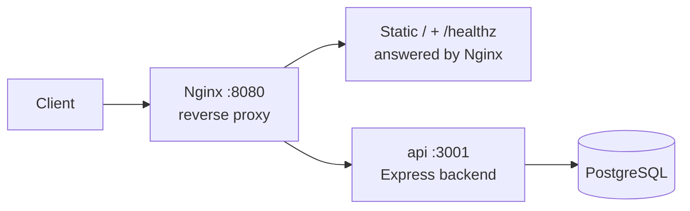
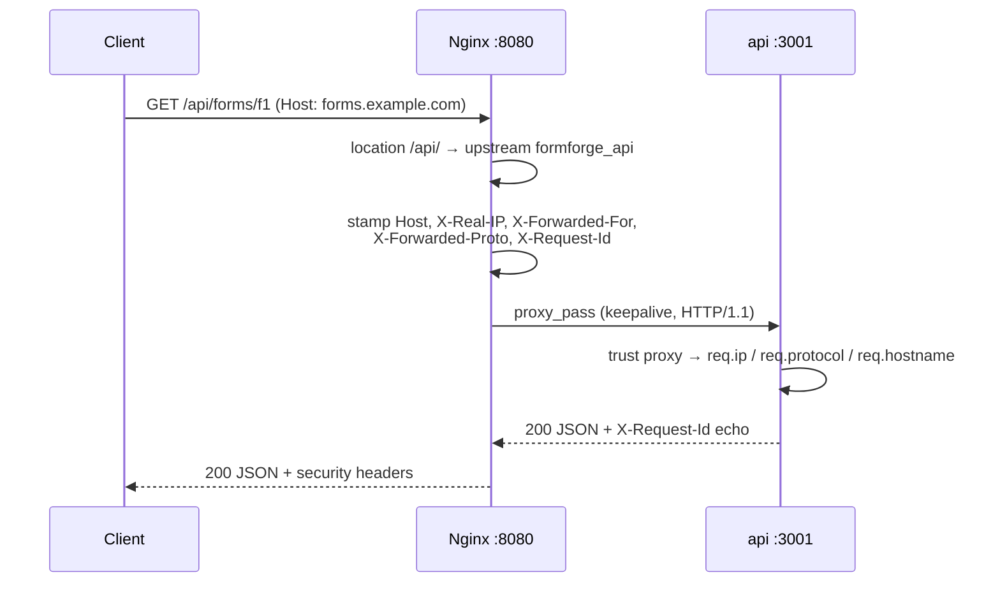

# Chapter 04 — Reverse Proxies

> **Part I — Traffic Management and Deployment**
> **Prerequisites:** Chapter 03 (Load Balancing) — this chapter reuses its Nginx + Express vocabulary (upstream, proxy_pass, forwarded headers) and narrows the focus from *many backends* to *one backend done right*. Helpful but not required: basic HTTP (methods, headers, status codes).
> **FormForge context:** the public API (`/api/*`) and the marketing page (`/`) now sit behind a single Nginx reverse proxy on `:8080`, with one FormForge API backend on `:3001`. Every header, timeout, size limit, and Upgrade handshake in this chapter is demonstrated by that proxy.

---

## 1. Definition and Fundamentals

### What it is

A **reverse proxy** is a server that sits in front of your application servers and forwards client requests to them. Clients talk to the proxy; the proxy talks to the app; the app never sees the raw internet. "Reverse" distinguishes it from a *forward* proxy (Section 2): a forward proxy sits in front of *clients* (your laptop's corporate proxy fetching the web on your behalf), while a reverse proxy sits in front of *servers* (Nginx fetching your API on the client's behalf).

Our implementation is the same pair the book standardizes on: **Nginx 1.24 (open source)** listening on `:8080`, forwarding to **one Node.js/Express backend** on `:3001`. No pool, no rotation — Chapter 03 covered distribution across three backends; this chapter covers everything the proxy does *besides* choosing between backends.

### Why it exists / what problem it solves

Exposing Node.js directly to the internet forces your application to do jobs it is bad at. A reverse proxy solves six problems at once:

1. **Edge defense** — reject oversized bodies (`client_max_body_size`), slow clients, and malformed requests before they reach your event loop.
2. **Identity plumbing** — stamp every proxied request with the real client address and scheme (`X-Real-IP`, `X-Forwarded-For`, `X-Forwarded-Proto`) so the app can log, rate-limit, and build URLs correctly.
3. **Timeout discipline** — bound how long one sick backend (or one slow client) can hold a connection (`proxy_connect/read/send_timeout`).
4. **Protocol upgrades** — translate WebSocket handshakes and (in production) terminate TLS, so Node serves plain HTTP/WS internally.
5. **Cheap request termination** — answer health checks, static pages, and redirects without waking the app at all.
6. **Operational seam** — one place to add structured access logs with upstream timing, security headers, and graceful config reloads.


### How it works internally (first pass)

1. Client sends `GET http://localhost:8080/api/forms/f1` to the proxy.
2. Nginx matches `location /api/` and selects the `formforge_api` upstream (here: the single backend `api:3001`).
3. It rebuilds the request toward the backend: same method + path, plus `Host`, `X-Real-IP`, `X-Forwarded-For`, `X-Forwarded-Proto`, and `X-Request-Id` headers.
4. The backend answers `200 {"id":"f1",...}`; Nginx adds security headers (`X-Content-Type-Options`, `X-Frame-Options`, `Referrer-Policy`) and returns the response untouched otherwise.
5. Requests that need no backend (`GET /healthz`, `GET /`) are answered by Nginx itself — the app is never contacted.

### Where it fits in the architecture



The proxy is the outermost layer you own: *outside* it is the CDN/DDoS provider (→ Chapter 75); *at* it live TLS, limits, routing, and logging; *behind* it are the app tier (→ Chapter 03 for multi-instance), the gateway productization (→ Chapter 05, API Gateways), and per-route rate limiting (→ Chapter 01).

### A real-world analogy

A **hotel front desk**. Guests (clients) never walk into the kitchen (your Node process) to order food — they tell the desk (the proxy), which writes down *who asked* (forwarded headers), checks the request is sane (size limits, timeouts), and either answers directly ("the pool is on floor 3" — static content) or passes the order back with the guest's room number attached. The kitchen cooks; it never manages the lobby.

### A production example (FormForge)

FormForge's public surface is two things: the marketing page (`/`, static, cacheable, high-traffic) and the API (`/api/*`, dynamic, authenticated in later chapters). Without a proxy, every marketing-page hit burns a Node event-loop turn. With one, Nginx answers `/` itself in microseconds while `/api/*` requests arrive at Express carrying the client's real IP and scheme — so submission logging, per-IP rate limiting (→ Chapter 01), and absolute-URL generation all see the truth instead of the proxy's address.

### When it is necessary / when it is unnecessary

**Reach for a reverse proxy when:** your app faces any untrusted network; you need TLS termination, header-based identity, request limits, static handling, or a single operational choke point for logging and reloads.

**Think twice when:**

- The service only ever receives calls from one trusted in-cluster caller over a private network — a proxy adds a hop for no threat model (revisit when callers multiply).
- You need *distribution across backends* specifically — that is → Chapter 03 (Load Balancing); a reverse proxy *can* forward to one backend, a load balancer *distributes* across many, and this chapter keeps the two jobs separate.
- Your platform already provides the proxy layer (Cloud Run, Fly, Vercel front-ends) — learn what it does for you (this chapter), then decide what remains yours to configure.

---

## 2. Types, Variants, and Classifications

### Forward vs reverse vs load balancer vs gateway (the distinction that matters)

| Role | Sits in front of | Picks between backends? | FormForge example |
|---|---|---|---|
| **Forward proxy** | Clients | No (fetches the web for you) | Corporate egress proxy (not ours) |
| **Reverse proxy** (this chapter) | Servers | No — forwards to *the* backend | Nginx `:8080` → `api:3001` |
| **Load balancer** (→ Chapter 03) | Server pools | **Yes** — round robin, least-conn | Nginx `:8080` → api-1/2/3 |
| **API gateway** (→ Chapter 05) | Product surface | Yes, plus auth/quotas/composition | Rate-limited, keyed, versioned API front door |

Overlap, stated precisely: every load balancer *contains* a reverse proxy (it must forward to forward), but a reverse proxy is *not* a load balancer until it distributes. Our Chapter 03 config was both at once; this chapter's config has a single-member upstream, so every behavior you observe is proxying, not balancing.

### By what the proxy terminates itself vs forwards

| Pattern | Nginx answers | Backend answers | Best when |
|---|---|---|---|
| **Full proxy** | Nothing (pure forwarder) | Everything | Backend owns all content; proxy is policy-only |
| **Edge termination** (ours) | `/`, `/healthz`, static, redirects | `/api/*`, `/ws` | Marketing + API share one origin |
| **TLS terminator** | Handshake, certs, redirect | Plain HTTP inside | Almost always in production (→ Chapter 71, TLS) |
| **Cache edge** | Repeat GETs | Misses only | Hot read paths (→ Chapter 02, → Chapter 48) |

### Decision guide

- One backend, need limits/headers/logging/TLS → **reverse proxy** (this chapter).
- Many identical backends, need distribution + exclusion → **add balancing** (→ Chapter 03).
- Many *different* backends with auth, quotas, versioning → **gateway** (→ Chapter 05).
- Clients needing controlled egress → **forward proxy** (different book, different team).

---

## 3. Internal Working and Architecture

### Request lifecycle through our proxy



Step by step:

1. **Match** the location. Exact matches (`= /healthz`, `= /`, `= /ws`) beat prefix matches (`/api/`); file order is irrelevant, specificity decides.
2. **Guard size first**: `client_max_body_size 256k` rejects oversized bodies with 413 before a single backend byte is spent.
3. **Stamp identity**: `Host $host` (the client's host, not `api:3001`), `X-Real-IP $remote_addr` (the direct peer Nginx sees), `X-Forwarded-For $proxy_add_x_forwarded_for` (**append** the peer to whatever the client sent), `X-Forwarded-Proto $scheme`, `X-Request-Id $request_id`.
4. **Forward** over a keepalive upstream connection (`proxy_http_version 1.1` + cleared `Connection` — without both, `keepalive 32` is accepted and silently does nothing).
5. **Bound the wait**: connect 2 s, read 10 s, send 5 s. A hung backend becomes a 504, never a hung client.
6. **Return** the backend's status and body untouched (our 404 contract test pins this), plus `always`-attached security headers and the request id.

### Forwarded headers and trust: the honest model

`$proxy_add_x_forwarded_for` expands to `$http_x_forwarded_for, $remote_addr` — the client's *claimed* chain, then the peer Nginx *actually* sees. Three consequences:

- A client can forge the head of `X-Forwarded-For` but never the tail: the proxy-appended address is authoritative.
- The app must read the **rightmost entry added by a proxy it controls**. Express's `trust proxy` setting is exactly that allowlist — `'loopback'` trusts only 127.0.0.1/::1 hops, so any other hop in the chain is treated as client-supplied.
- Our Compose trap, documented honestly in the README: in Docker the proxy arrives from the bridge network, not loopback, so with `TRUST_PROXY=loopback` Express ignores the forwarded headers and `req.ip` reports the bridge address. Host-level runs share one loopback, so reconstruction is exact. The fix in production is to restrict `trust proxy` to the proxy's real address — the forwarded-headers suite asserts the *append* property (forged `9.9.9.9` appears in the chain, but the real peer is also there), which is what makes any trust setting meaningful.

### TLS termination and the redirect loop

In production the proxy terminates TLS (`listen 443 ssl`) and the backend serves plain HTTP. Two rules our config encodes:

- The app derives scheme from `X-Forwarded-Proto`, never from its own socket — otherwise absolute URLs and secure-cookie decisions come out `http` behind an `https` edge.
- Redirect scheme **once, at the edge**. An app that redirects `http → https` behind a proxy that also redirects will loop until the client gives up. (Certificates are intentionally absent from this repo; TLS is → Chapter 71.)

### Buffering, keepalive, and timeouts as one system

| Knob | Ours | What it bounds |
|---|---|---|
| `client_max_body_size` | `256k` | Whether the body is accepted at all (413 beyond) |
| `proxy_connect_timeout` | `2s` | TCP handshake to the backend |
| `proxy_read_timeout` | `10s` (`1h` on `/ws`) | Silence between backend bytes |
| `proxy_send_timeout` | `5s` | Draining the request body to the backend |
| Upstream `keepalive` | `32` + HTTP/1.1 + cleared `Connection` | Reused backend connections |

Buffering honesty: Nginx buffers request bodies (to `client_body_temp_path`) and responses (to `proxy_temp_path`) by default. That is good for slow clients (the backend is freed early), bad for SSE/streaming (added latency) and large uploads (disk). Our example keeps defaults with a small body cap; streaming paths turn buffering off deliberately (→ Chapter 24, Server-Sent Events).

### WebSocket upgrade: three lines or nothing works

```nginx
proxy_http_version 1.1;
proxy_set_header Upgrade $http_upgrade;
proxy_set_header Connection "upgrade";
```

These convert the request into an Upgrade handshake the backend's `ws` server accepts. Without them the handshake dies with 400/426. Long-lived sockets also need `proxy_read_timeout 1h` on their location — the 10 s API timeout would otherwise kill idle connections (→ Chapter 22, WebSockets).

### Algorithms and complexity

Location matching is O(longest prefix) per request; header stamping O(number of headers); single-member upstream selection O(1). Memory is O(active connections + buffer size). The proxy adds one hop — sub-millisecond on localhost (hypothetical order of magnitude; measure yours by splitting `$request_time` vs `$upstream_response_time` in the `rp` log format).

### Configuration parameters (safe defaults used here)

| Parameter | Value | Why |
|---|---|---|
| `client_max_body_size` | `256k` | Abuse dies at the cheapest layer with 413 |
| `proxy_connect/read/send_timeout` | `2s` / `10s` / `5s` | No indefinite holds; `/ws` overrides read to `1h` |
| Forwarded headers | `Host`, `X-Real-IP`, XFF **append**, `X-Forwarded-Proto` | App reconstructs client truth; never blindly trusted |
| `X-Request-Id` | `$request_id`, both directions | One id across proxy and app logs |
| Security headers | `nosniff`, `DENY`, `no-referrer`, `always` | Defense on every response including error pages |
| Upstream keepalive | `32` + HTTP/1.1 + cleared `Connection` | The two companion lines are mandatory, not optional |

---

## 4. Practical Implementation

> **Runnable** — every code block exists in `book/code/04-reverse-proxies/` and was executed during writing (host-level: real Nginx 1.24 binary + real Node backend; `nginx -t` passed; 14/14 Vitest assertions passed through the live proxy; `docker compose config --quiet` passed. The Docker runtime path was not executed — sandbox daemon unavailable — stated honestly per → 00-standards §2.)

### Scenario

FormForge must present one origin (`forms.example.com`) serving both the marketing page and the API, forward only the API to Node, reconstruct client identity correctly, reject oversized uploads at the edge, and carry WebSocket upgrades — with every behavior testable.

### Requirements

**Functional:**

- Nginx on `:8080` (host variant `:8090`); one Express backend on `:3001` (host demo used `:3101` to avoid a port clash with Chapter 03's running stack — the code default is `3001`).
- `GET /healthz` and `GET /` answered by Nginx itself; `GET /api/*` and `GET /ws` proxied.
- Forwarded headers `Host`, `X-Real-IP`, `X-Forwarded-For` (append), `X-Forwarded-Proto`; correlation `X-Request-Id` both directions.
- `POST /api/upload` demonstrates `client_max_body_size` (413 at the edge for > 256k).
- WebSocket echo at `/ws` proving the three-line Upgrade stanza works end-to-end.
- Configuration validation command (`nginx -t`) documented before every start/reload.

**Non-functional:**

- Strict TypeScript; config read once at startup, fail fast; graceful shutdown (SIGTERM/SIGINT, 10 s hard exit).
- Security headers on every proxied response; JSON-only errors from the app (no stack traces).
- Visible test skips (never silent green) when the proxy is down; `REQUIRE_INFRA=1` for CI.

### Technology stack

| Piece | Choice | Why |
|---|---|---|
| Proxy | Nginx 1.24 open source | Book standard (→ 00-standards §1); no Plus features used |
| Backend | Node.js 22 / Express 4, TypeScript strict | Same stack as Chapters 01–03 |
| WS test client | `ws` 8.x | Minimal client for the upgrade round-trip test |
| Tests | Vitest 2 + supertest | Book harness; probe helper with `PROXY_PORT` override |

### Project structure

```
book/code/04-reverse-proxies/
├── docker-compose.yml          # proxy + api on the Compose network
├── Dockerfile                  # full install → tsc → prune → node dist/server.js
├── .dockerignore / .env.example / .gitignore
├── package.json / tsconfig.json
├── nginx/docker-nginx.conf     # conf.d variant (service-name upstream api:3001)
├── rp-nginx/nginx.conf         # standalone main config (host 127.0.0.1:3001)
├── src/config.ts               # PORT + TRUST_PROXY, fail-fast
├── src/app.ts                  # /healthz, /api/echo, /api/forms/:id, /api/upload, JSON 404
├── src/server.ts               # bootstrap + ws echo on /ws + graceful shutdown
└── test/
    ├── helpers/infra.ts        # probeProxy() with PROXY_PORT + REQUIRE_INFRA=1
    ├── proxy-routing.test.ts   # 5 tests: healthz, /api/, trailing slash, /, 404
    ├── forwarded-headers.test.ts # 4 tests: host/proto/ip, XFF spoof, request id, sec headers
    ├── proxy-limits.test.ts    # 2 tests: 413 oversize, 201 small body
    └── proxy-failure.test.ts   # 3 tests: ws echo, 404 passthrough, direct health control
```

### Configuration

The two Nginx variants share one policy; only the upstream address and the presence of the `events`/`http` wrapper differ:

```nginx
upstream formforge_api {
    server api:3001;        # host variant: 127.0.0.1:3001
    keepalive 32;           # needs HTTP/1.1 + cleared Connection below
}

server {
    listen 8080;            # host variant: 8090
    client_max_body_size 256k;
    proxy_connect_timeout 2s;
    proxy_read_timeout 10s;
    proxy_send_timeout 5s;

    proxy_set_header Host $host;
    proxy_set_header X-Real-IP $remote_addr;
    proxy_set_header X-Forwarded-For $proxy_add_x_forwarded_for;  # APPEND
    proxy_set_header X-Forwarded-Proto $scheme;
    proxy_http_version 1.1;
    proxy_set_header Connection "";

    add_header X-Content-Type-Options nosniff always;
    add_header X-Frame-Options DENY always;
    add_header Referrer-Policy no-referrer always;
    proxy_set_header X-Request-Id $request_id;
    add_header X-Request-Id $request_id always;

    location = /healthz { default_type text/plain; return 200 "proxy ok\n"; }
    location /api/       { proxy_pass http://formforge_api; }
    location = /         { default_type text/plain; return 200 "formforge...\n"; }
    location = /ws {
        proxy_pass http://formforge_api;
        proxy_http_version 1.1;
        proxy_set_header Upgrade $http_upgrade;
        proxy_set_header Connection "upgrade";
        proxy_read_timeout 1h;
    }
}
```

The Docker image supplies the main `events`/`http` wrapper, so `nginx/docker-nginx.conf` contains only the `upstream` + `server` blocks and mounts to `/etc/nginx/conf.d/default.conf`. `rp-nginx/nginx.conf` is a complete standalone main config (worker_processes, events, http, temp paths) for Docker-less runs. This separation is mandatory — the same file cannot serve both roles, and mixing them is Chapter 03's Case 2 trap in a new costume.


### Implementation (backend — runnable)

`src/config.ts` (full file): typed `AppConfig { port, trustProxy }`, `positiveInt` validation with fail-fast throw, `TRUST_PROXY` defaulting to `'loopback'`.

`src/app.ts` — the observables this chapter's tests assert against:

```typescript
export function createApp(deps: AppDeps): express.Express {
  const app = express();
  app.disable('x-powered-by');
  app.set('trust proxy', deps.config.trustProxy);   // allowlist, not 'true'
  app.use(express.json({ limit: '64kb' }));         // defense behind 256k edge

  app.get('/healthz', (_req, res) => {
    res.status(200).json({ status: 'ok' });
  });

  app.get('/api/echo', (req, res) => {
    res.status(200).json({
      ip: req.ip,                 // rightmost trusted hop (trust proxy)
      protocol: req.protocol,     // X-Forwarded-Proto or 'http'
      host: req.hostname,         // X-Forwarded Host
      forwardedFor: req.headers['x-forwarded-for'] ?? null,
      realIp: req.headers['x-real-ip'] ?? null,
    });
  });

  app.get('/api/forms/:formId', (req, res) => {
    res.status(200).json({
      id: req.params.formId,
      title: 'Contact us',
      seenHost: req.hostname,       // proves Host survived the hop
      seenProtocol: req.protocol,
    });
  });

  app.post('/api/upload', (req, res) => {
    res.status(201).json({ receivedBytes: Number(req.headers['content-length'] ?? 0) });
  });

  app.use('/api', (_req, res) => {  // JSON-only 404, never a stack trace
    res.status(404).json({ error: 'not_found' });
  });
  return app;
}
```

`src/server.ts` — bootstrap + WebSocket echo + graceful shutdown:

```typescript
const server = createServer(app);
const wss = new WebSocketServer({ server, path: '/ws' });
wss.on('connection', (socket) => {
  socket.on('message', (data) => socket.send(`echo:${data.toString()}`));
});
server.listen(config.port, () => { /* JSON listening line */ });

function shutdown(signal: string): void {
  server.close(() => process.exit(0));
  setTimeout(() => process.exit(1), 10_000).unref();  // hard cap
}
process.on('SIGTERM', () => shutdown('SIGTERM'));
process.on('SIGINT', () => shutdown('SIGINT'));
```

### Execution (host-level, actually run)

```bash
cd book/code/04-reverse-proxies
npm install && npx tsc
PORT=3101 TRUST_PROXY=loopback node dist/server.js &
nginx -t -c $PWD/rp-nginx/nginx.conf          # syntax check BEFORE start — always
nginx -c $PWD/rp-nginx/nginx.conf             # proxy on :8090 (host variant)
```

Smoke, observed:

```
$ curl -s http://127.0.0.1:8090/healthz   # proxy ok        (Nginx itself)
$ curl -s http://127.0.0.1:8090/          # formforge: create forms...
$ curl -s http://127.0.0.1:8090/api/forms/f1
{"id":"f1","title":"Contact us","seenHost":"127.0.0.1","seenProtocol":"http"}
$ curl -s http://127.0.0.1:8090/api/echo
{"ip":"127.0.0.1","protocol":"http","host":"127.0.0.1","forwardedFor":...}
```

### Testing

`test/helpers/infra.ts` probes `127.0.0.1:$PROXY_PORT/healthz` (default 8080; `PROXY_PORT=8090` for host runs): reachable → suites run; unreachable → loud warning + visible `SKIPPED:` suites; `REQUIRE_INFRA=1` → throw.

Execution evidence (host-level: real Nginx 1.24 + real backend on 3101):

```
$ npx tsc --noEmit          # clean
$ nginx -t -c rp-nginx/nginx.conf
nginx: configuration file ... test is successful
$ REQUIRE_INFRA=1 PROXY_PORT=8090 npx vitest run
 Test Files  4 passed (4)
      Tests  14 passed | 4 skipped (18)
```

The 4 skipped are the `up === false` skip-marker suites (inert when infra is up). `docker compose config --quiet` also passed (syntax); the Docker *runtime* path is unverified here — sandbox daemon unavailable. WebSocket echo through the proxy passed as part of the 14.

### Expected result (representative)

- 6 routing tests green: `/healthz` + `/` answered by Nginx, `/api/*` forwarded, trailing slash consistent, unknown `/api/*` → JSON 404.
- 4 header tests green: Host/proto/IP reconstructed; forged `X-Forwarded-For: 9.9.9.9` appears in the chain **and** the real peer is appended after it (append-not-replace); `X-Request-Id` is a 32-hex id; security headers present.
- 2 limit tests green: 300 KiB body → 413 at the edge; small body → 201 from the app.
- 3 failure-contract tests green: WS echo round trip, 404 passthrough, direct-backend control.

### Design decisions

- **Single-member upstream, deliberately.** Chapter 03 already taught distribution; freezing the pool at one member makes every observed behavior pure *proxying* (headers, limits, upgrades), which is this chapter's subject.
- **`trust proxy` as an allowlist, never `true`.** `'true'` trusts every hop including client-supplied headers — the spoofing hole the interview questions drill. The README's Compose note is the honest cost of a conservative allowlist.
- **`$proxy_add_x_forwarded_for` (append) over `$remote_addr` (replace).** Append preserves the audit chain; the rightmost entry is the truth. The spoof test pins this.
- **`default_type text/plain` over `add_header Content-Type`.** With `return`, the `add_header` form produced a dual `application/octet-stream,text/plain` header that broke strict clients (observed during validation, then fixed); `default_type` is the correct directive for `return`-generated bodies.
- **WebSocket on the same port.** Separate ports would hide the Upgrade-hop behavior this chapter exists to demonstrate; the `ws` client test proves the three-line stanza.

---

## 5. Production-Ready Implementation

What changes before this demo serves real traffic:

- **TLS termination** with real certificates (ACME, cert-manager) and an `http → https` redirect at the edge only (→ Chapter 71, TLS). Backend stays plain HTTP inside the VPC.
- **`trust proxy` pinned to the proxy's real address** (an IP/CIDR or `uniquelocal`), never `'true'` or `'loopback'` when the proxy is not on loopback — the Compose trap above is the live example.
- **Rate limiting at the edge** keyed on the trusted client IP (→ Chapter 01) and per-route policy.
- **Active health checks** against `/healthz` plus a deeper readiness signal (→ Chapter 56); `proxy_next_upstream` policy from Chapter 03 if the pool grows beyond one.
- **Observability:** the `rp` log format ships `up`, `us`, `rt`, `urt` — wire those into Prometheus (nginx-vts or an exporter) and alert on 502/504 rate and `urt` P95 (→ Chapters 58–62). Correlate `X-Request-Id` across proxy, app logs, and traces (→ Chapter 60).
- **Graceful reloads:** `nginx -t` then `nginx -s reload` in deploy pipelines — reload is zero-downtime by design; a bad config must never reach `reload` (Section 9).
- **Secrets/certs** via the orchestrator's secret store, never baked into images (→ Chapter 67).
- **Cost:** one Nginx process is cheap; the real cost is the operational surface (config drift between the two variants, cert expiry) — automate both (→ Chapter 88).

---

## 6. Edge Cases and Failure Scenarios

### Case 1 — Client IP spoofing via trusted `trust proxy`
- **Scenario:** `trust proxy` set to `'true'`/`1/1`; attacker sends `X-Forwarded-For: 1.2.3.4` and bypasses per-IP rate limits or forges audit logs.
- **Cause:** Express trusts every hop, so the client's claimed header becomes `req.ip`.
- **Impact:** audit logs lie; rate limiting (→ Chapter 01) counts the wrong key; security decisions rest on attacker-controlled data.
- **Detect:** log `req.ip` vs the socket address; look for impossible geography in access patterns.
- **Prevent/mitigate:** allowlist the proxy's real address; read the rightmost *trusted* hop; the proxy must **append** (`$proxy_add_x_forwarded_for`), never replace. Our spoof test asserts the appended peer survives a forged head.
- **Test the fix:** `forwarded-headers.test.ts` — send `X-Forwarded-For: 9.9.9.9`, assert the real peer is also present and last.

### Case 2 — Redirect loop behind TLS termination
- **Scenario:** browser spins forever between `http://` and `https://`.
- **Cause:** both the proxy and the app redirect scheme; each hop undoes the other.
- **Impact:** total user-visible outage for the affected route.
- **Detect:** repeated 301/302 pairs in the proxy log with no terminal 200.
- **Prevent/mitigate:** redirect once, at the edge; backend never scheme-redirects; derive `req.protocol` from `X-Forwarded-Proto` only.
- **Test the fix:** a curl asserting a single hop to the canonical scheme (manual in this repo — TLS not exercised).

### Case 3 — Keepalive silently inert
- **Scenario:** upstream `keepalive 32` configured; connection churn stays high; `TIME_WAIT` count climbs.
- **Cause:** without `proxy_http_version 1.1` and a cleared `Connection` header, Nginx cannot reuse upstream connections (Chapter 03 Case 4, revisited).
- **Impact:** extra TCP handshakes per request; tail-latency regression under load.
- **Detect:** connection-per-request ratio in the backend's socket stats.
- **Prevent/mitigate:** always ship the two companion lines; our config comments them as mandatory.
- **Test the fix:** not measured here (hypothetical) — a load test comparing connection counts, per Section 8's method.

### Case 4 — Oversized body accepted by the proxy, then OOMs the app
- **Scenario:** a 100 MB upload sails past the proxy (no `client_max_body_size`), exhausts Node's memory.
- **Cause:** Nginx's default is 1 MB, but a zero/disabled value (or unlimited buffering to disk) lets huge bodies through.
- **Impact:** backend OOMKill; event-loop stall for every other request.
- **Detect:** memory graphs, 502 spikes after large POSTs.
- **Prevent/mitigate:** explicit small `client_max_body_size` (ours: 256k); app-level `express.json` limit as second line (ours: 64kb); real upload routes elsewhere with streaming + auth (→ Chapter 44, Backpressure).
- **Test the fix:** `proxy-limits.test.ts` — a 300 KiB body must produce 413 from Nginx, never reaching the app.


### Case 5 — WebSocket upgrade returns 400/426
- **Scenario:** socket client connects; handshake fails; the app's `ws` server never sees a connection.
- **Cause:** missing `Upgrade`/`Connection` header forwarding, or HTTP/1.0 to the upstream (the three-line stanza, Section 3).
- **Impact:** live features (→ Chapter 22) dead behind the proxy while direct connections work.
- **Detect:** 400/426 in the proxy log on `/ws`; works on `:3001` direct, fails on `:8080`.
- **Prevent/mitigate:** the exact three lines in our `location = /ws`; plus `proxy_read_timeout 1h` so idle sockets survive.
- **Test the fix:** `proxy-failure.test.ts` — WS echo round trip through the proxy.

### Case 6 — Trailing-slash rewrite changes the path the backend sees
- **Scenario:** `/api/forms/f1/` reaches the backend as a different route (or 404s) than `/api/forms/f1`.
- **Cause:** `proxy_pass http://upstream/;` (with a URI part) makes Nginx **replace** the matched prefix — documented behavior that silently rewrites paths.
- **Impact:** routes mysteriously missing only through the proxy; hard-to-find 404s.
- **Detect:** diff direct-vs-proxied responses for both spellings.
- **Prevent/mitigate:** `proxy_pass` without a URI part (ours) preserves the original path; if you must rewrite, test both slash spellings explicitly.
- **Test the fix:** `proxy-routing.test.ts` — assert equal status for `/api/forms/f1` and `/api/forms/f1/`.

### Case 7 — Backend down: proxy 502 with an opaque body
- **Scenario:** `api` container stops; every `/api/*` request returns Nginx's default 502 page (HTML, no app shape).
- **Cause:** upstream connection refused; Nginx answers with its own error page.
- **Impact:** clients expecting JSON get HTML; client-side error handling breaks.
- **Detect:** 502 spike in the `rp` log with `us=-` (no upstream status).
- **Prevent/mitigate:** custom `error_page 502 503 504` returning a JSON envelope; active health checks (→ Chapter 56) so the operator learns first.
- **Test the fix:** README smoke steps (stop `api`, observe 502, start, observe recovery) — manual and honest, not claimed as an automated pass here.

### Case 8 — Nginx reload with a bad config kills the fleet
- **Scenario:** a deploy ships a config with a typo; `nginx -s reload` fails; the master exits or keeps stale state.
- **Cause:** reload without a preceding `nginx -t`; workers torn down before the new config validates.
- **Impact:** outage caused by the *fix*, not the feature.
- **Detect:** deploy pipeline green but proxy 502; `error.log` shows `[emerg]`.
- **Prevent/mitigate:** always `nginx -t` then `reload`; treat `-t` failure as a pipeline red (Section 9's command).
- **Test the fix:** corrupt a copy, run `nginx -t`, assert non-zero exit (Exercise 2).

---

## 7. Common Mistakes and Anti-Patterns

### Mistake 1 — `trust proxy true` because "there's a proxy, obviously"
- **Wrong approach:** `app.set('trust proxy', true)` the moment Nginx exists.
- **Why devs choose it:** it makes `req.ip` "look right" in every local test, immediately.
- **Why it fails:** `'true'` trusts *every* hop, including attacker-supplied headers — Case 1. The correct setting is an allowlist of your proxy's real addresses.
- **Real-world consequence:** per-IP rate limits (→ Chapter 01) and audit logs defeated by one forged header.

### Mistake 2 — `proxy_pass http://upstream/;` with a trailing slash, everywhere
- **Wrong approach:** copying the trailing-slash form "because tutorials have it."
- **Why devs choose it:** it strips the prefix in the one tutorial they copied — which is exactly the behavior they didn't want to silently inherit.
- **Why it fails:** with a URI part, Nginx *replaces* the matched prefix — paths change behind your back (Case 6); without one, the original path is preserved.
- **Real-world consequence:** routes that work on `:3001` and 404 on `:8080`, bisected only by diffing both responses.

### Mistake 3 — trusting `X-Forwarded-Proto` without a proxy that sets it
- **Wrong approach:** app reads `req.protocol` but no proxy stamps `X-Forwarded-Proto`.
- **Why devs choose it:** works locally on plain HTTP where `req.protocol` is already `http`.
- **Why it fails:** behind TLS termination the app builds `http://` absolute URLs and drops secure cookies — mixed-content warnings and session bugs.
- **Real-world consequence:** login loops and broken redirects the moment HTTPS goes live; Case 2's loop when the app "fixes" it with its own redirect.
- **Correct alternative:** stamp `X-Forwarded-Proto $scheme` at the proxy (ours) and redirect scheme once, at the edge.


### Mistake 4 — WebSocket "works locally" without the Upgrade stanza
- **Wrong approach:** backend runs the socket server; no proxy between client and server in dev; ship.
- **Why devs choose it:** local dev usually skips the proxy tier, so nothing complains.
- **Why it fails:** the first deploy behind Nginx kills the handshake with 400/426 (Case 5) — the proxy must forward `Upgrade`/`Connection` on HTTP/1.1.
- **Real-world consequence:** the demo works, production chat/live features never connect; the bug is discovered by users, not CI.

### Mistake 5 — no `client_max_body_size`, then "why did Node OOM?"
- **Wrong approach:** rely on Nginx's default (1 MB) or leave it unset while the app accepts unbounded bodies.
- **Why devs choose it:** bodies are small in dev; the limit feels like arbitrary friction.
- **Why it fails:** one crafted upload is a memory-exhaustion DoS (Case 4) — the edge is the cheapest place to say 413.
- **Real-world consequence:** backend restarts under memory pressure from requests that should never have been accepted.

### Mistake 6 — reading local-dev distribution as production proof
- **Wrong approach:** "`/api/echo` shows the right IP on my laptop, so the proxy is production-ready."
- **Why devs choose it:** the host-level loopback *does* reconstruct identity exactly — our own demo proves it.
- **Why it fails:** single host, no TLS, no slow clients, no cert expiry, no config drift between variants; Compose's bridge network already breaks the loopback assumption we documented.
- **Correct alternative:** treat Section 4 as behavioral proof of the mechanics; Section 5 is the checklist before load or trust claims (stated in the README's Honest notes).


---

## 8. Performance and Scalability

- **Per-request cost:** location match O(longest prefix) + header stamping + one upstream hop. On localhost the hop is sub-millisecond (hypothetical order of magnitude — measure with `$request_time` vs `$upstream_response_time` in the `rp` log).
- **Throughput shape:** Nginx is event-driven; one worker handles thousands of idle keepalive connections cheaply. For stateless backends, proxy capacity far exceeds app capacity in practice — the app saturates first.
- **Bottlenecks, in order:** backend event-loop saturation → large-body buffering to disk (`client_body_temp_path`) → TLS handshake CPU (when terminated here) → worker connection limits (`worker_connections 1024`).
- **Buffering trade-off (explicit):** default buffering protects the backend from slow clients but adds latency to streams; `proxy_buffering off` (or `X-Accel-Buffering: no` per response) is the deliberate choice for SSE/chunked paths (→ Chapter 24).
- **Scaling strategies:** more workers/CPU at the proxy; then a second proxy behind DNS or a cloud LB (→ Chapter 03 for the pool, → Chapter 86 for regions); never one proxy per backend (fan-out cost).
- **Benchmarking method:** `k6` or `autocannon` against the proxy while the backend sleeps; assert proxy overhead as the delta. No load numbers are claimed here — none were measured.

---

## 9. Testing and Debugging

| Layer | What | Command / file |
|---|---|---|
| Typecheck | Strict TS, no emit | `npm run typecheck` |
| Routing | 5 tests: healthz, /api/, trailing slash, /, JSON 404 | `test/proxy-routing.test.ts` |
| Forwarded headers | 4 tests: host/proto/ip, XFF spoof, request id, sec headers | `test/forwarded-headers.test.ts` |
| Limits | 413 oversize; 201 small body | `test/proxy-limits.test.ts` |
| Upgrade + contract | WS echo; 404 passthrough; direct control | `test/proxy-failure.test.ts` |
| Infra probe | `GET 127.0.0.1:$PROXY_PORT/healthz`, 1 s timeout | `test/helpers/infra.ts` |
| CI mode | Fail loudly without infra | `REQUIRE_INFRA=1 npm test` |
| Local mode | Visible skips without infra | `npm test` |
| Compose validity | Parses (no daemon needed) | `docker compose config --quiet` |
| Nginx syntax | Validates before start/reload | `nginx -t -c rp-nginx/nginx.conf` |

**Debug commands:**

```bash
docker compose ps                       # both Up?
docker compose logs proxy               # us=- / connect() failed lines (Case 7)
docker compose logs api                 # app errors, missing request ids
curl -sI http://localhost:8080/api/forms/f1 | grep -i x-request-id
curl -s http://localhost:3001/api/forms/f1 # bypass proxy: backend alive?
```

**Expected failure signals:** 502/504 through `:8080` with a healthy `:3001` → upstream addressing or timeout config. 400/426 only on `/ws` → missing Upgrade stanza (Case 5). Route 404s only through the proxy → `proxy_pass` URI rewrite (Case 6). `req.ip` = proxy address in app logs → `trust proxy` allowlist misses the proxy (Case 1).

---

## 10. Follow-Up Interview Questions

### Level 1 — Fundamentals

**Q1. Reverse proxy vs forward proxy — one sentence.**
*Answer:* a reverse proxy sits in front of *servers* and fetches your app on the client's behalf; a forward proxy sits in front of *clients* and fetches the web on their behalf.
*Reasoning:* the "which side does it shield" framing; our Nginx is reverse.
*Example:* Nginx `:8080 → api:3001`.
*Common wrong answer:* "A reverse proxy is just a load balancer" — it may forward to one backend (Case: our single-member upstream).
*Follow-up:* when does a reverse proxy become a load balancer? (When it distributes — Chapter 03.)

**Q2. What does `client_max_body_size 256k` actually do?**
*Answer:* Nginx rejects request bodies larger than 256 KB with 413 before the request reaches the backend.
*Reasoning:* edge-first cost rejection; the cheapest place to spend a rejection.
*Example:* our 300 KiB test POST → 413 from Nginx, zero backend bytes.
*Common wrong answer:* "It limits the response size" — that is not what it controls.
*Follow-up:* what is the app's second-line limit here? (`express.json({ limit: '64kb' })`.)

**Q3. Why does the app need `trust proxy` at all?**
*Answer:* behind a proxy, the socket address is the proxy's; the real client is in forwarded headers, which must be trusted *selectively* or `req.ip` is either the proxy (useless) or the attacker (dangerous).
*Reasoning:* the identity-reconstruction problem; the allowlist is the fix.
*Example:* `'loopback'` in our Compose — and the README's honest note that Compose's bridge breaks the loopback assumption.
*Common wrong answer:* "It's a performance setting." It is not.
*Follow-up:* what's wrong with `trust proxy: true`? (Level 2, Q4.)

### Level 2 — Applied

**Q4. An attacker sends `X-Forwarded-For: 9.9.9.9`. What does your stack do?**
*Answer:* Nginx *appends* the real peer (`$proxy_add_x_forwarded_for`), so the chain becomes `9.9.9.9, <real>`; the app must read the rightmost trusted hop, making the forged head harmless.
*Reasoning:* append-not-replace is the property our spoof test asserts.
*Example:* `forwarded-headers.test.ts` asserts `9.9.9.9` is present AND the last entry is not `9.9.9.9`.
*Common wrong answer:* "Set `trust proxy false`" — then the app can never see the real client either; allowlist, don't disable.
*Follow-up:* how many hops do you trust, and why that number?

**Q5. WebSocket works direct on `:3001` but 400s through `:8080`. Why?**
*Answer:* the proxy isn't forwarding the Upgrade handshake — it needs `proxy_http_version 1.1`, `Upgrade $http_upgrade`, and `Connection "upgrade"` on that location.
*Reasoning:* Case 5; also HTTP/1.0 upstreams can't upgrade.
*Example:* our `location = /ws` stanza + `ws` client echo test.
*Common wrong answer:* "Raise `proxy_read_timeout`" — that fixes idle kills, not handshakes.
*Follow-up:* why the separate `proxy_read_timeout 1h` too?

**Q6. How do you avoid an http→https redirect loop behind TLS termination?**
*Answer:* redirect scheme exactly once, at the edge; the backend never scheme-redirects and derives scheme only from `X-Forwarded-Proto`.
*Reasoning:* Case 2; each layer "fixing" the scheme undoes the other.
*Example:* our config stamps `X-Forwarded-Proto $scheme`; app reads `req.protocol`.
*Common wrong answer:* "Add another redirect in the app" — that's the loop.
*Follow-up:* what breaks if `X-Forwarded-Proto` is missing entirely? (Absolute URLs come out `http`; secure cookies dropped — Q3/Mistake 3.)


### Level 3 — Judgment

**Q7. Buffering on or off for your API responses?**
*Answer:* on by default (protects the backend from slow clients); off *only* for streaming/SSE routes where added latency matters more than backend protection.
*Reasoning:* the explicit trade-off from Section 8; one policy does not fit both.
*Example:* our API keeps defaults; SSE chapters (→ Chapter 24) flip it.
*Common wrong answer:* "off everywhere because buffering is bad" — invites slow-client resource exhaustion.
*Follow-up:* how would you detect buffering hurting your P99? (`urt` vs `rt` split in the `rp` log.)

**Q8. Your `keepalive 32` shows no effect. Diagnose.**
*Answer:* the two companion lines are missing — upstream keepalive requires HTTP/1.1 and a cleared `Connection` header (Case 3; Chapter 03 Case 4).
*Reasoning:* the directive is accepted and silently ignored without them — a documented footgun.
*Example:* our config ships `proxy_http_version 1.1` + `Connection ""` beside the pool.
*Common wrong answer:* "raise keepalive to 256" — same silence, bigger number.
*Follow-up:* how would you prove it works? (Connection-per-request ratio.)

**Q9. You must strip the `/api` prefix before the backend. How, and what must you test?**
*Answer:* use a `proxy_pass` *with* a URI part (`http://upstream/`) — the documented rewrite — but then test both trailing-slash spellings, because prefix replacement changes what the backend sees (Case 6 / Mistake 2).
*Reasoning:* knowing *when* the rewrite is deliberate vs accidental is the skill.
*Example:* our config deliberately avoids rewriting (no URI part) and pins both spellings to equal status.
*Common wrong answer:* "just copy the trailing-slash form" — inherits silent rewriting.
*Follow-up:* which form preserves the original path exactly? (No URI part.)

### Level 4 — Architecture

**Q10. Design the proxy tier for a service with 3 backends, TLS, and SSE endpoints.**
*Answer:* one Nginx (or a pair behind DNS) terminating TLS; upstream with keepalive + Chapter 03's balancing/exclusion policy over the 3 backends; `trust proxy` allowlisted to the proxy CIDR; default buffering with per-route `proxy_buffering off` on SSE locations; `X-Request-Id` correlation; structured `rp`-style logs wired to metrics; `nginx -t`-gated reloads in the pipeline.
*Reasoning:* forces composition of Ch 03 + 04 + streaming + trust — the real shape.
*Example:* our single-backend config is the seed; add members + health policy.
*Common wrong answer:* "put a proxy per backend" — fan-out without benefit.
*Follow-up:* where do you put the rate limiter? (Edge, → Chapter 01, keyed on trusted IP.)

**Q11. Your proxy config has two variants (Docker conf.d + standalone). How do you stop drift?**
*Answer:* one source of truth (a shared snippet or a generator); CI runs `nginx -t` on *both* shapes; the difference is limited to the wrapper blocks and the upstream address, never policy.
*Reasoning:* Case 8 / Mistake 6 — drift is an operational hazard, not a style issue.
*Example:* our two files share one policy; validation runs `nginx -t` on the standalone and `docker compose config` on the Docker shape.
*Common wrong answer:* "they're only used in different envs, drift is fine" — the prod incident starts as a dev-only config difference.
*Follow-up:* what single tool command catches most drift? (`nginx -t` in CI on every variant.)

### Level 5 — System Design

**Q12. Design FormForge's edge for 100× traffic with untrusted clients.**
*Answer:* CDN/edge caches static + public form pages (→ Chapters 48–49); the origin is a reverse-proxy pair terminating TLS, rate-limiting per trusted IP (→ Chapter 01) and per key (→ Chapter 05), enforcing body/time limits, forwarding identity with append-only XFF; behind them, the balanced stateless API (→ Chapter 03) with active health checks (→ Chapter 56); the app trusts the proxy address allowlist only, logs `X-Request-Id` end-to-end, and derives scheme from `X-Forwarded-Proto`; error budgets decide how conservative limits may be (→ Chapters 63–65).
*Reasoning:* composes the whole traffic-survival kit around the proxy as the choke point.
*Common wrong answer:* "a bigger Node process, no proxy" — every lesson in this chapter is then your app's problem.
*Follow-up:* what fails first in that design, and what metric says so? (Proxy `urt` P95 + 502 rate; app event-loop lag — Chapters 92–93.)


---

## 11. Scenario-Based Engineering Problems

### Scenario A — New marketing domain behind the same API origin
- **Problem:** FormForge moves marketing to `www.formforge.com` while the API stays on `api.formforge.com`; both must share the proxy but the app must see the correct `Host` for absolute URLs and CORS.
- **Constraints:** no app redeploy allowed (proxy-only change); both domains must carry the forwarded identity headers.
- **Options:** (1) two `server` blocks, one per `server_name`, sharing the same upstream; (2) one block with a wildcard `server_name` and Host passthrough; (3) per-domain upstreams.
- **Recommended:** (1) — explicit `server_name` blocks are the readable, auditable form; both stamp the same forwarded headers; Host passthrough (`proxy_set_header Host $host`) keeps `req.hostname` correct per domain.
- **Trade-offs:** (2) is fewer lines but hides the domain policy; (3) is unnecessary unless backends differ per domain.
- **Failure scenarios:** missed `X-Forwarded-Proto` on one block → that domain alone gets `http` URLs (Mistake 3); forgot `server_name` → the default block silently catches stray Host values.
- **Testing strategy:** assert `req.hostname` per domain through the proxy (extend `forwarded-headers.test.ts`'s Host test with a second `server_name`).

### Scenario B — SSE endpoint added to an API behind the proxy
- **Problem:** analytics live-updates use SSE; the stream delivers the first byte fast but the proxy buffers, so clients see nothing for seconds.
- **Constraints:** same proxy; other routes must keep default buffering (slow-client protection).
- **Options:** (1) `proxy_buffering off` on the SSE location; (2) `X-Accel-Buffering: no` from the app per response; (3) buffer everywhere and accept latency.
- **Recommended:** (1) at the location (auditable, config-level); (2) as a per-response refinement when only *some* routes stream.
- **Trade-offs:** off-buffering returns slow-client protection to the app — backpressure is now the app's job (→ Chapter 44).
- **Failure scenarios:** disabling buffering globally (Mistake-scale error) re-exposes the app to slow clients on non-streaming routes; a load balancer that *re-enables* buffering silently (per-hop behavior — read its docs).
- **Testing strategy:** k6 SSE scenario asserting time-to-first-byte; assert a non-streaming route's slow-client behavior is unchanged.

### Scenario C — Client IP spoofing escapes staging into prod
- **Problem:** staging set `trust proxy: true` "for the demo"; prod copied the app config; a partner integration starts forging `X-Forwarded-For` to scrape behind per-IP limits.
- **Constraints:** prod traffic is already flowing; audit logs have been untrustworthy for days.
- **Options:** (1) flip `trust proxy` to an allowlist now; (2) fix the proxy to overwrite XFF instead of appending; (3) add WAF rules for forged headers.
- **Recommended:** (1) immediately (restore trustworthy identity), then (3) as defense-in-depth; (2) is *wrong* here — overwrite destroys the audit chain and breaks the multi-hop model the book standardizes on.
- **Trade-offs:** (1) requires knowing the proxy's real address (the Compose trap is the rehearsal); (3) costs false-positive tuning.
- **Failure scenarios:** allowlisting too broadly (`uniquelocal` when other services share the subnet) re-opens the hole; rotating proxy IPs without updating the allowlist silently drops trust.
- **Testing strategy:** replay the spoof test (forged XFF + real peer assertion) against the prod-shaped config in CI with `REQUIRE_INFRA=1`.


---

## 12. Hands-On Exercises

### Beginner — Prove the hop happened
- **Task:** bring the stack up; through the proxy, fetch `/`, `/healthz`, and `/api/forms/f1`; show which layer answered each.
- **Hints:** `/` and `/healthz` are answered by Nginx (`proxy ok`, the marketing line); `/api/*` returns JSON with `seenHost`.
- **Acceptance criteria:** three curls; the first two return Nginx's plain text, the third returns the backend's JSON; you can explain why no backend was contacted for the first two.

### Intermediate — Forge a header and watch the proxy correct it
- **Task:** send `GET /api/echo` through the proxy with a forged `X-Forwarded-For: 9.9.9.9`; show the app's view of the chain; then explain what `req.ip` would be under `'loopback'` vs `'true'`.
- **Hints:** `curl -H "X-Forwarded-For: 9.9.9.9" .../api/echo`; the last chain entry is the proxy-added peer.
- **Acceptance criteria:** the echoed `forwardedFor` contains `9.9.9.9` AND a second, real address after it; a written statement of what each `trust proxy` setting would do with that chain.

### Advanced — Kill the upgrade, then fix it
- **Task:** copy `rp-nginx/nginx.conf`, delete the three-line Upgrade stanza from `location = /ws`, validate with `nginx -t`, run the WS test, observe the failure; then restore the stanza and show the test passing again.
- **Hints:** `nginx -t -c <corrupt copy>` must still pass syntax (the stanza isn't a syntax error); the *behavior* test is what fails.
- **Acceptance criteria:** a recorded failing WS round trip with the stanza removed and a passing one with it restored, plus one sentence on why `proxy_read_timeout 1h` must stay regardless.

### Solutions

- **Beginner:** the README's first three curls are the solution; the split is `location = /healthz` + `location = /` (Nginx) vs `location /api/` (proxied) — Section 3, step 1.
- **Intermediate:** the `forwarded-headers.test.ts` spoof test is the checkable version — the chain keeps the forged head *and* the real tail because `$proxy_add_x_forwarded_for` appends; `'loopback'` trusts only loopback hops so a remote forged head is ignored for `req.ip`, while `'true'` would trust it (Case 1).
- **Advanced:** the WS echo test in `proxy-failure.test.ts` is the assertion; removing the stanza makes the handshake fail with 400/426 (Case 5) while `nginx -t` still passes — proving syntax validation alone can't catch *behavioral* config regressions, which is why the test suite exists alongside `nginx -t`.


---

## 13. Chapter Summary and Revision Notes

### Five key takeaways

1. A reverse proxy forwards *one* backend's traffic and owns the edge (limits, headers, TLS, static); a load balancer additionally distributes across many — same tool, different job (→ Chapter 03).
2. Forwarded headers are an **append-only audit chain**; the app trusts only hops it controls via a `trust proxy` allowlist — never `'true'`.
3. Keepalive needs HTTP/1.1 + cleared `Connection`; WebSocket upgrade needs `Upgrade`/`Connection` forwarding; both are silent-failure footguns without their companion lines.
4. Reject oversized bodies and bound timeouts at the edge — the cheapest 413 and 504 you'll ever spend (Mistakes 3, 5).
5. `nginx -t` gates every start/reload, but syntax validation cannot catch *behavioral* regressions — the test suite runs against the live proxy for that reason (Exercise 3).

### Quick revision sheet

| Item | Value / rule |
|---|---|
| Proxy role | forward one backend + own the edge (headers, limits, TLS, static) |
| Our topology | Nginx `:8080` → `api:3001` (host `:8090`/`:3101`) |
| Forwarded identity | `Host`, `X-Real-IP`, XFF **append**, `X-Forwarded-Proto`, `X-Request-Id` |
| Trust | `trust proxy` = allowlist of the proxy's real address; never `'true'` |
| Limits | `client_max_body_size 256k`; connect/read/send `2s`/`10s`/`5s` (`1h` on `/ws`) |
| Keepalive needs | `proxy_http_version 1.1` + cleared `Connection` |
| WS upgrade needs | `Upgrade $http_upgrade` + `Connection "upgrade"` + HTTP/1.1 |
| Path preservation | `proxy_pass` **without** a URI part preserves the original path |
| Validation | `nginx -t` before start/reload; tests assert *behavior*, not just syntax |
| Test bounds | 14 assertions across 4 suites; WS echo is one of them |

### Essential terminology

- **Reverse proxy** — server-side proxy forwarding to your app; may or may not distribute.
- **Forwarded headers** — `X-Real-IP` / `X-Forwarded-For` / `X-Forwarded-Proto`: how the app learns the client behind a proxy.
- **Append vs replace (XFF)** — the proxy must append its peer, never overwrite; the tail is the truth.
- **Trust proxy** — Express allowlist of hop addresses whose forwarded headers are honored.
- **Upstream keepalive** — reused backend connections; requires HTTP/1.1 + cleared `Connection`.
- **WebSocket upgrade** — HTTP handshake converting a request to a socket; needs explicit header forwarding.
- **`client_max_body_size`** — edge body rejection (413); cheapest abuse defense.

### Decision-making checklist

- [ ] Forwarded headers stamped (Host, XFF append, X-Real-IP, X-Forwarded-Proto)?
- [ ] `trust proxy` is an allowlist of the proxy's real address, not `'true'`?
- [ ] `client_max_body_size` explicit and small at the edge?
- [ ] Timeouts explicit (connect/read/send) with longer overrides on long-lived routes?
- [ ] Keepalive paired with HTTP/1.1 + cleared `Connection`?
- [ ] WS routes carry the Upgrade stanza + generous `proxy_read_timeout`?
- [ ] `proxy_pass` deliberately has (or lacks) a URI part; both slash spellings tested?
- [ ] `nginx -t` gates every start/reload; `X-Request-Id` correlates proxy and app logs?

### Five flashcards

1. **Q:** What two things separate a reverse proxy from a load balancer? **A:** Distributing across many backends, and the health/exclusion loop that makes distribution safe.
2. **Q:** Why does a client's forged `X-Forwarded-For` not win? **A:** the proxy *appends* its own peer; the rightmost trusted entry is the truth.
3. **Q:** What does `trust proxy: true` cost you? **A:** every hop is trusted, so forged headers become `req.ip` — rate limits and audit logs fall.
4. **Q:** Three lines a WebSocket location cannot miss? **A:** `proxy_http_version 1.1`, `Upgrade $http_upgrade`, `Connection "upgrade"`.
5. **Q:** Why does `nginx -t` passing not mean the proxy works? **A:** syntax ≠ behavior — the Upgrade stanza can be *deleted* and `-t` still passes (Exercise 3).

### Three comprehension-verification questions

1. Your WS works on `:3001` direct but 400s through `:8080`; name the three config lines and the one timeout that must also differ on that location.
2. Behind TLS termination the app builds `http://` URLs and drops secure cookies — what single header is missing at the edge, and what rule prevents the redirect loop when you add it?
3. A route works on the backend and 404s only through the proxy — which `proxy_pass` form is likely in use, and what test pins the two trailing-slash spellings?

### Authoritative references and further reading

- Nginx `ngx_http_proxy_module` — `proxy_pass`, `proxy_set_header`, timeouts, `proxy_buffering`: [nginx.org/en/docs/http/ngx_http_proxy_module.html](https://nginx.org/en/docs/http/ngx_http_proxy_module.html)
- Nginx `ngx_http_upstream_module` — `keepalive`: [nginx.org/en/docs/http/ngx_http_upstream_module.html](https://nginx.org/en/docs/http/ngx_http_upstream_module.html)
- RFC 7230 §5.3.2 (absolute-form request target) and §6.3 (Via, forwarding): [datatracker.ietf.org/doc/html/rfc7230](https://datatracker.ietf.org/doc/html/rfc7230) — the spec basis for proxy behavior; RFC 9110 is the current equivalent.
- MDN — `X-Forwarded-For` semantics and the append model: [developer.mozilla.org/en-US/docs/Web/HTTP/Headers/X-Forwarded-For](https://developer.mozilla.org/en-US/docs/Web/HTTP/Headers/X-Forwarded-For)
- Express docs — `trust proxy` settings: [expressjs.com/en/guide/behind-proxies.html](https://expressjs.com/en/guide/behind-proxies.html)
- Next in this book: → Chapter 03 (Load Balancing) for what happens when the upstream has more than one member; → Chapter 05 (API Gateways) for the productized bundle; → Chapter 71 (TLS) for real certificates.
