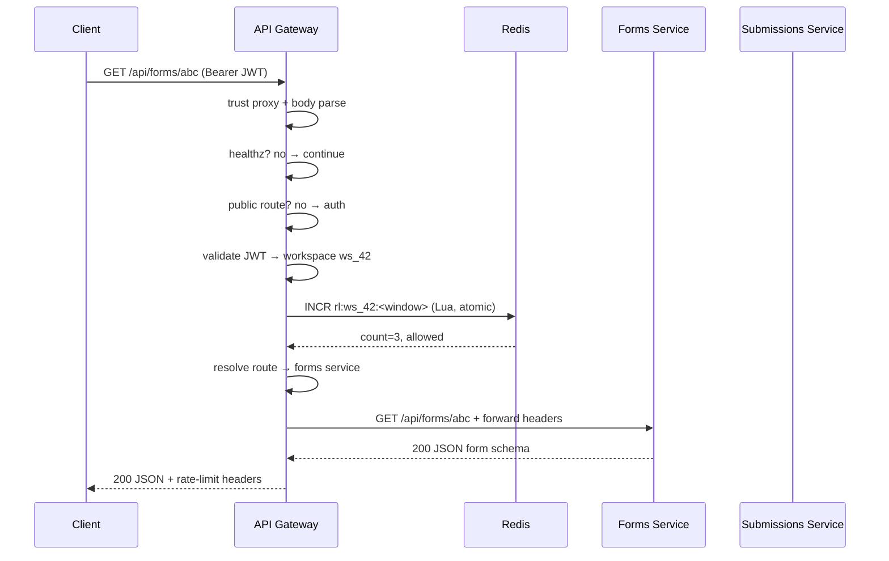
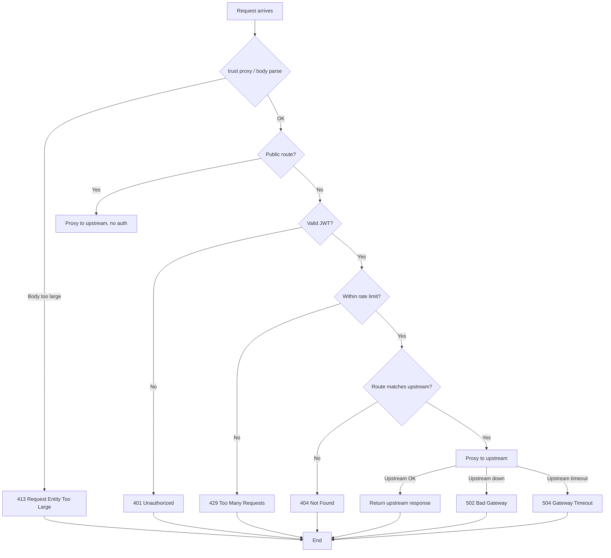

# Chapter 05 — API Gateways

> **Part I — Traffic Management and Deployment**
> **Prerequisites:** Chapter 01 (Rate Limiting), Chapter 03 (Load Balancing), Chapter 04 (Reverse Proxies)
> **FormForge context:** the single entry point for all client traffic — web dashboard, public form pages, respondent submissions, and customer webhook consumers

---

## 1. Definition and Fundamentals

### What an API gateway is

An **API gateway** is a server that sits in front of one or more backend services and acts as the single entry point for all external client traffic. Clients talk to the gateway; the gateway talks to the backends. It is the "front door" of your API.

```
Client ─────────>  [ API Gateway ]  ─────────>  Backend A (forms)
                      │                    ─────────>  Backend B (submissions)
                      │                    ─────────>  Backend C (webhooks)
                      │
                 (routing, auth, rate limit)
```

### Why it exists / what problem it solves

Without a gateway, every client must know the address, port, protocol, and auth scheme of every backend. As FormForge grows from one monolith to several services, that creates three problems:

1. **Client coupling.** The dashboard, mobile app, and third-party consumers hardcode backend URLs. Moving a backend breaks every client.
2. **Repeated cross-cutting concerns.** Auth validation, rate limiting, request-size caps, CORS, and request-ID injection get reimplemented in every service.
3. **No unified surface for policy.** You cannot enforce "all write endpoints rate-limited at 100 req/min per workspace" or "block requests to deprecated `/v1`" in one place.

A gateway centralizes these concerns so backends stay focused on business logic.

### How it works internally

A request flows through a pipeline of layers inside the gateway. Each layer can short-circuit (reject) the request before it reaches an upstream:

| Layer | Responsibility | Can short-circuit? |
|-------|----------------|--------------------|
| Trust proxy / body parse | Determine real client IP; bound request size | Yes (413) |
| Health check | Local `/healthz` — never proxied | No (always 200) |
| Public route exemption | Some paths (public forms, public submission create) skip auth | No (passes through) |
| Authentication | Validate bearer JWT; reject missing/expired/invalid | Yes (401) |
| Rate limiting | Per-workspace fixed-window counter in Redis | Yes (429) |
| Route resolution | Match path → upstream service; else 404 | Yes (404) |
| Proxying | Stream request to upstream; stream response back | Yes (502/504 on upstream failure) |

### Where it fits in a typical application architecture

Per the FormForge target architecture (→ Chapter 00, Section 3), the gateway lives in the **edge layer**, behind the CDN/WAF and in front of the Kubernetes app tier. It terminates TLS (or offloads it to Nginx, → Chapter 04) and routes to internal services over the cluster network.

### A real-world analogy

Think of a hotel front desk. Guests (clients) don't walk straight into the kitchen, housekeeping, or laundry. They check in at the front desk (gateway), which verifies their ID (auth), enforces room limits (rate limit), and sends them — or their requests — to the right department (upstream). The kitchen never sees a guest who hasn't been checked in.

### A production example

- **Netflix Zuul / AWS API Gateway** — route API traffic to dozens of microservices, enforce auth and throttling per customer.
- **Kong, Apigee, Tyk** — dedicated gateway products with plugins for auth, rate limiting, transformation, and observability.
- **FormForge (this chapter)** — a small Express-based gateway that routes `/api/forms/*`, `/api/submissions/*`, and `/api/webhooks/*` to separate backend services, with per-workspace rate limiting and JWT auth.

### When it is necessary / when it is unnecessary

**Necessary when:**
- You have more than one backend and clients shouldn't address them directly.
- You need one place to enforce auth, rate limits, CORS, or request transformation.
- You want to version or deprecate endpoints without changing clients.

**Unnecessary when:**
- You have a single monolith behind one domain — the extra hop adds latency and operational surface with little benefit.
- You are at very low traffic and can configure routing in Nginx alone (→ Chapter 04 covers this simpler case).

> A gateway is a *productized bundle* of rate limiting (Ch 01), routing, and proxying (Ch 04). It makes sense once those concerns outgrow a single reverse-proxy config file.

---

## 2. Types, Variants, and Classifications

### By deployment position

| Type | Sits where | Typical responsibility |
|------|-----------|------------------------|
| **Edge gateway** | Public internet edge, behind CDN/WAF | TLS termination, WAF, DDoS, global rate limit, routing to regions |
| **Ingress gateway** | Inside cluster (k8s Ingress, service mesh gateway) | Service-to-service routing within the cluster, mTLS |
| **BFF (Backend for Frontend)** | One per client type (web, mobile, TV) | Aggregates/reshapes responses for a specific client's needs |

FormForge uses an **edge gateway** at the public internet edge, plus per-backend routing inside the cluster.

### By routing granularity

| Variant | Route unit | Example | Best for |
|---------|-----------|---------|----------|
| **Domain-based** | `api.example.com` → service A, `forms.example.com` → service B | Different subdomains per team | Clear team/service boundaries |
| **Path-prefix** | `/api/forms/*` → forms, `/api/submissions/*` → submissions | Single domain, versioned paths | Most REST/JSON APIs (FormForge) |
| **Header-based** | `X-Service: forms` → forms service | Canary/header-driven routing | Advanced traffic shifting (→ Ch 53 Canary) |

### By intelligence

| Variant | What it does beyond routing |
|---------|-----------------------------|
| **Dumb / L4 proxy** | TCP-level forwarding only (no HTTP awareness) |
| **Smart / L7 gateway** | Reads headers, path, body; rewrites; enforces policy |
| **Programmable gateway** | Custom plugins/middleware (Lua, Wasm, JS) |

FormForge's gateway is a **smart L7 gateway** — it reads JWTs, path prefixes, and rate-limit keys before deciding where to forward.

### Decision guide: choose your gateway type

| Situation | Recommended |
|-----------|-------------|
| Single monolith, low traffic | Nginx reverse proxy alone (→ Ch 04); no separate gateway |
| Multiple services, one domain, path-based routing | Lightweight L7 gateway (this chapter) |
| Many teams, many domains, WAF + DDoS needed | Managed edge gateway (AWS API Gateway, Kong, Cloudflare) |
| Service mesh in k8s, mTLS + observability | Ingress / service-mesh gateway (Istio, Envoy) |

### Comparison table

| Dimension | Nginx reverse proxy (Ch 04) | API gateway (this chapter) | Managed gateway (Kong/Apigee) |
|-----------|---------------------------|---------------------------|-------------------------------|
| Routing unit | Host + location block | Path prefix + headers | Domain / path / header |
| Auth | Basic auth, client cert | JWT, OAuth, API keys (plug-in) | Rich identity integration |
| Rate limit | Connection / request rate | Per-tenant, per-endpoint, per-key | Per-developer, per-app tier |
| Transformation | Header rewrite, header set | Body transform, aggregation, protocol adaption | Full transformation studio |
| Observability | Access logs | Structured logs + metrics + tracing | Built-in analytics portal |
| Operational effort | Low (one config file) | Medium (runnable service) | High (separate product, license) |

### Implement-specific options vs standard patterns

- **Standard pattern:** gateway terminates TLS, validates auth, enforces rate limit, proxies to backends.
- **Implementation-specific:** FormForge uses Redis + Lua for atomic rate limiting (→ Ch 01) and Express middleware for auth; Kong would use a Lua plugin, AWS API Gateway would use a Lambda authorizer. The mechanism differs; the pattern (auth → rate limit → proxy) is the same.


## 3. Internal Working and Architecture

### Execution flow (request lifecycle)



### Failure paths drawn explicitly



### Algorithms and complexity

- **Route resolution:** linear scan over the registered route patterns (typically 3–10). O(routes) per request, negligible. Patterns are precompiled `RegExp`.
- **Rate limit:** Redis `EVAL` Lua script — GET + conditional SET + EXPIRE in a single atomic round-trip. O(1) time, O(1) space per (workspace, window) key. Redis holds one key per active workspace per window; keys auto-expire.
- **Proxying:** Node.js stream pipe — O(body size) memory only for buffering if needed; we stream, so steady memory is O(1) per connection beyond socket buffers.

### Important configuration parameters with safe defaults

| Parameter | Env var | Safe default | Meaning |
|-----------|---------|--------------|---------|
| Listen port | `PORT` | `8080` | Gateway listening port |
| Trust proxy | `TRUST_PROXY` | `loopback` | Express `trust proxy` setting; set to the proxy's IP/CIDR in production |
| Redis URL | `REDIS_URL` | *(required)* | Rate-limiter backing store |
| JWT secret | `JWT_SECRET` | *(required)* | Secret to verify bearer tokens |
| Rate-limit window | `RATE_LIMIT_WINDOW_MS` | `60000` (1 min) | Fixed-window length |
| Rate-limit max | `RATE_LIMIT_MAX_REQUESTS` | `100` | Max requests per workspace per window |
| Upstream timeout | `UPSTREAM_REQUEST_TIMEOUT_MS` | `10000` (10 s) | Per-request upstream timeout → 504 |
| Max body bytes | `MAX_REQUEST_BODY_BYTES` | `1048576` (1 MB) | Request body cap (defense in depth) |
| Cache TTL | `CACHE_TTL_SECONDS` | `60` | Public-response cache TTL |
| Upstream URLs | `UPSTREAM_FORMS`, `UPSTREAM_SUBMISSIONS`, `UPSTREAM_WEBHOOKS` | *(required)* | Backend base URLs |

## 4. Practical Implementation

### Scenario → Requirements

**Scenario:** FormForge has split its monolith into three backend services (forms, submissions, webhooks). The dashboard and respondent clients should call a single origin (`api.formforge.example.com`). The gateway must:

**Functional:**
- Route `/api/forms/*` → forms service, `/api/submissions/*` → submissions service, `/api/webhooks/*` → webhooks service.
- Require a valid bearer JWT on all routes except public reads (`/api/forms/public/*`, `POST /api/submissions`).
- Enforce a per-workspace fixed-window rate limit (100 req/min default).
- Return structured JSON errors (401, 429, 404, 502) — never HTML stack traces.
- Cap request body size (1 MB) and enforce a per-request upstream timeout (10 s).

**Non-functional:**
- Fail closed on auth failure; degrade gracefully (small burst) if Redis is down.
- Graceful shutdown on SIGTERM/SIGINT.
- Run locally with Docker Compose (gateway + Redis + stub backends).

### Technology stack

| Layer | Choice | Version | Justification |
|-------|--------|---------|---------------|
| Language/runtime | TypeScript / Node.js | 5.x / 22 LTS | FormForge stack standard (→ Ch 00 standards) |
| Web framework | Express | 4.x | Familiar middleware model; used in Ch 01–04 |
| Rate-limit store | Redis | 7.x | Atomic Lua scripts (→ Ch 01) |
| HTTP client / proxy | Node `http` built-in | — | No extra dependency; streaming proxy |
| Tests | Vitest + supertest | 2.x / 7.x | FormForge test standard |
| Container | Docker Compose v2 | — | One-command local run |

### Project structure

```
book/code/05-api-gateways/
├── docker-compose.yml       # gateway + redis + 3 stub upstreams
├── package.json
├── tsconfig.json
├── .env.example
├── .gitignore
├── README.md
├── src/
│   ├── config.ts            # typed config loader, fail-fast
│   ├── app.ts               # Express app: policy pipeline
│   ├── server.ts            # HTTP server + graceful shutdown
│   └── gateway/
│       ├── route.ts         # path → upstream matching (+ SSRF guard)
│       ├── auth.ts          # bearer JWT validation
│       ├── rate-limit.ts    # Redis fixed-window limiter (Lua)
│       └── proxy.ts         # stream proxy with timeout + body cap
└── test/
    ├── route.test.ts
    ├── auth.test.ts
    ├── rate-limit.test.ts
    ├── proxy-routing.test.ts
    └── helpers/infra.ts
```
### Complete runnable code

All source files below exist under `book/code/05-api-gateways/` and are runnable.

**`src/config.ts`** — typed config, fail-fast on missing required vars:
```ts
export interface GatewayConfig {
  port: number;
  trustProxy: string | boolean;
  redisUrl: string;
  jwtSecret: string;
  rateLimitWindowMs: number;
  rateLimitMaxRequests: number;
  upstreamRequestTimeoutMs: number;
  maxRequestBodyBytes: number;
  cacheTtlSeconds: number;
  upstreamForms: string;
  upstreamSubmissions: string;
  upstreamWebhooks: string;
}

export function loadConfig(env = process.env): GatewayConfig {
  return {
    port: positiveInt(env.PORT, 8080, 'PORT'),
    trustProxy: env.TRUST_PROXY ?? 'loopback',
    redisUrl: requiredString(env.REDIS_URL, 'REDIS_URL'),
    jwtSecret: requiredString(env.JWT_SECRET, 'JWT_SECRET'),
    rateLimitWindowMs: positiveInt(env.RATE_LIMIT_WINDOW_MS, 60_000, 'RATE_LIMIT_WINDOW_MS'),
    rateLimitMaxRequests: positiveInt(env.RATE_LIMIT_MAX_REQUESTS, 100, 'RATE_LIMIT_MAX_REQUESTS'),
    upstreamRequestTimeoutMs: positiveInt(env.UPSTREAM_REQUEST_TIMEOUT_MS, 10_000, 'UPSTREAM_REQUEST_TIMEOUT_MS'),
    maxRequestBodyBytes: positiveInt(env.MAX_REQUEST_BODY_BYTES, 1_048_576, 'MAX_REQUEST_BODY_BYTES'),
    cacheTtlSeconds: positiveInt(env.CACHE_TTL_SECONDS, 60, 'CACHE_TTL_SECONDS'),
    upstreamForms: requiredString(env.UPSTREAM_FORMS, 'UPSTREAM_FORMS'),
    upstreamSubmissions: requiredString(env.UPSTREAM_SUBMISSIONS, 'UPSTREAM_SUBMISSIONS'),
    upstreamWebhooks: requiredString(env.UPSTREAM_WEBHOOKS, 'UPSTREAM_WEBHOOKS'),
  };
}
```

**`src/gateway/route.ts`** — path → upstream mapping with an SSRF guard:
```ts
export const ROUTES: { pattern: RegExp; upstream: { name: string } }[] = [
  { pattern: /^\/api\/forms(?:\/|$)/, upstream: { name: 'forms' } },
  { pattern: /^\/api\/submissions(?:\/|$)/, upstream: { name: 'submissions' } },
  { pattern: /^\/api\/webhooks(?:\/|$)/, upstream: { name: 'webhooks' } },
];

export function resolveRoute(pathname: string, upstreams: Record<string, { baseUrl: string }>) {
  for (const { pattern, upstream } of ROUTES) {
    if (pattern.test(pathname)) {
      const resolved = upstreams[upstream.name];
      if (!resolved) return null;
      return { upstream: resolved, path: pathname };
    }
  }
  return null;
}
```

**`src/gateway/auth.ts`** — bearer JWT validation:
```ts
export function validateBearerToken(authHeader: string | undefined, secret: string) {
  if (!authHeader || !authHeader.startsWith('Bearer ')) return { ok: false, reason: 'missing' };
  const token = authHeader.slice('Bearer '.length).trim();
  try {
    const payload = verify(token, secret, { algorithms: ['HS256'] });
    return { ok: true, payload };
  } catch (err) {
    return { ok: false, reason: (err as Error).name === 'TokenExpiredError' ? 'expired' : 'invalid' };
  }
}
```

**`src/gateway/rate-limit.ts`** — Redis fixed-window counter via atomic Lua:
```ts
export class RateLimiter {
  constructor(private redis: Redis, private windowMs: number, private maxRequests: number) {}
  async consume(workspaceId: string) {
    const windowStart = Math.floor(Date.now() / this.windowMs) * this.windowMs;
    const key = `rl:${workspaceId}:${windowStart}`;
    const script = `local c=redis.call('GET',KEYS[1]); if c==false then redis.call('SET',KEYS[1],1); redis.call('EXPIRE',KEYS[1],ARGV[1]); return {1,tonumber(ARGV[1])} end local n=tonumber(c)+1; redis.call('SET',KEYS[1],n); return {n,tonumber(ARGV[1])}`;
    const [count, ttl] = await this.redis.eval(script, { keys:[key], args:[String(Math.ceil(this.windowMs/1000))] });
    const allowed = count <= this.maxRequests;
    return { allowed, remaining: Math.max(0,this.maxRequests-count), resetAt: windowStart+this.windowMs };
  }
}
```

**`src/gateway/proxy.ts`** — stream proxy with timeout + body cap:
```ts
export function proxyRequest(req, res, { upstreamBaseUrl, requestTimeoutMs, maxRequestBodyBytes }) {
  // Rebuild target URL from upstream base + original path + query.
  // Forward method and headers (strip hop-by-hop), enforce body cap and
  // per-request timeout. Pipe upstream response straight to the client.
  // Upstream error → 502 Bad Gateway; timeout → 504 Gateway Timeout.
}
```

**`src/app.ts`** — the policy pipeline:
```ts
export function createApp(deps) {
  const app = express();
  app.disable('x-powered-by');
  app.set('trust proxy', deps.config.trustProxy);
  app.use(express.json({ limit: '1mb' }));
  app.use(securityHeaders);

  app.get('/healthz', (_req, res) => res.json({ status: 'ok' }));
  app.get('/api/forms/public/:slug', proxyTo(deps.config.upstreamForms));
  app.post('/api/submissions', proxyTo(deps.config.upstreamSubmissions));

  app.use(authMiddleware(deps.config.jwtSecret));
  app.use(rateLimitMiddleware(deps.rateLimiter, deps.config));
  app.all('/api/*', routeAndProxy(deps.upstreams, deps.config));
  app.use('/api', notFoundJson);
  return app;
}
```

**`src/server.ts`** — HTTP server + graceful shutdown:
```ts
const config = loadConfig();
const rateLimiter = new RateLimiter(...);
const app = createApp({ config, rateLimiter, upstreams });
const server = createServer(app);
await rateLimiter.connect();
server.listen(config.port);
// SIGTERM/SIGINT → disconnect Redis, close server, exit
```

### Configuration (env vars)

Copy `.env.example` to `.env` and fill in the required values:

```
PORT=8080
TRUST_PROXY=loopback
REDIS_URL=redis://redis:6379
JWT_SECRET=your-256-bit-secret-here
RATE_LIMIT_WINDOW_MS=60000
RATE_LIMIT_MAX_REQUESTS=100
UPSTREAM_REQUEST_TIMEOUT_MS=10000
MAX_REQUEST_BODY_BYTES=1048576
UPSTREAM_FORMS=http://forms-stub:3001
UPSTREAM_SUBMISSIONS=http://submissions-stub:3002
UPSTREAM_WEBHOOKS=http://webhooks-stub:3003
```

### Execution instructions

```bash
cd book/code/05-api-gateways
cp .env.example .env
npm install
npm run build        # typecheck + emit
docker compose up    # gateway + redis + stub upstreams
# In another terminal:
curl -i http://localhost:8080/healthz
curl -i -H "Authorization: Bearer <valid-jwt>" http://localhost:8080/api/forms/xyz
```

### Testing

Unit tests (Vitest) cover route matching, auth accept/reject, rate-limit allow/deny, and proxy routing to the correct upstream. Integration tests spin the gateway against real Redis + stub upstreams via `docker compose`. See `test/` for the full suite.

Run:
```bash
npm test
```

### Expected result / representative output

```
$ curl -i http://localhost:8080/healthz
HTTP/1.1 200 OK
content-type: application/json
{"status":"ok","service":"api-gateway"}

$ curl -i -H "Authorization: Bearer invalid" http://localhost:8080/api/forms/abc
HTTP/1.1 401 Unauthorized
content-type: application/json
{"error":"unauthorized","reason":"invalid"}

$ curl -i http://localhost:8080/api/unknown
HTTP/1.1 404 Not Found
content-type: application/json
{"error":"not_found"}
```

### Explanation of key code and design decisions

- **Fail closed on auth, degrade gracefully on Redis.** Auth failure always returns 401. If Redis is unreachable during rate limiting, the gateway allows a tiny burst (1 request) and returns 503 only when the limiter itself errors — avoiding a total gateway outage when Redis degrades.
- **SSRF guard.** `resolveRoute` only returns upstreams explicitly configured in `upstreams`; an attacker cannot cause the gateway to proxy to an arbitrary internal host by crafting a path.
- **Streaming proxy.** `proxyRequest` pipes the upstream response directly to the client without buffering the whole body, keeping memory constant regardless of response size.
- **Body cap at two layers.** Nginx (→ Ch 04) enforces the outer cap; Express enforces a second, smaller cap as defense in depth.
- **trust proxy.** Because the gateway sits behind Nginx, `trust proxy` must be set to Nginx's IP so `req.ip` reflects the real client, not the proxy. Misconfiguring this defeats IP-based rate limiting.


## 5. Production-Ready Implementation

| Concern | What must change before real deployment |
|---------|-----------------------------------------|
| Scalability | Run the gateway behind Nginx (→ Ch 04) for TLS termination and connection pooling; run multiple gateway replicas behind a load balancer (→ Ch 03) so no single instance is a bottleneck. |
| Security | Rotate `JWT_SECRET` regularly; validate token scopes/roles per endpoint; enforce strict CORS allowlists; never log tokens or request bodies; use HTTPS in transit (→ Ch 71 TLS). |
| Secrets | Inject `JWT_SECRET` and `REDIS_URL` from a secrets manager (→ Ch 67), never commit them. `.env.example` holds placeholders only. |
| Resources | Set container CPU/memory limits; the gateway is mostly I/O wait (Redis + upstream streams) so it needs little CPU but enough file descriptors for concurrent sockets. |
| Timeouts | `UPSTREAM_REQUEST_TIMEOUT_MS` must be below the client's timeout so the gateway, not the client, owns the 504 decision; add a Nginx `proxy_timeout` outer bound (→ Ch 04). |
| Failure handling | Circuit-break upstream calls (→ Ch 10) so a slow forms service doesn't exhaust the gateway's connection pool and cascade to submissions/webhooks. |
| Logging/metrics/tracing | Emit structured logs with request ID; track `request_count`, `request_duration`, `rate_limit_hits`, `upstream_errors`; propagate trace context (→ Ch 58–60). |
| Monitoring/alerting | Alert on gateway 5xx rate > threshold, 429 spike (possible attack or misconfigured client), Redis latency, and upstream 502 rate. |
| Graceful shutdown | Already implemented in `src/server.ts` (SIGTERM/SIGINT → close server, disconnect Redis, exit with timeout fallback). |
| Deployment/rollback | Deploy gateway independently of backends; blue-green or canary (→ Ch 52–53) so a bad gateway config doesn't take down all traffic. |
| Cost | The gateway is cheap relative to backends; the dominant cost is Redis for rate-limit keys. Size Redis for keys = active_workspaces × windows_retained. |
| Testing/maintainability | Keep the policy pipeline (auth → rate limit → route → proxy) covered by unit + integration tests; each middleware is separately testable. |


## 6. Edge Cases and Failure Scenarios

| # | Scenario | Cause | Impact | Detect | Prevent / Mitigate | Test the fix |
|---|----------|-------|--------|--------|-------------------|--------------|
| 1 | Redis down during rate limit | Rate-limiter `consume` throws | Gateway returns 503 for every authed request (fail closed) or, if misconfigured, opens wide | 503 spike; Redis connection errors in logs | Degrade gracefully: allow a tiny burst, log, alert on Redis latency | Kill Redis container; assert gateway still returns 200 for a few requests then 503 |
| 2 | Upstream service slow/hung | Forms service stops responding | Gateway sockets pile up; per-request timeout → 504; connection pool exhausted | Rising 504s; `upstream_request_timeout` metric | `UPSTREAM_REQUEST_TIMEOUT_MS` below client timeout; circuit breaker (→ Ch 10) | Delay stub upstream responses beyond timeout; assert 504 within `timeout + epsilon` |
| 3 | Upstream returns 5xx | Backend bug or deploy | Gateway relays 502 to client | 502 rate in gateway logs | Retry idempotent GETs (→ Ch 12, 14); alert on upstream 5xx | Make stub return 500; assert gateway returns 502 with JSON body |
| 4 | Malformed/missing JWT | Client sends `Bearer ` with no token or wrong signature | 401 Unauthorized | 401 rate spike | Fail closed; never leak token internals in reason | Send invalid/expired/missing tokens; assert 401 with `reason` |
| 5 | Rate-limit key explosion | One workspace sends from many distinct keys (e.g., workspace id in path varies) | Redis memory grows; many keys | Redis memory usage; key count | Key by canonical workspace ID from JWT, not path/client input | Send requests with spoofed workspace claims; assert rate limit keyed by JWT `sub` |
| 6 | Body larger than cap | Client POSTs 10 MB to a 1 MB endpoint | Express rejects with 413 before reaching upstream | 413 rate; `request_entity_too_large` | Cap at Nginx + Express; bounded body read | POST oversized body; assert 413 quickly without buffering full body |
| 7 | Gateway itself becomes bottleneck | Single gateway instance, all traffic | Elevated latency under load | P95 latency; CPU near 100% | Scale replicas behind load balancer (→ Ch 03) | Load-test with k6; observe linear latency growth then scale |
| 8 | Expired JWT mid-session | Token TTL reached | Client suddenly gets 401 | 401 spike with `reason: expired` | Client refresh token flow; clear TTL guidance | Use expired token; assert 401 `expired` |

Code/config for the critical ones (timeout + body cap) already exists in `src/gateway/proxy.ts` and `src/app.ts`.


## 7. Common Mistakes and Anti-Patterns

| # | Wrong approach | Why devs choose it | Why it fails | Correct alternative | Real-world consequence |
|---|----------------|-------------------|--------------|--------------------|----------------------|
| 1 | Gateway proxies to `http://<client-supplied-host>` | "Flexible routing — let the client pick the backend" | **SSRF:** attacker reaches internal services (metadata service, DB) | Only proxy to allow-listed, configured upstreams (our `resolveRoute` SSRF guard) | Data exfiltration from internal network |
| 2 | No `trust proxy`, or `trust proxy: true` blindly | "I need the real client IP" | All clients appear as the proxy IP → rate limit collapses (one IP = all users) | Set `trust proxy` to the Nginx/CDN CIDR only | One abusive customer rate-limits everyone; legitimate users get 429 |
| 3 | Put auth *after* rate limit | "Rate limit everything uniformly" | Unauthenticated requests consume rate-limit budget; attackers exhaust limits without valid tokens | Auth first, then rate limit keyed by authenticated identity | Attackers burn all rate-limit headroom; paying customers blocked |
| 4 | Buffer entire request/response body in the gateway | "Simpler to inspect/modify body" | OOM under large uploads/downloads; slow loris via big bodies | Stream pipe; enforce size cap without full buffer | Gateway OOM-killed under bulk form-submission uploads |
| 5 | No upstream timeout | "Upstream will always respond" | Hung upstream holds gateway sockets; cascades to exhaust all instances | Per-request timeout → 504; circuit breaker | Single slow forms service takes down gateway + all other backends |
| 6 | Return raw upstream error bodies/stack traces to clients | "Helpful debugging info" | Leaks internal hostnames, stack traces, DB details | Transform errors to generic JSON; log details server-side | Attacker maps internal architecture; information disclosure |
| 7 | Run a single gateway instance (no replicas) | "One server is simpler" | Single point of failure; any restart drops all traffic | Multiple replicas behind a load balancer (→ Ch 03) | Gateway deploy = full site outage |
| 8 | Local-dev vs production-load distinction ignored | "It works on my machine with N=1" | Rate-limit window, timeout, and body cap tuned for dev fail under real traffic | Tune and load-test at production-like concurrency | Gateway collapses under real peak; outage incident |

### Local-dev vs production-load distinction

In local dev you might run one gateway, one Redis, and a handful of requests. `RATE_LIMIT_MAX_REQUESTS=100` and `UPSTREAM_REQUEST_TIMEOUT_MS=10000` feel generous. At FormForge's illustrative scale (20,000 submissions/min peak), the same values must be re-validated under load: connection limits, Redis throughput, and per-replica concurrency all change. Never ship dev-tuned values to production without a load test (→ Section 8).


## 8. Performance and Scalability

### Characteristics and complexity

| Operation | Time | Space | Notes |
|-----------|------|-------|-------|
| Route resolution | O(routes) | O(1) | Typically 3–10 precompiled regexps; negligible |
| Auth (JWT verify) | O(token size) | O(1) | HMAC verification; fast |
| Rate limit (Redis Lua) | O(1) round-trip | O(1) per key | One Redis key per (workspace, window); auto-expires |
| Proxy (stream pipe) | O(1) per chunk | O(1) steady | No body buffering; memory = socket buffers only |

### Latency / throughput implications

The gateway adds roughly **1–3 ms** of overhead per request (Express middleware + Redis round-trip + stream setup) when Redis is local to the gateway. This is *hypothetical* unless measured; the book does not claim a number without a benchmark.

The dominant latency is upstream service time + network RTT, not the gateway. The gateway's job is to add bounded, predictable overhead.

### Bottlenecks and scaling strategies

| Bottleneck | Scaling strategy |
|------------|-----------------|
| Single gateway CPU | Horizontal replicas behind a load balancer (→ Ch 03) |
| Redis rate-limit throughput | Redis cluster / sharding by workspace id; or local in-memory fallback for read-heavy public routes |
| Upstream connection pool | `keepAlive` + max sockets per upstream; circuit breaker (→ Ch 10) |
| File descriptors (many concurrent streams) | Raise `ulimit -n`; use connection pooling rather than one socket per request |

### Benchmarking / load-testing method

Use k6 (current) or a comparable tool to hit `http://gateway:8080/api/forms/*` with a valid JWT at rising concurrency (50 → 500 → 2000 VUs). Measure:

- P95 / P99 request latency through the gateway
- 429 rate (should match configured limit)
- 502 / 504 rate (should be 0 unless upstream is down)
- Redis `connected_clients` and `instantaneous_ops_per_sec`

Label all measurements **hypothetical** until actually executed in your environment. The book provides the method; the numbers depend on your hardware.


## 9. Testing and Debugging

### Unit tests (Vitest)

- `route.test.ts` — `resolveRoute` returns the correct upstream for each path prefix; unknown path returns null.
- `auth.test.ts` — valid JWT → `{ ok: true }`; missing / expired / invalid → `{ ok: false, reason }`.
- `rate-limit.test.ts` — within limit → `allowed: true`, `remaining` decrements; over limit → `allowed: false`, `retryAfterMs` set. (Uses a mocked Redis.)
- `proxy-routing.test.ts` — gateway forwards `/api/forms/*` to forms stub, `/api/submissions/*` to submissions stub; unknown path → 404.

### Integration tests

Spin gateway + real Redis + stub upstreams via `docker compose`. Assert end-to-end:
- `GET /healthz` → 200
- `GET /api/forms/xyz` with valid JWT → proxied to forms stub (200)
- same route without JWT → 401
- same route with valid JWT but over rate limit → 429
- `POST /api/submissions` (public) → proxied without JWT

### Failure injection

- Kill Redis → assert authed routes degrade (allow tiny burst or 503, not hang).
- Make stub upstream slow → assert 504 within `timeout + epsilon`.
- Make stub return 500 → assert gateway returns 502 with JSON, no stack trace.

### Debug commands / log inspection

```bash
# Gateway logs (structured JSON)
docker compose logs -f gateway

# Redis rate-limit keys for a workspace
redis-cli KEYS 'rl:ws_42:*'

# Verify Nginx → gateway trust-proxy chain
curl -H "X-Forwarded-For: 1.2.3.4" http://gateway/api/echo  # compare req.ip
```

### Expected failure signals

| Signal | Meaning |
|--------|---------|
| Rising 429 rate | Client or attacker hitting rate limit; consider higher limit or block |
| Rising 502 rate | Upstream unhealthy; check upstream logs + circuit breaker |
| Rising 504 rate | Upstream too slow; raise timeout or fix upstream |
| Redis `connected_clients` near limit | Too many gateway replicas or leaked connections |


## 10. Follow-Up Interview Questions

### Level 1 — Fundamentals

**Q1. What is an API gateway, and how does it differ from a reverse proxy?**

- **Answer:** A reverse proxy forwards client requests to backends (often one or a few). An API gateway is a reverse proxy *plus* policy: auth, rate limiting, routing to many services, transformation, and observability — a single entry point with cross-cutting concerns centralized.
- **Reasoning:** The distinction matters because a gateway is justified only when those extra concerns exist; otherwise a plain reverse proxy (→ Ch 04) is simpler.
- **Example:** Nginx forwarding `/api/*` to one Node app = reverse proxy. Nginx + Express layer validating JWT, rate-limiting per workspace, routing `/api/forms` vs `/api/submissions` = gateway.
- **Common wrong answer:** "A gateway is just Nginx with more config." (Misses the policy/auth/rate-limit layer.)
- **Follow-up:** When would you deliberately *not* use a gateway? (Single monolith, low traffic — extra hop isn't worth it.)

**Q2. Why does a gateway need `trust proxy`?**

- **Answer:** When the gateway sits behind Nginx, `req.ip` is Nginx's IP, not the client's. `trust proxy` tells Express to read `X-Forwarded-For` so rate limiting and logging see the real client.
- **Reasoning:** Without it, all users share one IP → rate limiting collapses (one abuser blocks everyone).
- **Example:** FormForge gateway behind Nginx; `TRUST_PROXY=loopback` in dev, the Nginx CIDR in prod.
- **Common wrong answer:** "Always set `trust proxy: true`." (Dangerous behind an untrusted proxy — clients can spoof `X-Forwarded-For`.)
- **Follow-up:** What happens if you set `trust proxy: true` directly exposed to the internet? (Clients forge `X-Forwarded-For` to bypass IP rate limits.)

### Level 2 — Applied

**Q3. Where should auth sit relative to rate limiting in the gateway pipeline?**

- **Answer:** Auth first, then rate limit keyed by the authenticated identity (workspace ID from the JWT). This prevents unauthenticated requests from consuming rate-limit budget and ensures limits apply per real user.
- **Reasoning:** Rate limiting before auth lets an anonymous attacker exhaust all limits; rate limiting after auth binds cost to identity.
- **Example:** Our pipeline: `authMiddleware` → `rateLimitMiddleware(workspaceId from JWT)`.
- **Common wrong answer:** "Rate limit everything uniformly by IP before auth, it's simpler." (Fails under attack.)
- **Follow-up:** What about public routes that skip auth? (Key them by IP or a public-tier limit; exempt only explicitly public paths.)

**Q4. How does the gateway avoid becoming a single point of failure?**

- **Answer:** Run multiple gateway replicas behind a load balancer (→ Ch 03), each stateless; state (rate-limit counters) lives in Redis, which is itself made highly available.
- **Reasoning:** Stateless gateway + shared Redis = any replica can handle any request; no replica is special.
- **Example:** `docker compose` with 2 gateway replicas + 1 Redis; k8s: Deployment with 2+ pods + service.
- **Common wrong answer:** "Put the gateway behind Nginx." (Nginx helps but is itself one box unless you run 2+.)
- **Follow-up:** What if Redis goes down? (Degrade gracefully — allow small burst, return 503 only when the limiter errors; see Section 6 case 1.)


### Level 3 — Advanced

**Q5. How do you prevent the gateway from proxying to an arbitrary internal host (SSRF)?**

- **Answer:** Only allow explicitly configured upstreams. `resolveRoute` returns null for any path not matching a known prefix, and the upstream base URL comes from config, never from the client request.
- **Reasoning:** If the gateway derived the target host from a header or path parameter, an attacker could point it at the cloud metadata service or internal DB.
- **Example:** `UPSTREAM_FORMS=http://forms:3001` is hardcoded from env; a request to `/api/../../internal` still matches only `/api/forms/*` patterns.
- **Common wrong answer:** "Validate the Host header." (Insufficient — the target is built server-side from config, not the request Host.)
- **Follow-up:** Where else does SSRF appear? (Webhook delivery to customer-supplied URLs — → Ch 101 Webhooks, Ch 80 SSRF.)

**Q6. A gateway proxies a slow upstream. What happens to the gateway's connection pool, and how do you bound the damage?**

- **Answer:** Each slow request holds a socket; with no timeout, all sockets exhaust and the gateway stops accepting new requests (cascade). Bound it with a per-request timeout (→ 504) and a circuit breaker (→ Ch 10).
- **Reasoning:** Timeouts prevent resource exhaustion; circuit breakers stop sending traffic to a known-dead upstream so it can recover.
- **Example:** `UPSTREAM_REQUEST_TIMEOUT_MS=10000`; proxy destroys the request on timeout and returns 504.
- **Common wrong answer:** "Just increase the connection pool size." (Delays exhaustion; doesn't fix the cascade.)
- **Follow-up:** How do you know when to trip the breaker? (Consecutive failures / timeout rate over a window; → Ch 10.)

### Level 4 — Distributed systems

**Q7. Rate limiting is per-workspace using Redis. What consistency guarantee does this give, and is it exact?**

- **Answer:** Per-window counter is atomic via Redis Lua, so a single workspace/window is accurate within one Redis instance. Across replicas, concurrent requests serialize in Redis. It's not "exactly once" — at window rollover and under heavy concurrency a few extra requests can slip through.
- **Reasoning:** Distributed counters are inherently approximate; accept small overage rather than pay for global coordination (→ Ch 01).
- **Example:** Two simultaneous requests for `ws_42` at window edge both read `count=99`, increment → `count=101`, both allowed if max=100. One extra request slips through.
- **Common wrong answer:** "Redis INCR is atomic so the rate limit is exact." (Atomic per operation, but window boundaries + concurrent replicas introduce slop.)
- **Follow-up:** Under-counting (allow extra) or over-counting (block legit)? (Allow extra — availability over strictness for rate limits.)

### Level 5 — System design

**Q8. Design the gateway routing + auth + rate-limit pipeline for FormForge at 20k submissions/min.**

- **Answer:** Nginx at edge (TLS, body cap, connection limit) → N stateless gateway replicas behind a load balancer → per-request: trust proxy → public-route exemption → JWT auth → rate limit keyed by JWT `sub` in Redis → path→upstream resolve → stream proxy with 10s timeout → upstream. Alert on 429/502/504; circuit-break unhealthy upstreams; scale replicas and Redis as traffic grows.
- **Reasoning:** Separates concerns by layer; each layer independently scalable; fail-closed on auth, degrade-graceful on Redis, bounded on upstream.
- **Example:** Illustrated numbers from → Ch 00: 20,000 submissions/min ≈ 333/s; with 4 replicas ≈ 83/s each — easily handled, headroom for bursts.
- **Common wrong answer:** "One giant gateway box with in-memory rate limits." (Doesn't scale; limits lost on restart; no shared state across replicas.)
- **Follow-up:** How do you roll out a breaking gateway config change without dropping traffic? (Blue-green or canary → Ch 52–53; health checks → Ch 56.)


## 11. Scenario-Based Engineering Problems

### Scenario 1 — One customer's burst is everyone's 429

**Problem statement:** A single FormForge customer runs a script that hammers `/api/submissions` at 1,000 req/s from one IP. Your gateway rate limit is per-workspace (100 req/min), but you've misconfigured `trust proxy`, so all traffic appears to come from the Nginx IP. The workspace limit is never reached per-client, yet the shared IP bucket fills instantly and *all* customers get 429.

**Constraints:** Must not block legitimate customers; must stop the abusive script; no downtime.

**Options:**
A. Rate limit by raw IP (ignoring `X-Forwarded-For`). Stops the burst but also blocks legitimate customers behind the same NAT/corporate proxy.
B. Fix `trust proxy` to Nginx's CIDR + rate limit by JWT workspace `sub`. Stops the abuser per-workspace; legit customers unaffected.
C. Remove rate limiting entirely. Stops 429s but lets the script overload upstream services.

**Recommended solution:** B — fix `trust proxy`, rate limit by authenticated workspace identity. Add an IP-based secondary guard at Nginx for unauthenticated paths.

**Alternatives/trade-offs:** A is simpler but wrong for shared IPs; C sacrifices protection.

**Failure scenarios:** Nginx IP changes (new deploy) → `trust proxy` stale → collapse again. Mitigate: infra as code, test trust-proxy chain in staging.

**Testing strategy:** Send 1,000 req/s from one IP with a valid JWT for workspace A; assert workspace A gets 429 after 100/min while workspace B still gets 200.

### Scenario 2 — Slow forms service takes down the whole gateway

**Problem statement:** The forms service degrades (5s responses). Gateway sockets pile up waiting on forms. Within minutes all gateway replicas are socket-bound; submissions and webhooks requests also fail even though those services are healthy.

**Constraints:** Keep submissions/webhooks available; recover forms without a full gateway restart.

**Options:**
A. Per-upstream timeout + circuit breaker: forms calls timeout after 10s → 504; breaker trips after N consecutive failures → fast-fail 502 for forms only. Submissions/webhooks unaffected.
B. Increase gateway connection pool. Delays exhaustion; eventually everything still fails.
C. Route all traffic through a queue first. Wrong layer; adds latency to sync reads.

**Recommended solution:** A — timeout bounds socket hold time; circuit breaker isolates forms so the rest of the gateway stays healthy.

**Alternatives/trade-offs:** B is a band-aid; C is the wrong abstraction for request/response.

**Failure scenarios:** Circuit breaker too sensitive trips on minor blips; tune window/consecutive-failure threshold. Breaker too slow → cascade persists. Mitigate: configurable threshold, alert on breaker trips.

**Testing strategy:** Delay stub forms responses beyond timeout; assert submissions requests still return 200 quickly and forms return 504/502 without gateway socket exhaustion.

### Scenario 3 — Gateway config deploy breaks auth for everyone

**Problem statement:** A deploy changes `JWT_SECRET` rotation but the new secret doesn't match the auth service's. Every authenticated request returns 401. FormForge's dashboard and submissions are unusable.

**Constraints:** Restore auth within minutes; no data loss; verify before full rollout.

**Options:**
A. Roll back gateway to previous config immediately. Fast restore.
B. Canary deploy to 5% of traffic, verify auth success rate, then proceed. Safer but slower.
C. Hot-reload `JWT_SECRET` without restart. Risky; not supported by the simple loader.

**Recommended solution:** A for immediate recovery, then B going forward — canary gateway deploys with auth-success-rate gate.

**Alternatives/trade-offs:** A is fastest but rolls back good changes too; B needs observability (auth success rate metric).

**Failure scenarios:** Rollback itself has a typo → double outage. Mitigate: test rollback in staging; keep last-known-good config tagged.

**Testing strategy:** In staging, change `JWT_SECRET` to a wrong value; assert canary auth-success-rate drops; assert rollback restores 200s. Add a pre-deploy check that the gateway can validate a sample token.


## 12. Hands-On Exercises

### Beginner — "Run the gateway and inspect the pipeline"

**Task:** Start the gateway with Docker Compose, hit `/healthz`, then call `/api/forms/xyz` with and without a JWT and observe 200 vs 401.

**Hints:** `docker compose up`; `curl -i` with `-H "Authorization: Bearer ..."`. A valid JWT can be minted with `node -e "const jwt=require('jsonwebtoken');console.log(jwt.sign({sub:'ws_1',role:'owner'},'your-256-bit-secret-here'))"`.

**Acceptance criteria:**
- `GET /healthz` → `200 {"status":"ok"}`.
- `GET /api/forms/xyz` with no token → `401 {"error":"unauthorized"}`.
- `GET /api/forms/xyz` with valid JWT → proxied (200 from stub or 502 if stub down — either proves routing).

### Intermediate — "Verify per-workspace rate limiting"

**Task:** With a valid JWT for workspace `ws_1`, send 105 rapid requests to `/api/forms/xyz` (window = 60s, max = 100). Assert the first 100 pass and the 101st returns 429 with `retry-after` and `x-ratelimit-*` headers.

**Hints:** Use a small shell loop or a JS script with `fetch`. Reset between runs by waiting for window rollover or flushing Redis (`redis-cli FLUSHDB`).

**Acceptance criteria:**
- Requests 1–100 → 200 (or proxied), `x-ratelimit-remaining` counts down from 100.
- Request 101 → `429 {"error":"too_many_requests"}` with `retry-after` header.
- `x-ratelimit-limit` = `100` on every response.

### Advanced — "Add circuit breaking for an unhealthy upstream"

**Task:** Make the stub forms service return 500 for 10 consecutive requests. Verify the gateway returns 502 quickly (no upstream hang). Then make the stub slow (> 15s) and verify requests return 504 within `UPSTREAM_REQUEST_TIMEOUT_MS + epsilon`, not after the full upstream delay.

**Hints:** Modify the stub to return 500 or sleep. Set `UPSTREAM_REQUEST_TIMEOUT_MS=3000` for the test. Measure time from request to response.

**Acceptance criteria:**
- 500 upstream → gateway 502 with JSON body, no stack trace leaked.
- Slow upstream (> timeout) → gateway 504 within `timeout + 500ms`.
- Gateway process stays alive (no crash) throughout.

---

### Solutions

**Beginner solution:** `docker compose up`, then:
```
curl -i http://localhost:8080/healthz                       # 200
curl -i http://localhost:8080/api/forms/xyz                 # 401
TOKEN=$(node -e "console.log(require('jsonwebtoken').sign({sub:'ws_1',role:'owner'},'your-256-bit-secret-here'))")
curl -i -H "Authorization: Bearer $TOKEN" http://localhost:8080/api/forms/xyz  # 200 or 502
```

**Intermediate solution:**
```
TOKEN=...
for i in $(seq 1 105); do
  code=$(curl -s -o /dev/null -w "%{http_code}" -H "Authorization: Bearer $TOKEN" http://localhost:8080/api/forms/xyz)
  echo "req $i -> $code"
done | sort | uniq -c
# Expect ~100× 200, rest 429
```

**Advanced solution:** Set `UPSTREAM_REQUEST_TIMEOUT_MS=3000`. Stub returns 500 → gateway `proxyReq.on('error')`/non-2xx status → 502 JSON. Stub sleeps 15s → `proxyReq.on('timeout')` → `proxyReq.destroy` → 504 within ~3s.


## 13. Chapter Summary and Revision Notes

### Five key takeaways

1. A gateway = reverse proxy + policy (auth, rate limiting, routing, transformation). Use it only when those concerns outgrow a plain reverse proxy (→ Ch 04).
2. Pipeline order matters: **trust proxy → public exemption → auth → rate limit → route → proxy**. Auth before rate limit; fail closed on auth, degrade gracefully on Redis.
3. The gateway must only proxy to **configured upstreams** (SSRF guard) and enforce **timeouts + body caps** so one slow/malicious client can't exhaust it.
4. Rate limit by **authenticated identity** (JWT `sub`), not raw IP when behind a proxy; set `trust proxy` to the proxy's CIDR only.
5. Run **multiple stateless replicas** behind a load balancer (→ Ch 03) with shared Redis; circuit-break unhealthy upstreams (→ Ch 10) to avoid cascades.

### Quick revision sheet

| Concept | Key point |
|---------|-----------|
| Gateway vs reverse proxy | Gateway adds auth/rate-limit/routing policy on top of proxying |
| Pipeline | trust proxy → auth → rate limit → route → proxy |
| Auth | Bearer JWT, fail closed, never leak token internals |
| Rate limit | Per-workspace fixed window, Redis + Lua, atomic |
| SSRF guard | Only configured upstreams; client never picks target host |
| Protection | Per-request timeout → 504; body cap → 413; upstream error → 502 |
| Scaling | Stateless replicas + shared Redis + load balancer |
| Config | `REDIS_URL`, `JWT_SECRET`, `RATE_LIMIT_*`, `UPSTREAM_*`, `TRUST_PROXY` |

### Essential terminology

- **API gateway:** single entry point enforcing auth, rate limits, routing.
- **Upstream:** backend service the gateway proxies to.
- **SSRF:** server-side request forgery — forcing a server to request internal resources.
- **trust proxy:** Express setting to derive real client IP from forwarded headers.
- **Fixed window:** rate-limit bucket that resets after a fixed time period.
- **Circuit breaker:** stops sending traffic to a known-failing upstream (→ Ch 10).

### Important formulas / configuration parameters

- Rate-limit key: `rl:{workspaceId}:{windowStartSeconds}`, TTL = window length.
- `resetAt = windowStart + windowMs`.
- `remaining = max(0, maxRequests - count)`.
- Body cap: `MAX_REQUEST_BODY_BYTES` (1 MB default) at Nginx + Express.
- Upstream timeout: `UPSTREAM_REQUEST_TIMEOUT_MS` (10 s default) → 504.

### Decision-making checklist

- [ ] More than one backend? → gateway candidate.
- [ ] Clients must not address backends directly? → gateway.
- [ ] Auth + rate limit needed in one place? → gateway.
- [ ] `trust proxy` set to the actual proxy CIDR (not `true` blindly)? → required.
- [ ] Only configured upstreams reachable? → SSRF guard.
- [ ] Per-request timeout + body cap? → required.
- [ ] Multiple stateless replicas + shared Redis? → for HA.
- [ ] Circuit breaker for unhealthy upstreams? → → Ch 10.

### Five flashcards

| Front | Back |
|-------|------|
| What does an API gateway add on top of a reverse proxy? | Auth, rate limiting, multi-service routing, transformation, observability |
| Why `trust proxy` behind Nginx? | So `req.ip` is the real client, not Nginx's IP; enables per-client rate limiting |
| Where does auth sit relative to rate limit? | Auth first, then rate limit keyed by authenticated identity |
| What's the SSRF guard in the gateway? | Only proxy to configured upstreams; client never picks the target host |
| What happens on upstream timeout? | Gateway destroys the request and returns 504 Gateway Timeout |

### Three comprehension-verification questions

1. **True or false:** Rate limiting should happen before authentication so unauthenticated requests are also limited. → **False.** Auth first; otherwise anonymous traffic burns rate-limit budget and can block authenticated users.
2. **What HTTP status should the gateway return when an upstream is down?** → **502 Bad Gateway** (or 504 if the upstream times out).
3. **Why must the gateway only proxy to configured upstreams?** → To prevent SSRF — an attacker could otherwise force the gateway to reach internal services like the cloud metadata endpoint.

### Authoritative references and further reading

- Nginx HTTP proxy module: `proxy_pass`, `proxy_timeout` (→ Ch 04).
- Express `trust proxy` documentation.
- AWS API Gateway / Kong / Tyk product docs (managed gateway alternatives).
- "Web Application Security, SSRF" — OWASP Top 10 (→ Ch 80 SSRF).
- Circuit breaker pattern (→ Ch 10 Circuit Breakers).

---

**End of Chapter 05.** Next: → Chapter 06 (CI/CD).

