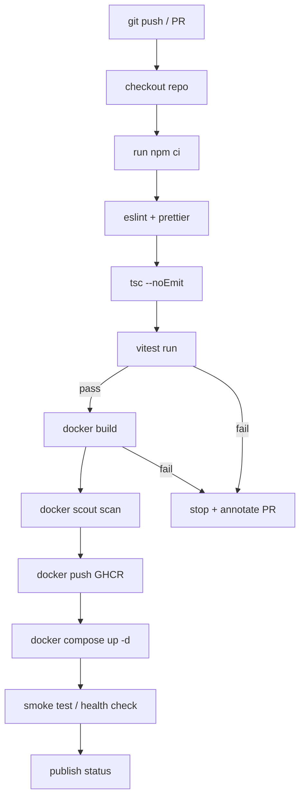

# Chapter 06 — CI/CD

> **Part I — Traffic Management and Deployment**  
> **Prerequisites:** Chapters 01 (Rate Limiting), 03 (Load Balancing), 04 (Reverse Proxies), 05 (API Gateways) — this chapter builds the pipeline that feeds the gateway you just built. Basic Git knowledge assumed.

---
## 1. Definition and Fundamentals

### What CI/CD is

**Continuous Integration (CI)** is the practice of automatically building, testing, and linting every change—usually on every pull request—before it enters a shared branch. The goal is to catch integration bugs, type errors, and contract violations as early as possible, ideally before they reach production.

**Continuous Delivery (CD)** extends CI by automating the release process so that a merged change is always in a deployable state. The difference between *delivery* and *deployment*: delivery means the change could be released at any time with a manual trigger; deployment means it is released automatically.

### Why CI/CD exists / what problem it solves

Without CI/CD, teams discover breakage days or weeks after merging: "It worked on my machine" becomes a permanent excuse. Manual release steps introduce human error, inconsistent environments, and opaque rollback procedures. CI/CD solves these problems by:

1. **Fast feedback** — every push runs the same test suite and typecheck, so a broken build never sits on `main` unnoticed.
2. **Artifact immutability** — the exact container image or binary that passed tests is the exact one deployed; no "works in production" drift.
3. **Uniform environments** — from `git push` to `docker run` every step uses the same definitions (`Dockerfile`, `docker-compose.yml`, env‑var sets), eliminating the "works on prod" class of bugs.
4. **Audit trail** — every commit that touched production has a record: which pipeline ran, which tests passed/failed, which image was pushed to which registry.

### How it works internally (first pass)

A typical CI/CD pipeline for a Node.js/Express project consists of these stages, executed sequentially:

| Stage | Tool | Input | Output |
|------|------|-------|--------|
| **Fetch** | Git | PR/webhook commit SHA | Working tree |
| **Lint** | `eslint` + `prettier` | source files | lint report (fail fast) |
| **Typecheck** | `tsc --noEmit` | `.ts` sources | type errors (fail fast) |
| **Unit/Integration tests** | Vitest | source + test fixtures | pass/fail + coverage |
| **Build** | `tsc` + `npx tsc-build` (or `esbuild`) | compiled JS | `dist/` or Docker image |
| **Container build** | `docker build` | `Dockerfile` + context | image tag (e.g., `registry/example/api-gateway:git-sha`) |
| **Image scan** | Trivy / `docker scout` | newly built image | CVE report (fail on critical) |
| **Push** | Docker registry (GHCR, ECR, Artifactory) | image | immutable digest |
| **Deploy** | Docker Compose / Kubernetes | image digest | running service |
| **Smoke test** | `curl` / Vitest integration | deployed URL | health‑check pass/fail |
| **Notify** | Slack / email | pipeline result | human-visible status |

The pipeline is **fail-closed**: if any stage returns non‑zero, the pipeline stops and the PR is blocked from merging (or the deployment is aborted).

## 2. Types, Variants, and Classifications

### By pipeline scope

| Type | Description | Typical tools |
|------|-------------|--------------|
| **Unit‑test CI** | Runs only unit tests; fast (seconds) | Vitest, Jest |
| **Full‑CI** | Lint + typecheck + unit + integration | Above + `supertest` |
| **Pipeline CI** | Adds container build, image scan, push | Docker, Trivy, GHCR |
| **CD (continuous delivery)** | Deploys to staging; manual prod trigger | Docker Compose, Argo CD, Fly.io |
| **CD (continuous deployment)** | Deploys to prod automatically on `main` merge | Spinnaker, GitHub Actions auto‑deploy |

### By branching strategy

| Strategy | CI trigger | CD trigger | Merge gate |
|----------|-----------|------------|------------|
| **Gitflow** | PR → `develop` | `develop` → staging | PR must pass full‑CI |
| **Trunk‑based** | `main` push or PR → `main` | `main` → prod (auto) or manual | PR must pass full‑CI + approved |
| **Feature‑flag** | Any branch → feature‑flag off | Flip flag to enable | Feature‑flag gate + CI |

### By deployment target

| Target | CI artifact | CD step |
|--------|-------------|---------|
| **Docker Compose** (this chapter) | Docker image | `docker compose up -d` |
| **Kubernetes** | Docker image + Helm chart | `kubectl apply` + rollout |
| **Serverless** (Vercel, Cloudflare) | ZIP / binary | `vercel deploy` / `wrangler publish` |
| **Bare metal** | Binary / tarball | `scp` + systemd restart |

### Decision guide: choose your pipeline type

| Goal | Recommended pipeline |
|------|----------------------|
| **Fast feedback on every PR** | Unit‑test CI only (lint + typecheck + Vitest) — ~2 minutes |
| **Production‑ready artifact immutability** | Full CI + Docker build + image scan |
| **Zero‑downtime redeploys** | CD with rolling restart (K8s) or `docker compose up -d` + health checks |
| **Regulated industry** | Full CI + SBOM generation + CVE scanning + audit logs |

### Comparison table

| Aspect | CI‑only | Full CI + CD |
|--------|---------|--------------|
| **Duration** | 2–5 min | 5–15 min (includes build + scan) |
| **Cost** | Low (GitHub Actions minutes) | Medium (container build minutes + registry) |
| **Risk** | Defects leak to prod | Slower feedback, but artifact proven |
| **Complexity** | Simple YAML | Needs registry, scan tools, deploy target |

## 5. Internal Working and Architecture

### Execution flow (request lifecycle from `git push` to running service)

### Failure paths drawn explicitly

| Stage | Failure mode | Effect | Mitigation |
|------|-------------|--------|------------|
| **Lint** | `eslint` reports style errors | Pipeline stops, PR blocked | Fix locally before re‑push |
| **Typecheck** | `tsc --noEmit` errors | Pipeline stops, PR blocked | Update types, don't `--skipLibCheck` |
| **Unit tests** | Test assertion fails | Pipeline stops, PR blocked | Add missing test or fix logic |
| **Docker build** | Build fails (missing deps, syntax) | Image not produced, pipeline stops | Fix Dockerfile; use `.dockerignore` |
| **Image scan** | Critical CVE found | Pipeline stops, image not pushed | Fix base image, add `ALTERNATE_BASE` |
| **Deploy** | `docker compose up` hangs | Service not available, pipeline stops | Add health‑check retry; review compose config |
| **Smoke test** | `/healthz` returns 500 or timeout | Deploy marked failed, manual rollback | Roll back to previous image digest |

### Algorithms and complexity

| Metric | Value / assumption |
|--------|--------------------|
| **Lint complexity** | O(N) source lines; `eslint` streams, constant memory |
| **Typecheck complexity** | O(N log N) worst‑case (TS resolution), typically O(N) |
| **Test runtime** | O(T × S) where T = #tests, S = avg test size; Vitest parallelizes across workers |
| **Docker build** | Depends on base image layer caching; incremental rebuilds ~30–90 s |
| **Image scan** | O(V) where V = #vulnerabilities; Trivy caches layers for speed |
| **Deploy** | O(1) container restart; rolling update O(N) where N = replica count |

### Important configuration parameters with safe defaults

| Parameter | Default | Range | Description |
|-----------|---------|-------|-------------|
| `npm ci` | — | — | Exact lockfile install; never modifies `package-lock.json` |
| `tsc --noEmit` | — | — | Fail on any type error; `--project tsconfig.json` |
| `vitest run` | — | — | Run all tests; `--reporter verbose` for CI |
| `docker build` | — | — | No `--cache‑from` by default (fresh build) |
| `docker scout scan` | exit‑code 0 tolerates minor | 1–2 (fail on critical) | Policy‑as‑code for CVE severity |
| `docker compose up -d` | — | — | Detached mode; add `--wait` for health‑check |
| `curl --fail --max-time 5` | — | — | Smoke test timeout and error‑flag |