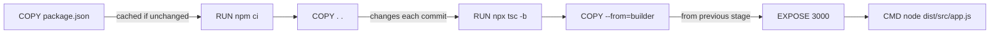

# Chapter 07 — Docker

## Learning Objectives
- Containerize a Node.js/Express application using Docker
- Understand Docker fundamentals: images, containers, Dockerfile, compose
- Build production-ready images with multi-stage builds
- Manage containers with `docker compose` for local development
- Debug common Docker issues: layer caching, resource limits, networking
- Integrate Docker into CI/CD pipelines (Chapter 06 connection)
- Optimize image size and build time with layer ordering and `.dockerignore`

## 7.1 Docker Fundamentals

### What is Docker?
Docker runs apps inside **containers** — lightweight packages with code, runtime, tools, libs and settings. A container isolates the app but shares the host OS kernel.

### Key Concepts
| Concept | Description |
|---------|-------------|
| **Image** | Read-only template built via `Dockerfile` |
| **Container** | Running instance of an image; process-level isolation |
| **Dockerfile** | Instructions `docker build` reads to create an image |
| **Docker Compose** | Multi-container apps via `docker-compose.yml` |
| **Registry** | Storage/distribution: GHCR, Docker Hub, ECR, Artifactory |
| **Layer** | Each `Dockerfile` instruction = cacheable layer |
| **Tag** | Image identifier: `api-gateway:v1.2.3` or `latest` |

### Docker vs. VMs
| Aspect | Docker | VM |
|--------|--------|-----|
| Guest OS | Shares host kernel | Full guest OS |
| Startup | Seconds | Minutes |
| Size | MBs | GBs |
| Isolation | Process-level | Hardware-level |
| Portability | High (same kernel) | Lower |

## 7.2 Dockerfile Best Practices

### Minimalist `Dockerfile`
```dockerfile
FROM node:22-alpine AS base
WORKDIR /usr/src/app
COPY package.json package-lock.json ./
RUN npm ci --omit=dev
COPY src/ ./src/
RUN npx tsc -b
EXPOSE 3000
CMD ["node", "dist/src/app.js"]
```

### Multi-Stage Build (Recommended for Production)
```dockerfile
# Stage 1: Build
FROM node:22-alpine AS builder
WORKDIR /usr/src/app
COPY package.json package-lock.json ./
RUN npm ci
COPY . .
RUN npx tsc -b

# Stage 2: Runtime
FROM node:22-alpine AS base
WORKDIR /usr/src/app
COPY --from=builder /usr/src/app/dist ./dist
COPY package.json ./
RUN npm ci --omit=dev
EXPOSE 3000
CMD ["node", "dist/src/app.js"]
```

### `.dockerignore` (Mirror of `.gitignore`)
```
node_modules
dist
.github
*.log
*.md
Dockerfile
docker-compose.yml
.travis.yml
.env*
.git/
.vscode/
```
### `.dockerignore` (Mirror of `.gitignore`)
```text
node_modules
dist
.github
*.log
*.md
Dockerfile
docker-compose.yml
.travis.yml
.env*
.git/
.vscode/
```
*Why?* Excludes unnecessary files from build context, reducing image size and build time.

## 7.3 `docker compose` for Local Development

### `docker-compose.yml`
```yaml
version: '3.8'
services:
  api-gateway:
    build: .
    ports:
      - "3000:3000"
    environment:
      - REDIS_URL=redis://redis:6379
      - JWT_SECRET=${JWT_SECRET}
    depends_on:
      - redis
    volumes:
      - ./src:/usr/src/app/src:ro
    restart: unless-stopped

  redis:
    image: redis:7-alpine
    ports:
      - "6379:6379"
    restart: unless-stopped

  nginx:
    image: nginx:stable-alpine
    ports:
      - "80:80"
      - "443:443"
    volumes:
      - ./nginx.conf:/etc/nginx/nginx.conf:ro
    depends_on:
      - api-gateway
    restart: unless-stopped
```

### Common `docker compose` commands
| Command | Description |
|---------|-------------|
| `docker compose up -d` | Start all services in detached mode |
| `docker compose down` | Stop and remove containers, networks, volumes |
| `docker compose logs` | View output from all services |
| `docker compose exec <service> <cmd>` | Run a command inside a running service |
| `docker compose ps` | List running services |
| `docker compose build` | Rebuild images (without starting containers) |
| `docker compose pull` | Pull image versions without creating containers |

### Health Checks
```yaml
services:
  api-gateway:
    healthcheck:
      test: ["CMD", "curl", "-f", "http://localhost:3000/healthz"]
      interval: 30s
      timeout: 10s
      retries: 3
      start_period: 10s
```
## 7.4 Debugging Docker Issues

### Common Problems and Solutions

| Problem | Symptom | Fix |
|---------|----------|-----|
| **Layer caching staleness** | Image doesn't reflect code changes | Put `COPY package.json` first; add `RUN npm ci` before code copy |
| **Image too large** | > 500 MB for Node.js app | Use `node:22-alpine`; multi-stage build; `.dockerignore` |
| **Container exits immediately** | Process crashes on start | Check `CMD`; ensure `dist/` exists; verify `node` version |
| **Network connectivity** | Can't reach Redis or external services | Check `depends_on`; use Docker network aliases; verify env vars |
| **Permission denied** | `EPERM` on volume mounts | Run with `sudo` (dev) or adjust ownership; use `:ro` for read-only |
| **Docker daemon not running** | `Cannot connect to the Docker daemon` | Start Docker Desktop / `dockerd`; check `DOCKER_HOST` |

### Docker Compose Debugging Commands

```bash
docker compose events
docker compose top
docker inspect <container_name_or_id>
docker compose logs -f --timestamps
docker exec <gateway> ping <redis>
```

### Layer Caching Strategy



**Optimal order:**
1. `COPY package.json package-lock.json` (cached)
2. `RUN npm ci` (cached if lockfile unchanged)
3. `COPY src/` (changes on code edit)
4. `RUN npx tsc -b` (recompiles if source changed)
## 7.5 CI/CD Integration (Chapter 06 Connection)

### GitHub Actions Docker Workflow

```yaml
name: CI/CD

on:
  push:
    branches: [main]
  pull_request:
    branches: [main]

jobs:
  build-and-test:
    runs-on: ubuntu-latest
    steps:
      - uses: actions/checkout@v4
      - uses: actions/setup-node@v4
        with:
          node-version: '22'
          cache: 'npm'
      - run: npm ci
      - run: npm run lint
      - run: npm run typecheck
      - run: npm test
      - name: Build Docker image
        run: |
          docker build -t api-gateway:${{ github.sha }} .
      - name: Push to GHCR
        run: |
          echo "${{ secrets.GHCR_TOKEN }}" | docker login ghcr.io -u ${{ github.actor }} --password-stdin
          docker tag api-gateway:${{ github.sha }} ghcr.io/myorg/api-gateway:${{ github.sha }}
          docker push ghcr.io/myorg/api-gateway:${{ github.sha }}
      - name: Scan image for CVEs
        run: |
          trivy image --exit-code 1 --severity HIGH,CRITICAL ghcr.io/myorg/api-gateway:${{ github.sha }}
      - name: Deploy with Docker Compose
        run: docker compose -f docker-compose.yml up -d
      - name: Smoke test
        run: |
          for i in {1..30}; do
            if curl -sf http://localhost:3000/healthz > /dev/null 2>&1; then
              echo "Healthy after $i s"
              break
            fi
            sleep 2
          done
```

## 7.6 Hands-On Exercises

### Beginner: Run the Gateway in Docker

1. Build the image: `docker build -t my-gateway .`
2. Start with compose: `docker compose up -d`
3. Test the health endpoint: `curl http://localhost:3000/healthz`
4. View logs: `docker compose logs -f`
5. Stop: `docker compose down`

**Success criteria:** Health endpoint returns `200 OK` with `{"status":"ok"}`.

### Intermediate: Multi-Stage Build Optimization

1. Convert the existing `Dockerfile` to a multi-stage build
2. Compare image sizes: `docker images --format "{{.Repository}}:{{.Tag}} {{.Size}}"`
3. Add `.dockerignore` and compare again
4. Measure build time with `time docker build .`

**Success criteria:** Multi-stage image < 150 MB (vs. > 500 MB single-stage); build time reduction with cache.

### Advanced: Production Image Hardening

1. Add `USER node` to the final `Dockerfile` stage (avoid `root`)
2. Add `HEALTHCHECK` instruction to the image
3. Sign the image with `cosign`: `cosign sign ghcr.io/myorg/api-gateway:sha`
4. Verify signature: `cosign verify ghcr.io/myorg/api-gateway:sha`
5. Run with non-root user: `docker run -u node ...`

**Success criteria:** Image runs as non-root; cosign signature verifies; healthcheck passes.
5. `COPY --from=builder` (multi-stage: copy built artifacts)

**Avoid:** Copying `.` before `npm ci` — this invalidates the dependency cache on every file change.
## 7.7 Chapter Summary

### Key Takeaways (5 points)

1. **Docker images are layered** — each `Dockerfile` instruction creates a cacheable layer; order matters for build speed and size.
2. **Multi-stage builds reduce image size** — compile in one stage, copy only artifacts to the final stage.
3. **`.dockerignore` is essential** — excludes `node_modules`, `dist/`, `.git/` from build context.
4. **Health checks enable self-healing** — Docker and compose can restart unhealthy containers automatically.
5. **CI/CD integration is seamless** — GitHub Actions can build, scan, push, and deploy Docker images.

### Docker Terminology Quick Reference

| Term | Definition |
|------|------------|
| `IMAGE` | Read-only template with instructions for creating a container |
| `CONTAINER` | Running instance of an image; isolated process |
| `DOCKERFILE` | Script of instructions to build an image |
| `COMPOSE` | YAML file for defining multi-container apps |
| `LAYER` | Each `Dockerfile` instruction produces a layer (cached) |
| `TAG` | Image identifier (e.g., `v1.2.3`, `latest`, git SHA) |
| `REGISTRY` | Storage/distribution system (GHCR, Docker Hub, ECR) |
| `HEALTHCHECK` | Directive to monitor container health |
| `RESTART POLICY` | When to restart container (`on-failure`, `unless-stopped`, `always`) |
| `VOLUME` | Persistent data mount outside container filesystem |
| `NETWORK` | Isolation mode (bridge, host, none, custom Docker network) |

### Comprehension Questions

1. What's the difference between `docker image build` and `docker compose up --build`?
2. Why should you put `COPY package.json` before `COPY src/` in a Node.js `Dockerfile`?
3. What does `.dockerignore` exclude, and why is it important?
4. How does a multi-stage build differ from a single-stage build? What are the benefits?
5. What are the five restart policies for `docker run --restart`?

### Revision Sheet (Flashcards)

| Front | Back |
|-------|------|
| What command builds a Docker image from a Dockerfile? | `docker build -t my-image .` |
| What does `EXPOSE 3000` do in a Dockerfile? | Documents the port the app listens on (doesn't publish it) |
| How do you publish a port from a container? | Use `-p 3000:3000` in `docker run` or `ports:` in compose |
| What command sets the working directory for subsequent `Dockerfile` instructions? | `WORKDIR` |
| What command removes stopped containers? | `docker container prune` or `docker compose down` |
| What is the smallest base image for a Node.js 22 app? | `node:22-alpine` (≈ 25 MB) |
| How do you run a command inside a running container? | `docker exec <container> <cmd>` or `docker compose exec <service> <cmd>` |
| What does `docker compose up -d` do? | Starts all services defined in compose in detached mode |
| What is the difference between `docker image rm` and `docker rmi`? | Aliases — same command, different syntax |
| How do you inspect a container's configuration? | `docker inspect <container_id_or_name>` |

### Engineering Problems (Solve These)

1. **Slow Docker builds** — Your `docker build` takes 3+ minutes even for minor code changes. Diagnose the layer ordering issue and restructure the `Dockerfile` to use cache effectively.

2. **Image too large** — Your Node.js Docker image is 650 MB. Apply multi-stage build, `.dockerignore`, and Alpine base to reduce it below 150 MB.

3. **Container exits immediately** — Your container starts then stops. Debug the `CMD`, check `dist/` existence, verify the Node.js version, and fix the entrypoint.

4. **Port conflict** — Two services want to use port 3000. Use `docker compose` with port mapping, or configure different ports, or use host network selectively.

5. **Health check fails in CI** — Your GitHub Actions workflow deploys with `docker compose up -d` but the smoke test times out. Add `healthcheck` to compose, increase retry count, or verify the service startup time.