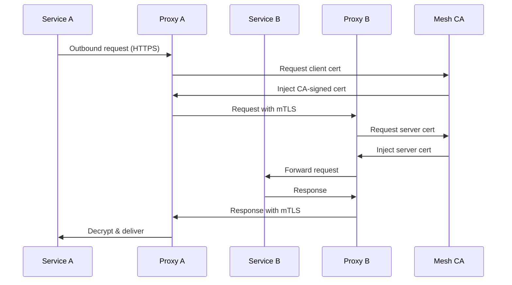

# Chapter 08 — Service Mesh

## Learning Objectives

- Understand what a service mesh is and why it's needed for microservices
- Compare popular service mesh implementations (Istio, Linkerd, Consul Connect)
- Implement mutual TLS (mTLS) for service-to-service authentication
- Configure traffic routing, retries, timeouts, and circuit breakers
- Observe service mesh metrics, traces, and logs with distributed tracing
- Deploy and manage a service mesh data plane (proxies, CRDs)
- Understand the control plane vs data plane architecture
- Evaluate when to add a service mesh to an existing architecture

## 8.1 Service Mesh Fundamentals

### What is a Service Mesh?

A **service mesh** is a dedicated infrastructure layer for handling service-to-service communication in microservices architectures. It provides capabilities like service discovery, load balancing, failure recovery, metrics, and secure communication without requiring changes to the application code.

A service mesh is typically implemented as a **sidecar proxy** pattern, where each service has an associated proxy (e.g., Envoy) that intercepts all inbound and outbound network traffic.

### Why You Need a Service Mesh

| Challenge | Without Service Mesh | With Service Mesh |
|-----------|---------------------|-------------------|
| **Secure communication** | Custom TLS config per service | mTLS automatically configured |
| **Observability** | Application must emit metrics/logs | Mesh provides centralized tracing, metrics, logs |
| **Reliability** | Retries/timeouts in app code | Mesh handles cross-cutting concerns |
| **Traffic routing** | Hardcoded or environment variables | Fine-grained routing via CRDs |
| **Service discovery** | Custom DNS or environment vars | Built-in service discovery |

### Control Plane vs Data Plane

```mermaid
graph TD
    subgraph Control Plane
        direction TB
        A[API Server] -->|stores config| B[Configuration Store]
        B --> C[Scheduler]
        C --> D[Controller Manager]
        D -->|syncs desired state| E[Sidecar Proxies]
    subgraph Data Plane
        direction TB
        F[Service A] -->|traffic through| G[Sidecar Proxy A]
        H[Service B] -->|traffic through| I[Sidecar Proxy B]
        G <--> I[Direct proxy-to-proxy]
    end
```

## 8.2 Popular Service Mesh Implementations

### Istio

| Aspect | Details |
|--------|---------|
| **Latest Version** | 1.18+ |
| **Base Proxy** | Envoy |
| **Key Features** | mTLS, traffic routing, observability, security policies, zero-trust networking |
| **Installation** | `kubectl apply -f istio-controlplane.yaml` |
| **Best For** | Complex microservices, Kubernetes-native teams |
| **Learning Curve** | Steep — many CRDs and concepts |

### Linkerd

| Aspect | Details |
|--------|---------|
| **Latest Version** | 21.09+ |
| **Base Proxy** | Envoy |
| **Key Features** | mTLS by default, simplicity, reliability metrics, no-sidecar mode |
| **Installation** | `linkerd install | kubectl apply -f -` |
| **Best For** | Teams new to service meshes, simplicity focus |
| **Learning Curve** | Gentle — "kubectl linkerd" friendly |

## 8.3 mTLS and Security

### Mutual TLS (mTLS) in Service Meshes

mTLS ensures that every service-to-service connection is authenticated and encrypted. The mesh generates certificates automatically and rotates them regularly.

### mTLS Flow



### Default mTLS Behavior

| Mesh | mTLS Default | Opt-Out |
|------|-------------|---------|
| Istio | Enabled for all traffic | `global.mtls.enabled = false` |
| Linkerd | Enabled for all traffic | `tap` or `trust` annotations |
| Consul Connect | Optional (per service) | `connect` sidecar can be disabled |

## 8.4 Traffic Management

### Traffic Routing with VirtualServices (Istio)

```yaml
apiVersion: networking.istio.io/v1beta1
kind: VirtualService
metadata:
  name: gateway-routing
spec:
  hosts:
    - my-service.namespace.svc.cluster.local
  http:
    - match:
        - headers:
            x-user-type:
              exact: premium
      route:
        - destination:
            host: my-service
            subset: premium-v1
    - route:
        - destination:
            host: my-service
            subset: standard-v1
```

### Subsets and Traffic Splitting

```yaml
apiVersion: networking.istio.io/v1beta1
kind: DestinationRule
metadata:
  name: my-service-dr
spec:
  host: my-service
  subsets:
    - name: v1
      labels:
        version: v1
    - name: v2
      labels:
        version: v2
    - name: canary
      labels:
        version: canary
---
apiVersion: networking.istio.io/v1beta1
kind: VirtualService
metadata:
  name: my-service-vr
spec:
  hosts:
    - my-service.namespace.svc.cluster.local
  http:
    - 70% to v1, 20% to v2, 10% to canary
      route:
        - destination.subset: v1
        - destination.subset: v2
        - destination.subset: canary
```

## 8.5 Observability

### Distributed Tracing

Service meshes inject tracing headers (e.g., `x-b3-traceid`, `x-b3-spanid`) into every request. Compatible with Jaeger, Zipkin, and Tempo.

```yaml
# Jaeger setup with Istio
apiVersion: opentelemetry.io/v1beta1
kind: OpenTelemetryCollector
metadata:
  name: otel-collector
spec:
  mode: installation
---
apiVersion: opentelemetry.io/v1beta1
kind: Instrumentation
metadata:
  name: my-service-otel
spec:
  image: otel/opentelemetry-java:latest
  # automatically collects traces via sidecar
```

### Metrics

Standard Prometheus metrics exported by the mesh:

| Metric | Description |
|--------|-------------|
| `istio_requests_total` | Total requests (with labels for destination, source, route) |
| `istio_requests_duration_seconds` | Request latency histogram |
| `istio_errrors_total` | Error count (5xx, client errors) |
| `proxy_cpu_seconds_total` | Proxy CPU usage |
| `mesh_delegated_calls_total` | Calls delegated to other services |

### Logs

Sidecar proxies emit access logs in JSON format:

```json
{
  "time": "2024-01-15T10:30:45Z",
  "proto": "http",
  "method": "GET",
  "path": "/api/users",
  "status": 200,
  "response_bytes": 512,
  "request_bytes": 128,
  "duration": "0.042s",
  "upstream_host": "my-service.namespace.svc.cluster.local",
  "upstream_service_time": "0.031s"
}
```
## 8.6 Deployment Strategies

### Canary Deployments

```yaml
# VirtualService for canary
apiVersion: networking.istio.io/v1beta1
kind: VirtualService
metadata:
  name: my-service-cd
spec:
  hosts:
    - my-service.namespace.svc.cluster.local
  http:
    - match:
        - headers:
            x-canary-test:
              exact: "true"
      route:
        - destination.subset: canary
    - route:
        - destination.subset: v1
        - weight: 90
        - destination.subset: canary
        - weight: 10
```

### Blue-Green Deployments

```yaml
# Create two subsets: v1 (blue) and v2 (green)
# Switch traffic via VirtualService weight
```

### A/B Testing

```yaml
# Split 50/50 traffic between two versions
apiVersion: networking.istio.io/v1beta1
kind: VirtualService
spec:
  http:
    - route:
        - destination.subset: v1
        - weight: 50
        - destination.subset: v2
        - weight: 50
```
## 8.7 Chapter Summary

### Key Takeaways (5 points)

1. **Service mesh = dedicated infrastructure** for service-to-service communication (east-west traffic)
2. **Sidecar proxy pattern** intercepts all network traffic per service without code changes
3. **mTLS is automatic** — service meshes generate and rotate certificates, eliminating custom TLS config
4. **Traffic management** via VirtualServices and DestinationRules enables canary, blue-green, and A/B testing
5. **Observability is built-in** — distributed tracing, Prometheus metrics, and JSON logs are standard

### Service Mesh vs. API Gateway Comparison

| | Service Mesh | API Gateway |
|---|---|---|
| **Traffic flow** | East-west (service-to-service) | North-south (client-to-service) |
| **Proxies** | Sidecar per service | Edge-facing |
| **Primary focus** | Reliability + security between services | Routing, auth, rate limiting at edge |
| **Typical use** | Microservices architectures | External API exposure |

### Service Mesh Terminology Quick Reference

| Term | Definition |
|------|------------|
| `SERVICE MESH` | Dedicated infrastructure layer for microservice communication |
| `SIDECAR PROXY` | Intercepts inbound/outbound traffic per service (typically Envoy) |
| `CONTROL PLANE` | Configures and manages the data plane (API server, configuration store, controllers) |
| `DATA PLANE` | Proxies that handle actual traffic (one per service) |
| `mTLS` | Mutual TLS — both server and client present certificates |
| `VIRTUALSERVICE` | Istio CRD for routing rules (hosts, http, tcp) |
| `DESTINATIONRULE` | Istio CRD for traffic policies (connection pool, timeouts, retries) |
| `SUBSET` | Label grouping for traffic splitting (e.g., v1, v2, canary subsets) |
| `CANNARY` | New version deployed alongside stable, receive limited traffic |
| `KIALI` | Istio-native observability dashboard for visualizing mesh |

### Comprehension Questions

1. What's the primary difference between a service mesh and an API gateway?
2. How does automatic mTLS work in a service mesh?
3. What are the three main service mesh implementations, and what are their strengths?
4. How do VirtualServices and DestinationRules work together for traffic management?
5. What observability features does a service mesh provide out of the box?

### Revision Sheet (Flashcards)

| Front | Back |
|-------|------|
| What does a service mesh primarily manage? | Service-to-service communication (east-west traffic) |
| What sidecar proxy is most commonly used in service meshes? | Envoy |
| What does mTLS stand for and what does it provide? | Mutual TLS — provides authentication and encryption for service-to-service traffic |
| What is the control plane in a service mesh? | The component that configures and manages the data plane (API server, configuration store, controllers) |
| What Istio CRD is used for traffic routing rules? | VirtualService |
| What Istio CRD is used for traffic policies (timeouts, retries)? | DestinationRule |
| What is a "subset" in service mesh terminology? | A label grouping for traffic splitting (e.g., v1, v2, canary subsets) |
| What tracing systems are compatible with service mesh automatic instrumentation? | Jaeger, Zipkin, Tempo |
| What Prometheus metric shows total requests with labels for destination/source/route? | `istio_requests_total` |
| What is the primary benefit of using a canary deployment? | Gradually roll out new versions while monitoring for issues |

### Engineering Problems (Solve These)

1. **Service mesh adoption hesitation** — Your organization is reluctant to add a service mesh due to complexity. Propose a phased adoption strategy starting with Linkerd for simplicity, or Istio's `pilot` profile minimal installation.

2. **Unexpected latency** — After adding a service mesh, you observe 200ms added latency per hop. Diagnose: check proxy startup time, connection pool settings, mTLS certificate verification overhead, and network topology.

3. **mTLS breakthrough** — A legacy service can't handle mTLS and fails with certificate errors. Diagnose: use `PeerAuthentication` mode `REQUEST_ONLY`, add `automount`: false, or sidecar replacement with `kubectl replace`.

4. **Traffic not routing** — Your VirtualService weight-based routing isn't working as expected. Check: subset labels match, DestinationRule host alignment, VirtualService host matching, and `istioctl analyze` output.

5. **Observability gap** — Your service mesh doesn't appear in Kiali or Jaeger. Diagnose: check telemetry configuration, tracing headers propagation, Jaeger query service reachability, and namespace isolation.