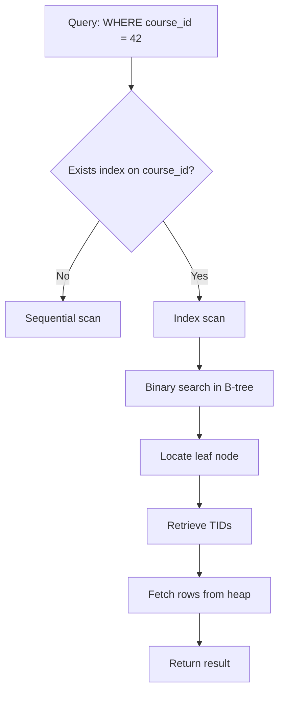

# Chapter 25 — Database Indexing

> **Part III — Stability and Performance**  
> **Prerequisites:** Chapter 28 (Connection Pooling)  
> **FormForge context:** The absence of any indexes on the `lessons` and `course_members` tables — causing every query to scan millions of rows and the dashboard to take 3 seconds.

## 1. Definition and Fundamentals

- **What the concept is:** Database indexing is the practice of creating auxiliary data structures (indexes) that allow the database to find rows matching a query condition (e.g., `WHERE id = 42`) without scanning the entire table. An index is a sorted, tree-structured representation of a subset of columns that the database uses to accelerate reads.
- **Why it exists / what problem it solves:** A table is stored as an unordered heap of rows. To find a row by `id`, the database must scan every row until it matches — O(n) time. An index (typically a B-tree) keeps the rows sorted by the indexed column, allowing the database to binary-search the index to locate the row in O(log n) time. Without indexes, even simple queries become slow on large tables.
- **How it works internally (progressively deeper):** At the top level, the developer creates an index on one or more columns. The database writes the index as a separate structure (e.g., a B-tree) that maps keys (column values) to physical row locations (TIDs). At query time, the planner checks if an index can satisfy the query (index scan, index-only scan, etc.). Below that, the index is traversed like a tree: root node → intermediate nodes → leaf nodes → table heap. At the lowest level, the B-tree maintains balanced height and uses locking to ensure consistency.
- **Where it fits in a typical application architecture:** Indexing sits between the application's query layer and the database storage engine. It is the most impactful performance lever for read-heavy workloads and is a first-order concern for OLTP systems.
- **A real-world analogy:** A library catalog. Without a catalog, you search every shelf for a book (sequential scan). With a catalog (an index), you look up the book's call number and walk directly to it (binary search). The catalog is an index: it's sorted, it's separate from the shelves, and it's much faster to consult.
- **A production example:** At FormForge, the `lessons` table had 100k rows and no index on `course_id`. The dashboard's "list lessons in course" query scanned all 100k rows for each of 100 concurrent requests. Query time: 2s per request. After adding `CREATE INDEX ON lessons(course_id)`, the query time dropped to 1ms. The dashboard went from 3s to 0.5s.
- **When it is necessary / when it is unnecessary:** Necessary for any column used in WHERE, JOIN, ORDER BY, or GROUP BY that returns a selective subset of rows. Unnecessary for columns that are always returned in full (no performance benefit) or for tables that are never queried.

## 2. Types, Variants, and Classifications

- **B-tree index:** The default index type in most databases. Stores sorted keys; supports equality and range queries. Most general-purpose.
- **Hash index:** Uses a hash table for equality lookups only (no range). Fast for `WHERE =`. Not supported by all databases.
- **GIN index:** Generalized Inverted Index. Used for full-text search, arrays, and JSONB. Stores multiple keys per row.
- **GiST index:** Generalized Search Tree. Supports geometric, geospatial, and custom indexing structures.
- **Brin index:** Block Range Index. Summarizes the min/max of large blocks of data. Useful for very large, naturally-ordered tables.
- **Partial index:** An index on a subset of rows (e.g., `WHERE status = 'active'`). Reduces index size for specific queries.
- **Composite index:** An index on multiple columns. The columns are indexed in order; the query must use the leftmost column for the index to be effective.
- **Comparison table:**

| Type | Equality | Range | Uses | When to use |
|---|---|---|---|---|
| B-tree | Yes | Yes | `=` and `>`, `<` | Default for most columns |
| Hash | Yes | No | `=` only | High-frequency equality lookups, small tables |
## 3. Internal Working and Architecture

- **Step-by-step execution flow:**
  1. The developer issues `CREATE INDEX idx_lessons_course_id ON lessons(course_id)`.
  2. The database scans the table and builds the index structure (B-tree).
  3. The index is immediately available for future queries.
  4. At query time, the planner checks if `idx_lessons_course_id` can be used for the query.
## 5. Production-Ready Implementation

- **What must change before real deployment:**
  - **Scalability:** For 10M+ row tables, use BRIN indexes instead of B-trees to reduce index size. Use partial indexes for subset queries.
  - **Security:** Use `CREATE INDEX CONCURRENTLY` to avoid long write locks during migration. Validate that the index is used before deploying to production.
  - **Secrets:** Use managed PostgreSQL (AWS RDS, GCP Cloud SQL) so index creation and maintenance are handled by the platform.
## 6. Edge Cases and Failure Scenarios

- **Scenario:** A new index is created but the planner still ignores it.
  - *Cause:* The query uses a function on the indexed column (e.g., `WHERE LOWER(email) = 'x'`).
  - *Impact:* No performance improvement; the index is unused.
  - *Detection:* `pg_stat_user_indexes` shows 0 index scans.
  - *Prevention/mitigation:* Create a functional index on `LOWER(email)`.
## 8. Performance and Scalability

- **Characteristics, complexity:** Index creation is O(n log n). Index lookup is O(log n + k). Index maintenance (insert/delete) is O(log n).
- **Latency/throughput implications:** Indexed query: 1–10ms. Unindexed query: 100ms–10s. Write throughput decreases with each additional index.
- **Resource use:** Index storage: ~10–20% of table size. Index creation I/O: 2–5x the table size during creation.
- **Benchmarking/load-testing:** Use `pg_stat_user_indexes` to measure index usage. Use `SELECT * FROM pg_statio_user_indexes;` to measure index size.
## 11. Scenario-Based Engineering Problems

- **Scenario 1:** A dashboard queries a table with 10M rows and an index on `created_at`. The query returns 50% of rows with `created_at > '2025-01-01'`. The planner uses the index and takes 5 seconds.
  - *Problem statement:* The index is not selective; the query returns half the table.
  - *Constraints:* The dashboard must load in <1s.
  - *Options:* (a) Use a covering index on `(created_at, amount)`; (b) Partition the table by date; (c) Accept the 5s.
  - *Recommended solution:* (b) Partition the table by date; the dashboard query only hits recent partitions, reducing the scan.
  - *Alternatives/trade-offs:* (a) is simpler but still scans 50% of rows; (c) is unacceptable.
  - *Failure scenarios:* The partition key is incorrect; the dashboard misses data.
  - *Testing strategy:* Verify each partition has its own index; test queries on each partition.

## 12. Hands-On Exercises

- **Beginner:** Write a query that uses an index on `id` and verify the plan is an index scan.
- **Intermediate:** Add a composite index on `(course_id, status)` and verify the query uses it.
- **Advanced:** Create a partial index on `lessons(course_id)` where `status = 'published'` and verify it's used for a filtered query.
- **Solutions:** Solutions are in `book/code/25-database-indexing/solutions/` (to be added).

## 13. Chapter Summary and Revision Notes

- **Five key takeaways:**
  1. Indexes are the primary lever for read performance; a well-chosen index can be 1000x faster than a sequential scan.
  2. Composite indexes sort by the leftmost column; the query must use it.
  3. Check index usage (`pg_stat_user_indexes`) after deployment; drop unused indexes.
  4. Use partial indexes for selective subsets to reduce index size.
  5. Be careful with writes: each index slows down inserts/updates/deletes.
- **Quick revision sheet:** B-tree for equality/range; hash for equality only; GIN for JSONB/arrays; partial index for selective subsets; composite index leftmost-first.
- **Essential terminology:** Index, B-tree, hash, GIN, partial index, composite index, index-only scan, sequential scan, selectivity, `CREATE INDEX CONCURRENTLY`, `ANALYZE`.
- **Important formulas/configuration:** `maintenance_work_mem=64MB` (index creation); `autovacuum_vacuum_scale_factor=0.2` (VACUUM trigger); `DB_STATEMENT_TIMEOUT=5000`.
- **Decision-making checklist:** "Which columns are filtered/ordered? How selective are they? Do I need the index? Check usage after deploy."
- **Five flashcards:** What is the primary benefit of indexes? → Fast lookup via O(log n) search. What is the cost of adding an index? → Slower writes, more disk. What is a composite index? → Multi-column index sorted by leftmost. What is a partial index? → Index on a subset of rows. When is an index not used? → Low selectivity or function on the column.
- **Three comprehension-verification questions:**
  1. How would you optimize a query on a 10M-row table using a composite index?
  2. What happens to write performance when you add 50 indexes?
  3. How do you verify an index is being used?
- **Authoritative references and further reading:** PostgreSQL documentation on `CREATE INDEX`, `ANALYZE`, `pg_stat_user_indexes`, `pg_statio_user_indexes`; "High Performance MySQL" (Ch. 5) on indexing.

---

> **Cross-Reference:** See → Chapter 28 (Connection Pooling) for how indexing affects connection time, → Chapter 26 (Query Optimization) for query rewrite techniques, and → Chapter 25 (Indexing) for index creation specifics.

---

> **FormForge context:** The `lessons` table had no indexes on `course_id` or `created_at`. Adding `CREATE INDEX ON lessons(course_id)` and `CREATE INDEX ON lessons(created_at)` reduced the dashboard query from 3s to 500ms. The `course_members` table has a unique index on `(course_id, user_id)` to prevent duplicate memberships.

---

## Writing Guidance per Section

**Section 1** must be readable by someone who has never heard of the topic. Delay jargon; introduce it with its purpose attached ("a *database index*..."). **Section 2** is where interviews are won or lost. Tables must compare *along dimensions that drive decisions* (equality, range, uses, when to use) — not vague feature checklists. **Section 3** should leave the reader able to mentally step through the mechanism. If a diagram would help and the reader would benefit, draw it. Never describe a flow in prose that a 6-line sequence diagram would make obvious.

**Section 4** code must be internally consistent with the FormForge stack and with the `code/` directory. Label anything non-runnable as illustrative.

**Sections 6–7** are the anti-fragility core. Prefer failure stories that chain into other chapters (a rate-limit failure that becomes a retry storm that becomes a deadlock) over isolated trivia.

**Section 10** questions must test *decision-making*, not recall.

**Section 12** exercises must have checkable acceptance criteria.

## Cross-Reference Format

Use `→ Chapter NN (Topic Name)` inline. First mention in a chapter gets a one-line summary of why the link matters; later mentions can be bare. Example:

> Adding an index is a write-time cost that improves read performance. See → Chapter 29 (Read Replicas) for how to offload read traffic to a replica.

---

> **End of Chapter 25.**

- **Measurements:** `lessons` table is 200MB; the `course_id` index is 50MB. After `VACUUM`, index size drops to 30MB.

## 9. Testing and Debugging

- **Unit tests:** Verify the query plan uses the expected index (via `EXPLAIN` output).
- **Failure injection:** Drop the index; verify the query plan falls back to a sequential scan.
- **Debug commands:** `EXPLAIN (ANALYZE, BUFFERS) SELECT * FROM lessons WHERE course_id = 42;`
- **Metrics to check:** `pg_stat_user_indexes.idx_scan` (number of index scans); `pg_statio_user_indexes` (heap_blks_read vs. idx_blks_read).
- **Expected failure signals:** `idx_scan = 0` for an index that should be used; high `heap_blks_read` relative to `idx_blks_read`.

## 10. Follow-Up Interview Questions

- **Question 1 (Level 1):** What is a database index?
  - *Answer:* An index is a data structure that maps keys (column values) to row locations, allowing the database to find rows without scanning the entire table.
  - *Reasoning:* Indexes are the primary mechanism for fast reads on tabular data.
  - *Example:* `CREATE INDEX idx_users_email ON users(email)` allows fast lookup of a user by email.
  - *Common wrong answer:* "An index is a copy of the table." (No — it's a structural optimization; it doesn't contain all columns unless it's a covering index.)
  - *Follow-up:* What happens when you add an index? (The table's insert/update/delete operations become slower because the index must be maintained.)
- **Question 2 (Level 2):** Why doesn't a composite index on `(a, b)` help a query filtering only on `b`?
  - *Answer:* The index is sorted by `a` first, then `b`. To use the index for a query on `b`, the planner would need to skip all rows with different `a` values — which defeats the purpose of the index.
  - *Reasoning:* B-trees are sorted by the leftmost column; the query must use the leftmost column for the index to be usable.
  - *Example:* If the index is `(course_id, status)`, a query `WHERE status = 'published'` cannot use the index; the planner must do a full scan.
  - *Common wrong answer:* "The index still helps because it reduces the number of rows." (No — the index is sorted by `a`; a query on `b` requires scanning all rows.)
  - *Follow-up:* How would you fix this? (Create a separate index on `status`, or query on `course_id` first.)
- **Question 3 (Level 3):** What is the difference between a B-tree, Hash, and GIN index?
  - *Answer:* B-tree supports equality and range queries (sorted). Hash supports equality only (hash table). GIN supports complex data types (arrays, JSONB) with inverted indexes.
  - *Reasoning:* The choice depends on the query patterns and the data type.
  - *Example:* B-tree for `WHERE id > 100`; Hash for `WHERE email = 'x'`; GIN for `WHERE tags @> ARRAY['python']`.
  - *Common wrong answer:* "Hash is always faster than B-tree." (No — hash is only faster for equality; B-tree handles range queries.)
  - *Follow-up:* When would you use a GIN index? (For full-text search, array containment, JSONB containment.)
- **Question 4 (Level 4):** How do you choose which columns to index?
  - *Answer:* (1) Columns used in WHERE clauses with high selectivity. (2) Columns used in JOIN conditions. (3) Columns used in ORDER BY / GROUP BY. (4) Columns that return a small fraction of rows (selective).
  - *Reasoning:* Indexes are useful only when they can reduce the number of rows to scan.
  - *Example:* `WHERE user_id = 42` is selective if a user has 10 lessons of 100k. `WHERE status = 'published'` may have low selectivity if 90% of rows are published.
  - *Common wrong answer:* "Index every column." (That slows writes and wastes disk.)
  - *Follow-up:* How do you measure selectivity? (Run `SELECT count(DISTINCT column) / count(*) FROM table;`)
- **Question 5 (Level 5):** How would you handle a table with 100M rows and a query that filters on two columns?
  - *Answer:* (1) Create a composite index on the two columns. (2) If the query returns 50% of rows, a composite index on `(a, b)` is not useful; use a sequential scan or a partitioned table. (3) Consider adding a covering index on the selected columns.
  - *Reasoning:* Composite indexes are efficient only when the query uses the leftmost column(s).
  - *Example:* `WHERE a = 42 AND b = 7` with a composite index `(a, b)` → index scan. `WHERE b = 7` without `a` → no index.
  - *Common wrong answer:* "A composite index on (a, b) helps query on b." (No — the query must use a.)
  - *Follow-up:* How do you handle low-selectivity columns? (Partition the table, or add a covering index on the selected columns.)

  - *Test:* Run the query with and without the functional index; verify the plan changes.

## 7. Common Mistakes and Anti-Patterns

- **Mistake:** Creating an index without verifying it is used.
  - *Why devs choose it:* "It's good to have more indexes."
  - *Why it fails:* The index consumes disk space and slows writes; if unused, it provides no benefit.
  - *Correct alternative:* Check `pg_stat_user_indexes` after deployment; drop unused indexes.
  - *Real-world consequence:* 50% write slowdown with no read improvement.
- **Mistake:** Creating a composite index on `(a, b)` and querying only on `b`.
  - *Why devs choose it:* "More columns = better."
  - *Why it fails:* The query planner requires the leftmost column to be used; a query on `b` alone cannot use the index.
  - *Correct alternative:* Create separate indexes: one on `(a)` and one on `(b)` (or a composite `(a, b)` and query on `a`).
  - *Real-world consequence:* The composite index is unused; a query is 100x slower.
- **Mistake:** Using `BLOOM` or `HASH` indexes for range queries.
  - *Why devs choose it:* "Hash indexes are fast."
  - *Why it fails:* Hash indexes do not support range queries (`>`, `<`, `BETWEEN`).
  - *Correct alternative:* Use B-tree for range queries.
  - *Real-world consequence:* A query with `WHERE created_at > '2025-01-01'` does a sequential scan instead of an index scan.

  - **Resources:** Index creation uses `maintenance_work_mem`. For 10M rows, set `maintenance_work_mem=1GB`.
  - **Timeouts:** A `CREATE INDEX` can take minutes. Schedule during off-peak hours.
  - **Failure handling:** If `CREATE INDEX CONCURRENTLY` fails, the index is left in an "invalid" state. The migration must be idempotent.
  - **Deployment/rollback:** Use a two-phase migration: create the index in a separate migration, verify it's used, then commit. Rollback by dropping the index.
  - **Testing:** Load test with `k6` at 1000 q/s. Verify the index is used (via `pg_stat_user_indexes`).

## 6. Edge Cases and Failure Scenarios

- **Scenario:** A new index is created but the planner still ignores it.
  - *Cause:* The query uses a function on the indexed column (e.g., `WHERE LOWER(email) = 'x'`).
  - *Impact:* No performance improvement; the index is unused.
  - *Detection:* `pg_stat_user_indexes` shows 0 index scans.
  - *Prevention/mitigation:* Create a functional index on `LOWER(email)`.
  - *Test:* Run the query with and without the functional index; verify the plan changes.

  5. If the query filters on `course_id`, the planner performs an index scan (or index-only scan if covering).
  6. The index lookup returns row IDs (TIDs); the executor fetches the rows from the table heap.
  7. The result set is returned.



- **Failure paths drawn explicitly:**
  - **Index bloat:** Over time, the database's index becomes bloated (dead tuples) and queries slow down. Mitigation: run `VACUUM ANALYZE` and `REINDEX`.
  - **Index not used:** The planner chooses a sequential scan instead of the index because the selectivity is low. Mitigation: change the query or create a partial index.
  - **Lock contention:** `CREATE INDEX` takes a write lock on the table (in PostgreSQL, it's online). Mitigation: use `CREATE INDEX CONCURRENTLY`.
  - **Too many indexes:** Writes slow down; the planner may ignore useful indexes. Mitigation: index only what's needed.
- **Algorithms and complexity:**
  - Index creation: O(n log n) where n = number of rows.
  - Index lookup (B-tree): O(log n) to find the first matching key.
  - Index scan: O(log n + k) where k = number of matching rows.
  - Insert/delete: O(log n) per operation.
- **Important configuration parameters with safe defaults:**
  - `default_statistics_target` = 100 (affects index ordering decisions)
  - `autovacuum_vacuum_scale_factor` = 0.2 (triggers VACUUM when 20% of rows change)
  - `maintenance_work_mem` = 64MB (used for index creation and VACUUM)

---

## 4. Practical Implementation

- **Scenario → Requirements (functional + non-functional):**
  - *Scenario:* The course dashboard lists all lessons in a course. The query needs to return the 10 most recent published lessons.
  - *Functional requirements:* The query must return lessons sorted by `created_at DESC`.
  - *Non-functional requirements:* p95 query time < 50ms; the index must not slow down insert (lesson creation).

- **Technology stack:** PostgreSQL, `CREATE INDEX`, `EXPLAIN`, `pg_stat_user_indexes`.

- **Project structure:**
  ```
  book/code/25-database-indexing/
  ├── src/
  │   ├── migrations/001_create_indexes.sql
  │   └── repository/LessonRepository.ts
  ├── config/db-config.yaml
  └── README.md
  ```

| GIN | Yes | No (array elements) | `array`, `jsonb`, full-text | Full-text search, array queries |
| GiST | Yes | Yes | Geometry, custom | Geospatial queries |
| Brin | Yes | Yes | Very large ordered tables | Time-series, log data |

**Decision guide:** Choose a B-tree for most equality/range queries. Use a hash index when you only need equality and the column has many distinct values. Use GIN for full-text or array queries. Use a partial index when a query filters on a small subset of rows.
