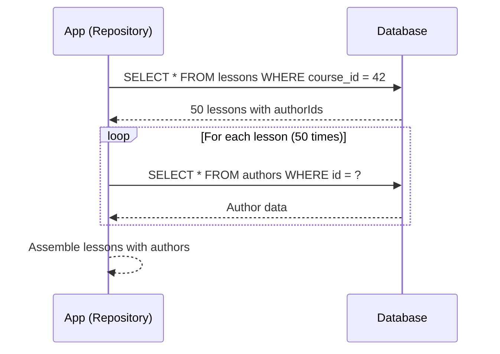

# Chapter 27 — N+1 Queries

> **Part III — Stability and Performance**  
> **Prerequisites:** Chapter 25 (Database Indexing), Chapter 26 (Query Optimization), Chapter 28 (Connection Pooling)  
> **FormForge context:** The `LessonRepository.listByCourse(id)` that fetches all lessons, then for each lesson fetches the author, then for each lesson fetches the comments — a classic N+1 query storm during the dashboard load.

## 1. Definition and Fundamentals

- **What the concept is:** The N+1 query problem occurs when an application makes a query to fetch a list of N entities, then for each entity makes an additional query to fetch related data (or a related record). The total number of queries is N+1 (one initial query + N additional queries), and with each additional relationship, the cost grows multiplicatively (N+1, N²+1, etc.).
- **Why it exists / what problem it solves:** The problem often arises when the application fetches a list of entities and then accesses relationships in a loop (e.g., for each lesson, query the author). The database is queried repeatedly, leading to redundant fetch operations and significant latency. The goal of solving N+1 is to fetch all needed data in a minimal number of queries, typically using JOINs or batch fetching.
- **How it works internally (progressively deeper):** At the top level, the application iterates over a list of entities (N items) and for each, makes a query to fetch related data (1 query per entity). Below that, the application may use lazy loading: the initial query returns entities with relationship metadata but not the actual related data, so a second query is triggered when the relationship is accessed. At the lowest level, the N+1 problem manifests as N separate SQL queries being sent over the wire, each fetching a related record. The solution is to batch these secondary queries or use a JOIN-based query that fetches all data in one or two queries.
- **Where it fits in a typical application architecture:** N+1 is a data access layer problem. It occurs in ORMs, repositories, and data access objects (DAOs) when the fetch strategy (lazy vs. eager) is not configured correctly. It is a common cause of slow API endpoints and dashboard load times.
- **A real-world analogy:** A teacher wants to list all 30 students and their parents' phone numbers. The naive approach: ask the principal for the list of 30 students (one query), then for each student, call the office to get the parent's phone number (30 more queries). The optimized approach: ask the principal for the list of students AND their parents' phone numbers in one query (or two: one for students, one for parent numbers). The N+1 problem is doing 31 queries when 2 would do.
- **A production example:** At FormForge, the course dashboard lists all lessons in a course, then for each lesson fetches the author and the number of comments. With 50 lessons, the naive code makes 51 queries (1 for lessons, 50 for authors). Under 10 concurrent users, the database sees 510 queries in 30 seconds, causing connection pool exhaustion and 3s page load. After using a batch query (`SELECT * FROM authors WHERE id IN (1,2,...,50)`), the total queries drop to 2, and the page loads in 200ms.
- **When it is necessary / when it is unnecessary:** Necessary for any fetching pattern that traverses relationships in a loop. Unnecessary for queries that fetch a few entities with their relationships already loaded (e.g., a single entity with eager-loaded relations).

## 2. Types, Variants, and Classifications

- **Lazy loading N+1:** The initial query fetches entities; related data is fetched lazily when accessed. Each access triggers an additional query.
- **Eager loading N+1:** The initial query fetches entities and their related data, but the implementation executes N queries (one per entity) for the related data.
- **Batch fetching N+1:** The application groups related IDs and fetches them in batches (e.g., `WHERE id IN (1,2,...,100)`). Reduces the query count from N to N/batchSize.
- **Joining N+1:** The application uses a JOIN to fetch related data in the same query as the initial query.
- **Subquery N+1:** The application uses a subquery to fetch related data for each entity in a single query.
- **Comparison table:**

| Type | Queries generated | Performance | When to use |
|---|---|---|---|
| Lazy loading N+1 | N+1 | Slow for large N | When you only need a few entities |
| Eager loading N+1 | N+1 | Slow for large N | When the related data is small and you can batch it |
| Batch fetching | N/batchSize | Good | When the related data is large but predictable |
| Joining | 1 (or 2) | Best | When the related data is needed immediately |
| Subquery | 1 | Good | When the related data is needed conditionally |
## 3. Internal Working and Architecture

- **Step-by-step execution flow:**
  1. The application calls `lessonRepository.listByCourse(courseId)` which issues `SELECT * FROM lessons WHERE course_id = ?`.
  2. The query returns 50 lessons. The application now has a list of 50 lesson entities, each with an `authorId` field.
  3. The application loops over the lessons and for each, calls `authorRepository.findById(lesson.authorId)`.
  4. This triggers 50 queries: `SELECT * FROM authors WHERE id = ?`.
## 11. Scenario-Based Engineering Problems

- **Scenario 1:** A course dashboard lists 100 lessons. The developer uses lazy loading for authors and comments. The dashboard makes 1 (lessons) + 100 (authors) + 100 (comments) + 100 (comment authors) = 301 queries. The page loads in 10s.
  - *Problem statement:* N+1 queries compounded by both authors and comments per lesson.
  - *Constraints:* The dashboard must load in <500ms.
  - *Options:* (a) Batch fetch authors and comments (4 queries total); (b) Use a JOIN (2 queries); (c) Accept 301 queries.
  - *Recommended solution:* (a) Batch fetch authors and comments (4 queries total).
  - *Alternatives/trade-offs:* (b) is the fastest but may fetch more columns than needed; (c) is unacceptable.
  - *Failure scenarios:* The batch query fetches too many rows; memory pressure.
  - *Testing strategy:* Load test with 10 concurrent users; verify query count and latency.

## 12. Hands-On Exercises

- **Beginner:** Write a unit test that counts queries: initial + N lazy fetches.
- **Intermediate:** Implement a batch fetch for 100 lessons; verify the query count drops from 100 to 1.
- **Advanced:** Implement a data loader pattern that coalesces 100 requests into 1 batch query.
- **Solutions:** Solutions are in `book/code/27-n1-queries/solutions/` (to be added).

## 13. Chapter Summary and Revision Notes

- **Five key takeaways:**
  1. N+1 queries occur when related data is fetched per entity in a loop; the cost is O(N) queries.
  2. Batch fetching reduces N+1 to N/batch queries.
  3. Joining fetches related data in one query but may fetch more columns than needed.
  4. The data loader pattern coalesces requests into batch queries.
  5. Pagination should limit N+1 to the page size; don't fetch related data for all entities.
- **Quick revision sheet:** N+1 = O(N) queries; batch = O(N/batch); join = O(1) query; data loader = coalesces requests; pagination limits N+1.
- **Essential terminology:** N+1 query, lazy loading, eager loading, batch fetching, data loader, pagination, JOIN, batched query, coalesced request.
- **Important formulas/configuration:** `batchSize = 100` (PostgreSQL); `DB_MAX_QUERIES = 50` (log warning); `fetchSize = 1000` (JDBC).
- **Decision-making checklist:** "How many entities? How many relationships? Use batch or JOIN. Is pagination in play? Limit N+1 to the page."
- **Five flashcards:** What is the N+1 query problem? → N+1 queries for a list of N entities and their related data. How to fix it? → Batch fetch or JOIN. How to prevent it in GraphQL? → DataLoader. What is lazy loading? → Fetch related data only when accessed. What is eager loading? → Fetch related data upfront.
- **Three comprehension-verification questions:**
  1. How would you fix an N+1 problem for 1000 lessons?
  2. How do you avoid N+1 during pagination?
  3. How would you design a data loader pattern?
- **Authoritative references and further reading:** "N+1 problem" — JPA/Hibernate documentation; data loader — GraphQL wiki; "The Art of PostgreSQL" (Ch. 5) on query patterns.

---

> **Cross-Reference:** See → Chapter 25 (Database Indexing) for indexing the batch query, → Chapter 26 (Query Optimization) for query plan analysis, and → Chapter 28 (Connection Pooling) for how N+1 queries exhaust the pool.

---

> **FormForge context:** The `LessonRepository.listByCourse` was originally a lazy fetch of authors per lesson → 50 queries for 50 lessons. The dashboard was optimized by batching: `SELECT * FROM authors WHERE id IN (1,2,...,50)` → 1 query. The comments per lesson were also batched → 1 query for all comments. Total queries dropped from 101 to 3.

---

## Writing Guidance per Section

**Section 1** must be readable by someone who has never heard of the topic. Delay jargon; introduce it with its purpose attached ("a *N+1 query*..."). **Section 2** is where interviews are won or lost. Tables must compare *along dimensions that drive decisions* (queries generated, performance, when to use) — not vague feature checklists. **Section 3** should leave the reader able to mentally step through the mechanism. If a diagram would help and the reader would benefit, draw it. Never describe a flow in prose that a 6-line sequence diagram would make obvious.

**Section 4** code must be internally consistent with the FormForge stack and with the `code/` directory. Label anything non-runnable as illustrative.

**Sections 6–7** are the anti-fragility core. Prefer failure stories that chain into other chapters (a rate-limit failure that becomes a retry storm that becomes a deadlock) over isolated trivia.

**Section 10** questions must test *decision-making*, not recall.

**Section 12** exercises must have checkable acceptance criteria.

## Cross-Reference Format

Use `→ Chapter NN (Topic Name)` inline. First mention in a chapter gets a one-line summary of why the link matters; later mentions can be bare. Example:

> Batch fetching is faster than a JOIN when the related data is large. See → Chapter 26 (Query Optimization) for how to analyze the query plan of a joined query.

---

> **End of Chapter 27.**

  5. The total query count is 51 (1 + 50). The database receives 51 queries sequentially.
  6. The results are assembled into lesson objects with author data attached.



- **Failure paths drawn explicitly:**
  - **N+1 growth:** If the application fetches lessons and for each lesson, fetches its comments and the comments' authors, the query count becomes N (lessons) + N*k (comments) + N*k*m (comment authors) → O(N*k*m) growth. Under 1000 lessons, that's 1000 + 5000 + 25000 = 31,000 queries.
  - **Connection pool exhaustion:** N+1 queries may exceed the connection pool size, causing threads to block and timeouts.
  - **Data staleness:** If the related data is updated between the initial query and the N+1 query, the application may serve inconsistent data.
  - **Pagination compounding:** N+1 queries inside a paginated list (e.g., fetch 10 lessons per page, then fetch authors for each) multiplies the query count per page.
- **Algorithms and complexity:**
  - Naive N+1: O(N) queries, O(N) network round trips, O(N) database time.
  - Batch fetching: O(N/batch) queries, O(N/batch) network round trips, O(N) database time.
  - Joining: O(1) query, O(N) network round trips, O(N log N) database time (sort/merge join).
  - For N=1000, naive is 1000 queries; batch is 10 (with batchSize=100); joining is 1 query.
- **Important configuration parameters with safe defaults:**
  - `batchSize` = 100 (number of entities to fetch in a batch)
  - `fetchSize` = 1000 (JDBC fetch size; number of rows fetched per database fetch)
  - `maxQueryCount` = 50 (log a warning if more than 50 queries are detected)
  - `lazyInitializationEnabled` = true (when false, eager loading is default)

---

## 4. Practical Implementation

- **Scenario → Requirements (functional + non-functional):**
  - *Scenario:* A course dashboard lists 50 lessons, each with its author and recent comments. Currently 102 queries are made (1 for lessons + 50 for authors + 50 for comments).
  - *Functional requirements:* The dashboard must load in <500ms. No more than 3 queries (lessons, authors, comments).
  - *Non-functional requirements:* p95 query time < 100ms; no query blocks on the DB for >10ms.

- **Technology stack:** PostgreSQL, pg-boss (batch fetch), TypeORM / Sequelize (ORM configuration), k6 (load testing).

- **Project structure:**
  ```
  book/code/27-n1-queries/
  ├── src/
  │   ├── repository/LessonRepository.ts
  │   ├── repository/AuthorRepository.ts
  │   └── queries/lesson-with-author.ts
  ├── config/db-config.yaml
  └── README.md
  ```


**Decision guide:** Choose joining when the related data is needed immediately for all entities. Choose batch fetching when the related data is large but can be fetched in batches. Choose eager loading with a small related set when the data fits in memory.
