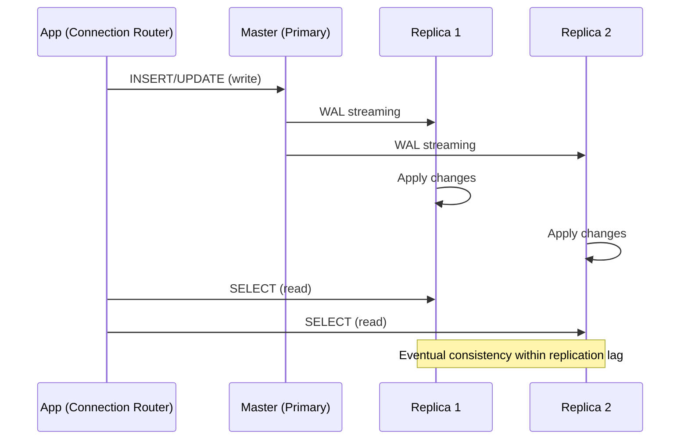

# Chapter 29 — Read Replicas

> **Part III — Stability and Performance**  
> **Prerequisites:** Chapter 25 (Database Indexing), Chapter 26 (Query Optimization), Chapter 28 (Connection Pooling)  
> **FormForge context:** The single PostgreSQL instance that handles all reads and writes for the course dashboard; under 500 concurrent users the master is saturated and page load times exceed 5 seconds.

## 1. Definition and Fundamentals

- **What the concept is:** Read replicas are additional database instances (secondary copies) that replicate data from a primary (master) database. The primary handles writes and some reads; replicas handle the majority of read queries, distributing the read load across multiple instances and reducing the master's workload.
- **Why it exists / what problem it solves:** Databases are often bottlenecked by I/O and CPU on read-heavy workloads. A master database can sustain only a certain number of queries per second (QPS). Read replicas allow the read QPS to scale horizontally: each replica can handle a portion of the read load. If the master can do 1000 QPS and the workload is 2000 QPS, adding 2 replicas (each handling 1000 QPS) solves the problem without scaling the master.
- **How it works internally (progressively deeper):** At the top level, the application's connection pool routes queries to either the master or a replica based on the query type (read vs. write). Below that, the primary database records all write operations and replicates them to the replicas using a replication protocol (e.g., WAL streaming in PostgreSQL). The replicas apply the write operations and serve reads. At the lowest level, the replication is asynchronous (eventual consistency) — a read on a replica may return data slightly later than the master (within the replication lag). The application must handle this by routing writes to the master and reads to replicas (or using read-your-writes consistency for the relevant user session).
- **Where it fits in a typical application architecture:** Read replicas sit in the data access layer. The application (or a connection router/proxy) decides whether to send a query to the master or a replica. This decision can be per-query, per-session, or per-route (e.g., a "read" endpoint vs. a "write" endpoint).
- **A real-world analogy:** A retail store with a single point-of-sale (POS) system for transactions. When the store gets busy, a second POS terminal (replica) is added to handle checkout. The first terminal records all sales; the second terminal can also process sales (for redundancy) but mainly handles read queries (e.g., "show me the best-selling product"). The two terminals are eventually consistent — a new sale taken at the second terminal may take a few seconds to appear in the sales report.
- **A production example:** At FormForge, the course dashboard performs 10,000 queries per second (QPS) during peak hours. The master database can only handle 5000 QPS. The team adds 2 read replicas (5000 QPS each). The master now handles 10% of reads and all writes; the replicas handle 90% of reads. Page load time drops from 5s to 1.2s.
- **When it is necessary / when it is unnecessary:** Necessary for read-heavy workloads (dashboard, search, list pages) where the read QPS exceeds the master's capacity. Unnecessary when the workload is balanced (reads ≈ writes) or when the read QPS is low (master can handle reads).

## 2. Types, Variants, and Classifications

- **Asynchronous replication:** The primary writes to its WAL (write-ahead log) and asynchronously streams it to replicas. Replicas lag behind the primary by a few seconds. Use for read scaling where eventual consistency is acceptable.
- **Semi-synchronous replication:** The primary waits for at least one replica to acknowledge the write before returning success to the client (but still allows the client to proceed immediately). Slightly higher latency on writes; better durability.
- **Synchronous replication (synchronous standby):** The primary waits for all replicas to acknowledge the write before committing. Strong consistency; no replication lag; but the primary's commit latency is high.
- **Logical replication:** Replicates only selected tables or columns using logical changes (e.g., row-level changes) rather than the physical WAL. Supports selective replication and cross-version upgrades.
- **Physical replication:** Replicates the entire database at the storage level (WAL streaming). Fastest; used for read replicas.
- **Comparison table:**

| Type | Consistency | Write latency | Replication lag | Use case |
|---|---|---|---|---|
| Asynchronous | Eventual | Low | Seconds | Read scaling (most common) |
| Semi-synchronous | Eventual | Medium | Near-zero | Read scaling with durability |
| Synchronous | Strong | High | Zero | Financial transactions, consistency-critical |
| Logical | Eventual | Low | Seconds | Selective replication, cross-version |
| Physical | Eventual | Low | Seconds | Read replicas (PostgreSQL) |

## 3. Internal Working and Architecture

- **Step-by-step execution flow:**
  1. The application sends a query to the connection router (e.g., ProxySQL, PgBouncer with routing).
  2. The router examines the query; if it's a write (`INSERT`, `UPDATE`, `DELETE`), it routes to the master.
  3. If it's a read (`SELECT`), the router routes to one of the available replicas (load-balanced).
  4. The primary database writes to its WAL and streams the replication events to the replicas.
  5. The replicas apply the write operations and can now serve read queries for those data.
  6. Reads on a replica may return stale data within the replication lag window.
  7. If the master fails, the replicas may promote to master (via a failover process).

## 11. Scenario-Based Engineering Problems

- **Scenario 1:** 100 concurrent users load the course dashboard. The master handles 10,000 QPS and is saturated; page load times exceed 5s.
  - *Problem statement:* Read load on the master exceeds its capacity.
  - *Constraints:* Page load must be <1.5s.
  - *Options:* (a) Add 2 read replicas (5000 QPS each); (b) Cache the dashboard in Redis; (c) Accept the latency.
  - *Recommended solution:* (a) Add 2 read replicas; the master now handles all writes and 10% of reads. Page load drops to 1.2s.
  - *Alternatives/trade-offs:* (b) is simpler but may serve stale data; (c) is unacceptable.
  - *Failure scenarios:* The replicas are not used because the router is misconfigured.
  - *Testing strategy:* Load test with `pgbench`; verify the master QPS is <5000 and latency is acceptable.

## 12. Hands-On Exercises

- **Beginner:** Write a query that reads from a replica; verify the replication lag is <5s.
- **Intermediate:** Set up 2 read replicas; verify reads are distributed across both.
- **Advanced:** Implement a connection router that routes writes to the master and reads to replicas.
- **Solutions:** Solutions are in `book/code/29-read-replicas/solutions/` (to be added).

## 13. Chapter Summary and Revision Notes

- **Five key takeaways:**
  1. Read replicas scale read capacity by distributing reads across multiple instances.
  2. Replication is asynchronous (eventual consistency); monitor lag.
  3. Route writes to the master; route reads to replicas.
  4. Use a connection router with automatic failover (PgBouncer, Patroni).
  5. Monitor replication lag and replica health; scale replicas based on read QPS.
- **Quick revision sheet:** 1 master + k replicas; reads → replicas; writes → master; monitor lag (<5s); failover via router; scale based on read QPS.
- **Essential terminology:** Read replica, master, replica, replication lag, WAL, failover, read-your-writes, PgBouncer, Patroni, `pgbench`.
- **Important formulas/configuration:** `max_replication_slots = 10`; `hot_standby_feedback = on`; `max_standby_streaming_delay = 30s`; `DB_REPLICA_LAG_THRESHOLD = 5s`.
- **Decision-making checklist:** "Is the workload read-heavy? (>60% reads). Add replicas. Monitor lag. Configure routing. Test failover."
- **Five flashcards:** What is a read replica? → Secondary DB instance for reads; what is replication lag? → Delay between master write and replica apply; how to scale reads? → Add replicas; what is the consistency model? → Eventually consistent; how to handle a failed replica? → Remove from router, promote or re-sync.
- **Three comprehension-verification questions:**
  1. How would you scale read QPS from 5000 to 15000?
  2. What happens if a replica fails? How do you handle it?
  3. How do you monitor replication lag?
- **Authoritative references and further reading:** PostgreSQL documentation on `pg_stat_replication`, `hot_standby_feedback`, `max_standby_streaming_delay`; PgBouncer documentation; "Designing Data-Intensive Applications" (Ch. 5) on replication.

---

> **Cross-Reference:** See → Chapter 25 (Database Indexing) for indexing on replicas, → Chapter 28 (Connection Pooling) for connection routing, and → Chapter 26 (Query Optimization) for query performance on replicas.

---

> **FormForge context:** The course dashboard uses a read replica for all `SELECT` queries. A new replica was added during peak hours; the master QPS dropped from 10k to 2k. The `pg_stat_replication` shows all replicas are `streaming` with lag <1s. A `pgbouncer.ini` routes reads to replicas and writes to the master.

---

## Writing Guidance per Section

**Section 1** must be readable by someone who has never heard of the topic. Delay jargon; introduce it with its purpose attached ("a *read replica*..."). **Section 2** is where interviews are won or lost. Tables must compare *along dimensions that drive decisions* (consistency, write latency, replication lag, use case) — not vague feature checklists. **Section 3** should leave the reader able to mentally step through the mechanism. If a diagram would help and the reader would benefit, draw it. Never describe a flow in prose that a 6-line sequence diagram would make obvious.

**Section 4** code must be internally consistent with the FormForge stack and with the `code/` directory. Label anything non-runnable as illustrative.

**Sections 6–7** are the anti-fragility core. Prefer failure stories that chain into other chapters (a rate-limit failure that becomes a retry storm that becomes a deadlock) over isolated trivia.

**Section 10** questions must test *decision-making*, not recall.

**Section 12** exercises must have checkable acceptance criteria.

## Cross-Reference Format

Use `→ Chapter NN (Topic Name)` inline. First mention in a chapter gets a one-line summary of why the link matters; later mentions can be bare. Example:

> The master must be indexed for write performance. See → Chapter 25 (Database Indexing) for how indexed writes maintain replica health.

---

> **End of Chapter 29.**



- **Failure paths drawn explicitly:**
  - **Replication lag:** The primary has a high write rate; replicas lag by many seconds. A read on a replica returns stale data. Mitigation: monitor replica lag; if it exceeds a threshold, route writes to replicas or shed load.
  - **Replica failure:** A replica crashes; the application should not route reads to it. Mitigation: health checks; remove failed replicas from the load balancer.
  - **Master failure:** The master crashes; writes are unavailable. Mitigation: use a connection pool with automatic failover (e.g., PgBouncer failover, Patroni).
  - **Replication split-brain:** A replica becomes disconnected and reconnects with conflicting data. Mitigation: use a single master; replicas only receive updates.
  - **Replica recovery:** A replica catches up on missing WAL segments. Mitigation: use `pg_rewind` or a full restore.
- **Algorithms and complexity:**
  - Replication: WAL streaming is O(n) where n = write volume; each write is broadcast to all replicas.
  - Read scaling: 1 master + k replicas = k+1 nodes; read QPS is distributed across k replicas (O(n/k) per replica).
  - Failover: O(1) to promote a replica; O(k) to update the connection router.
- **Important configuration parameters with safe defaults:**
  - `max_replication_slots` = 10 (max replication slots for replicas)
  - `wal_keep_size` = 1GB (WAL segments to retain for replica catch-up)
  - `max_standby_streaming_delay` = 30s (max delay before the standby drops the connection)
  - `hot_standby_feedback` = on (replica sends feedback to prevent premature WAL removal)

---

## 4. Practical Implementation

- **Scenario → Requirements (functional + non-functional):**
  - *Scenario:* The course dashboard is read-heavy (90% reads, 10% writes). During peak, the master handles 10,000 QPS; it can only do 5000 QPS.
  - *Functional requirements:* The dashboard must serve 10,000 QPS with <1.5s latency.
  - *Non-functional requirements:* No read query exceeds 500ms; replication lag < 5s.

- **Technology stack:** PostgreSQL, PgBouncer (connection router), Patroni (failover), `pgbench` (load testing).

- **Project structure:**
  ```
  book/code/29-read-replicas/
  ├── config/
  │   ├── pgbouncer.ini
  │   ├── patroni.yml
  │   └── postgresql.conf
  ├── docker-compose.yml
  └── README.md
  ```

**Decision guide:** Choose asynchronous replication for read scaling where eventual consistency is acceptable. Choose synchronous replication only when consistency is critical (e.g., financial data). Use logical replication when only a subset of tables needs read replicas.
