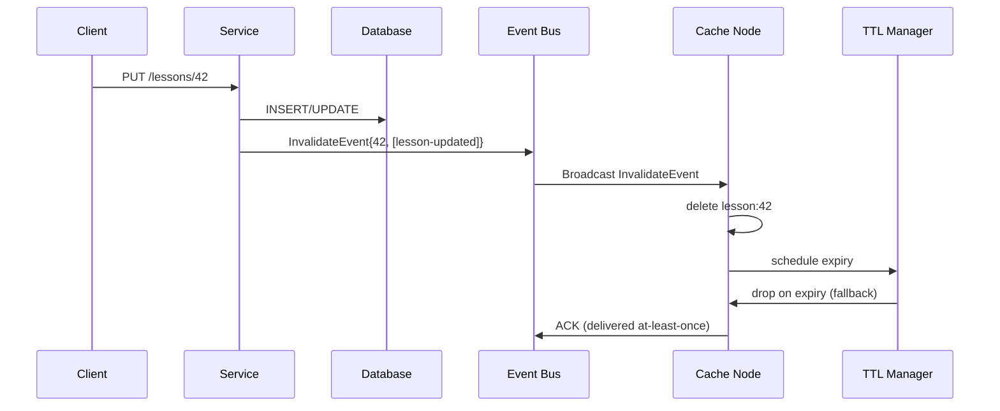

## 3. Internal Working and Architecture

- **Step-by-step execution flow:**
  1. Client sends a write request (e.g., `PUT /lessons/42`).
  2. The service validates and commits the write to the primary database.
  3. The service enqueues an invalidation event (`InvalidateEvent{v1: 42, reasons: ["lesson-updated"]}`) to the event bus.
  4. The runtime routes the event to all cache nodes in the cluster (broadcast).
  5. Each node applies: delete local key `lesson:42`, remove dependent keys `course:42:*`, and broadcasts a "node ACK" that the event was received.
  6. A separate cache manager enforces TTL; if the event was lost, the entry expires naturally.



- **Failure paths drawn explicitly:**
  - **Cache node loss:** Node is down; invalidation messages to it are dropped. TTL on remaining keys expires, but the node later rejoins with no cached entries, triggering a cold cache. Mitigation: persistence + replay.
  - **Event bus partition:** Writers commit to DB but invalidation never reaches some nodes. Stale reads possible until TTL expires. Mitigation: checksum + TTL bounded to 30s for critical keys.
  - **Ordering violation:** A delete arrives before the DB write commits (due to async replication). The delete is applied to an entry that now exists. Mitigation: idempotent invalidation, version check (entity version must match).

- **Algorithms and complexity:**
  - Tag-indexed lookup: O(tag count) to find dependent keys. In practice, tags are short and bounded.
  - Pub/Sub ACK: at-least-once → at-most-once via idempotent delete (idempotent operation).
  - Version check: O(1) comparison against DB snapshot version.

- **Important configuration parameters with safe defaults:**
  - `invalidation.ack_timeout` = 3s (how long to wait for node ACK before re-sending)
  - `invalidation.ttl_fallback` = 30s (max stale period before TTL alone guarantees expiry)
  - `invalidation.bulk_threshold` = 1000 keys (batch delete for tag-based invalidation)
  - `invalidation.max_retries` = 3 (max delivery attempts per event)

---

## 4. Practical Implementation

- **Scenario → Requirements (functional + non-functional):**
  - *Scenario:* Admin updates a lesson and expects students to see the new content.
  - *Functional requirements:* The new lesson content must appear within 10 seconds across all regions. Invalidation must be idempotent (duplicate events must not corrupt state).
  - *Non-functional requirements:* <5ms p99 invalidation latency; eventual consistency within TTL.

- **Technology stack:** Redis (as distributed cache), NATS (event bus), Go (writing service).

- **Project structure:**
  ```
  book/code/45-cache-invalidation/
  ├── src/
  │   ├── handlers/invalidate.go       # Event handler
  │   ├── cache/redis_invalidator.go   # Redis invalidation logic
  │   ├── bus/nats_validator.go        # NATS event producer/consumer
  │   └── metrics/invalidation.go      # Invalidation metrics
  ├── config/config.yaml
  ├── docker-compose.yml
  └── README.md
  ```
