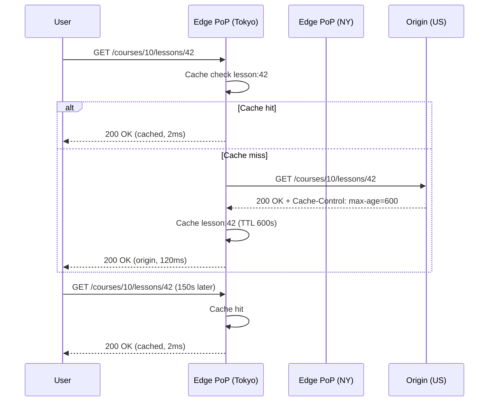

## 3. Internal Working and Architecture

- **Step-by-step execution flow:**
  1. User requests `/courses/10/lessons/42`.
  2. Edge node receives request; checks its local cache for `lesson:42`.
  3. Cache miss → edge forwards to origin (or intermediate PoP).
  4. Origin processes request; returns HTML + `Cache-Control: max-age=600`.
  5. Edge caches response with key `lesson:42` and TTL 600s.
  6. All subsequent users in the same PoP get the cached response for 600s.
  7. After 600s, the next request triggers a revalidation (conditional GET with If-None-Match).



- **Failure paths drawn explicitly:**
  - **Cache node loss:** Edge node crashes; all users in that PoP experience cache miss and fall through to the origin. Mitigated by multi-region replication of the cache.
  - **Stale data propagation:** A write invalidates a key, but the edge node has not received the invalidation yet. User reads stale data for up to TTL.
  - **Cache stampede:** 1000 concurrent requests for a missing key cause 1000 origin fetches. Mitigated by request coalescing / single-flight.
  - **Cache poisoning:** A malicious or buggy client crafts a request that writes a bad value into the cache. Mitigated by signed tokens and strict content-type validation.
- **Algorithms and complexity:**
  - Cache lookup: O(1) hash-based.
  - LRU eviction: O(1) per access (linked list + hash map).
  - Request coalescing: Single-flight with a shared promise; O(1) per request after the first.
  - TTL expiration: Time-wheel or heap-based; O(log n) per expiry.
- **Important configuration parameters with safe defaults:**
  - `edge.cache.max_items` = 100000 (max cached keys per PoP)
  - `edge.cache.ttl` = 600s (default TTL for HTML)
  - `edge.cache.max_stale` = 300s (max staleness allowed before revalidation)
  - `edge.request_coalescing` = true (enable single-flight)
  - `edge.cache.max_body_bytes` = 500000 (500KB max response body cached)

---

## 4. Practical Implementation

- **Scenario → Requirements (functional + non-functional):**
  - *Scenario:* Serve the lesson page to users in 200+ countries with <50ms p95 latency.
  - *Functional requirements:* Cache less-recently-used pages after 600s. Revalidate on TTL expiry using conditional GET.
  - *Non-functional requirements:* <50ms p95 edge latency; cache hit ratio >80% for public pages; <10ms cache-store overhead per request.

- **Technology stack:** Cloudflare Workers / Vercel Edge Runtime, Cloudflare KV, Cloudflare Cache API.

- **Project structure:**
  ```
  book/code/49-edge-caching/
  ├── src/
  │   ├── cache/edge-cache.ts     # Edge cache logic
  │   ├── handlers/lesson-handler.ts  # Request handler
  │   └── middleware/cache-control.ts # Cache control middleware
  ├── config/cloudflare.json
  ├── wrangler.toml
  └── README.md
  ```
